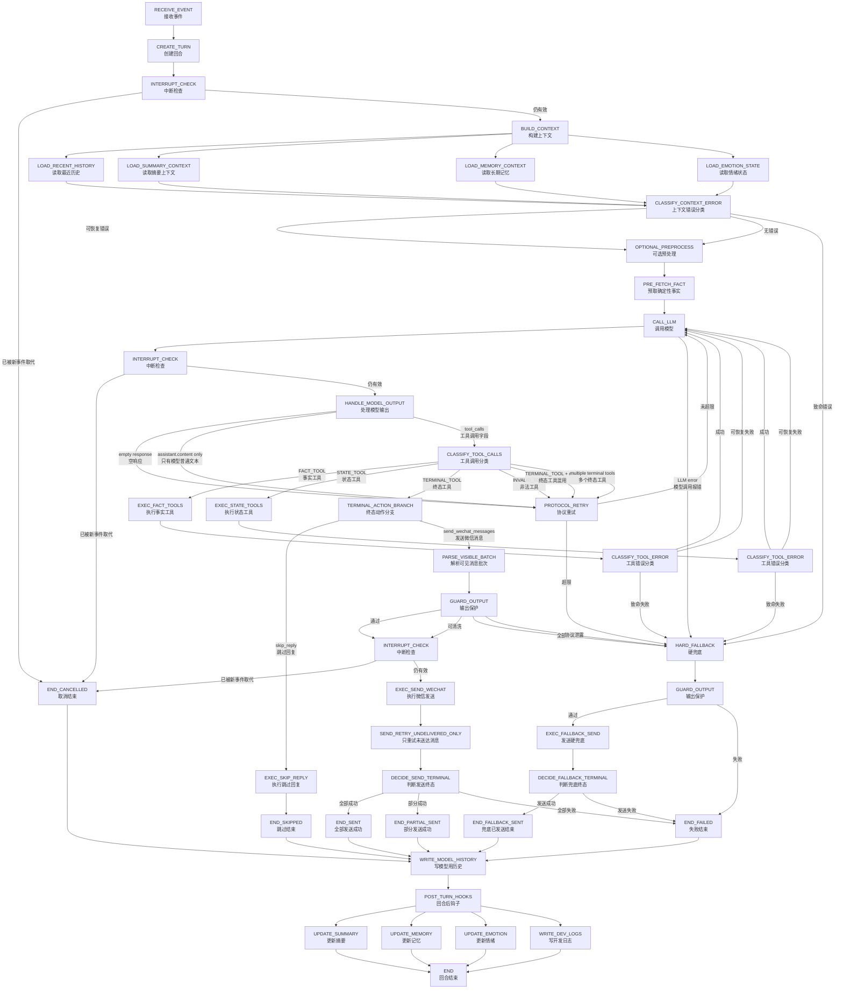
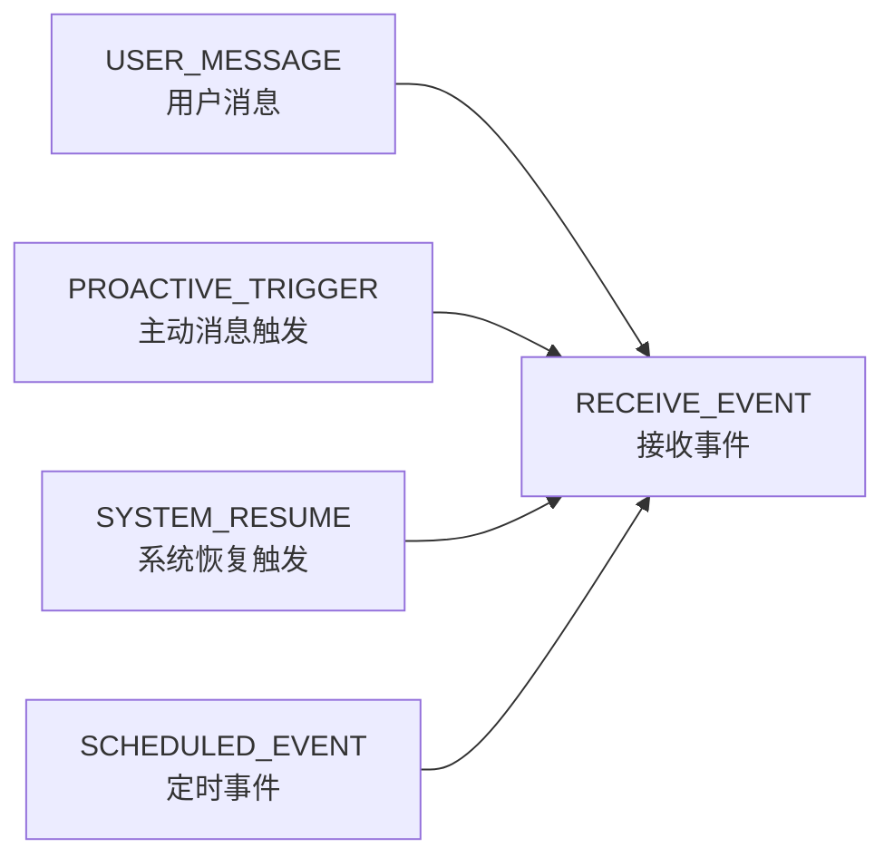
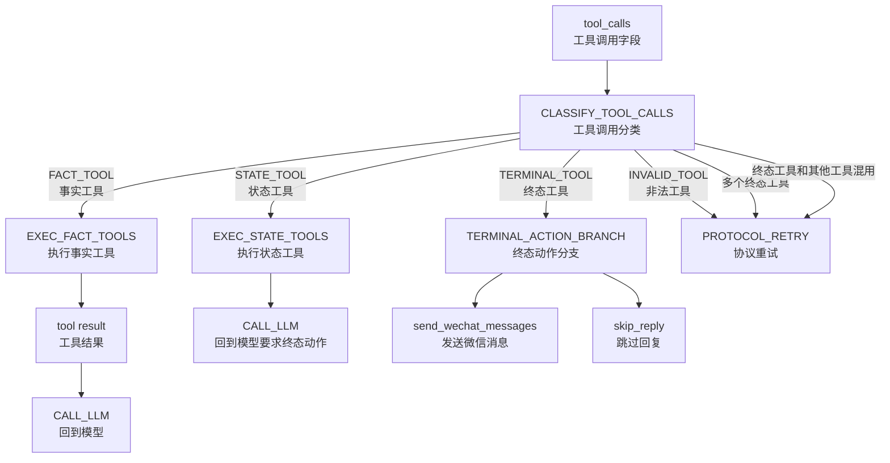
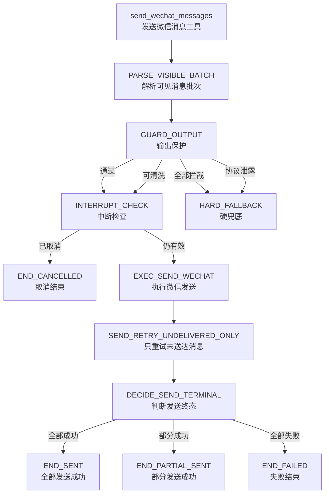
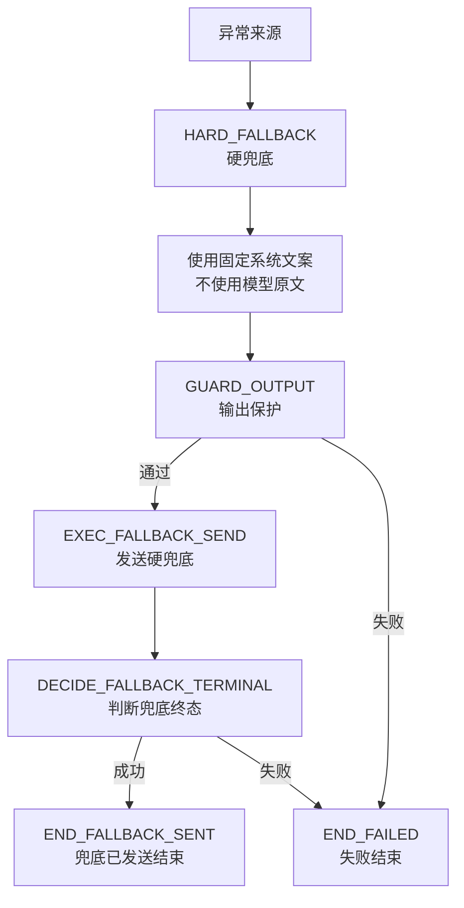
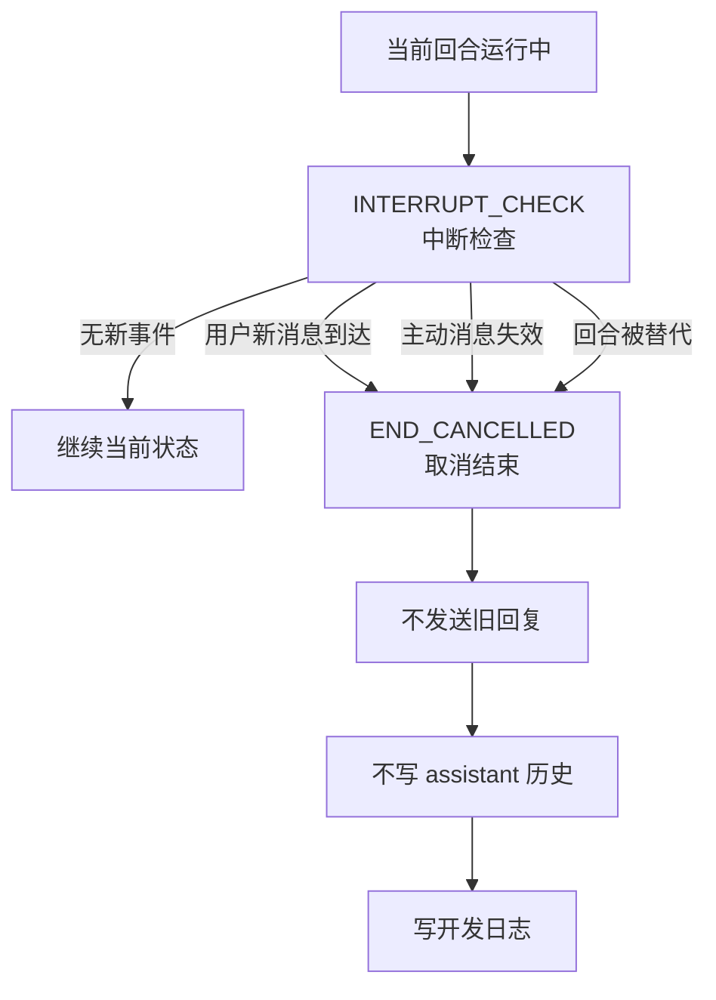
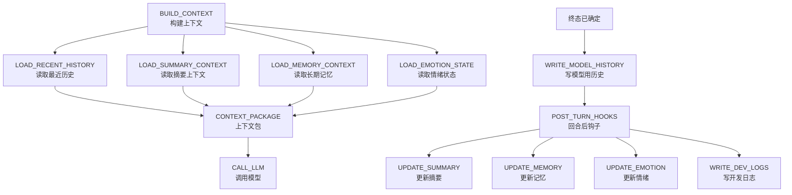
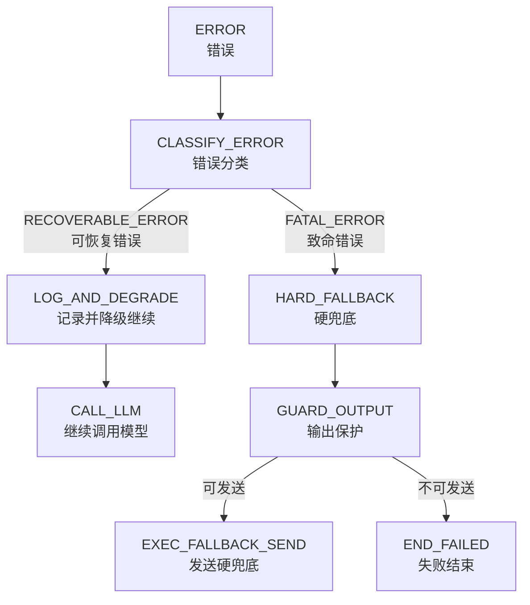

# Goal Chat Agent 第 0 层状态机图 v0.2

> 文档定位：第 0 层状态机图（Level-0 State Machine Diagram）  
> 目标：描述一轮微信 Agent 回合从事件进入到终态结束的总体生命周期。  
> 注意：本图只定义主状态、边界和扩展规则，不展开具体函数实现。

---

## 1. 第 0 层状态机总览



---

## 2. 主状态说明

| 状态 | 中文含义 | 责任 |
|---|---|---|
| `RECEIVE_EVENT` | 接收事件 | 接收用户消息、主动触发、系统事件 |
| `CREATE_TURN` | 创建回合 | 为本次处理创建唯一 turn |
| `INTERRUPT_CHECK` | 中断检查 | 判断当前回合是否已被新事件取代 |
| `BUILD_CONTEXT` | 构建上下文 | 组装模型需要看的信息 |
| `OPTIONAL_PREPROCESS` | 可选预处理 | 预取确定性事实，不能生成回复 |
| `CALL_LLM` | 调用模型 | 调用 LLM Gateway |
| `HANDLE_MODEL_OUTPUT` | 处理模型输出 | 检查是否有合法 tool_calls |
| `CLASSIFY_TOOL_CALLS` | 工具调用分类 | 将工具分成事实、状态、终态、非法 |
| `EXEC_FACT_TOOLS` | 执行事实工具 | 查时间、天气等，结果回灌模型 |
| `EXEC_STATE_TOOLS` | 执行状态工具 | 修改内部状态，之后回到模型 |
| `PROTOCOL_RETRY` | 协议重试 | 模型未按协议调用终态工具时提醒重试 |
| `TERMINAL_ACTION_BRANCH` | 终态动作分支 | 分到发送微信或跳过回复 |
| `PARSE_VISIBLE_BATCH` | 解析可见消息批次 | 解析 `send_wechat_messages` 参数 |
| `GUARD_OUTPUT` | 输出保护 | 检查所有可见输出 |
| `EXEC_SEND_WECHAT` | 执行微信发送 | 调用微信发送器 |
| `SEND_RETRY_UNDELIVERED_ONLY` | 只重试未送达消息 | 避免重复发送已成功消息 |
| `DECIDE_SEND_TERMINAL` | 判断发送终态 | 决定全部成功、部分成功或失败 |
| `HARD_FALLBACK` | 硬兜底 | 使用系统固定文案，不使用模型原文 |
| `WRITE_MODEL_HISTORY` | 写模型用历史 | 只写模型需要知道的真实聊天内容 |
| `POST_TURN_HOOKS` | 回合后钩子 | 更新摘要、记忆、情绪、日志 |
| `END` | 回合结束 | 结束本轮生命周期 |

---

## 3. 事件来源



规则：

1. 用户消息是当前唯一必须实现的来源。
2. 主动消息以后作为 `PROACTIVE_TRIGGER`（主动消息触发）进入同一状态机。
3. 主动消息不能独立绕过模型、guard、发送和历史写入。
4. 所有来源必须创建 turn，并进入统一生命周期。

---

## 4. 工具分类状态图



规则：

| 工具类型 | 中文含义 | 执行后流转 |
|---|---|---|
| `FACT_TOOL` | 事实工具 | 结果回灌模型 |
| `STATE_TOOL` | 状态工具 | 执行后回到模型，继续要求终态 |
| `TERMINAL_TOOL` | 终态工具 | 执行后进入终态 |
| `INVALID_TOOL` | 非法工具 | 协议重试 |

---

## 5. 发送路径状态图



关键约束：

1. `send_wechat_messages` 成功后不能把 tool result 回灌模型。
2. 已送达消息绝对不重发。
3. 失败重试只针对未送达消息。
4. 部分成功必须进入 `END_PARTIAL_SENT`（部分发送成功），不能粗暴归为失败。
5. 所有发送前必须经过 guard（输出保护）。
6. 发送前必须检查中断，避免旧回复发出。

---

## 6. 兜底路径状态图



兜底来源包括：

| 来源 | 中文含义 |
|---|---|
| `LLM error` | 模型调用报错 |
| `empty response` | 空响应 |
| `protocol retry exceeded` | 协议重试超限 |
| `guard rejected all` | 输出保护全部拦截 |
| `fatal system error` | 致命系统错误 |

规则：

1. 硬兜底不使用 `assistant.content`（模型普通文本输出）。
2. 硬兜底不算正常回复成功。
3. 硬兜底也必须经过 guard。
4. 硬兜底成功为 `END_FALLBACK_SENT`。
5. 硬兜底失败为 `END_FAILED`。

---

## 7. 中断机制状态图



必须检查的位置：

1. `CALL_LLM` 返回后。
2. `GUARD_OUTPUT` 前。
3. `EXEC_SEND_WECHAT` 前。
4. 主动消息发送前。
5. 长耗时工具返回后。

---

## 8. 上下文与记忆状态图



上下文隔离规则：

| 层级 | 中文含义 | 允许进入模型吗 | 持久化吗 |
|---|---|---:|---:|
| `TURN_SCRATCHPAD` | 本轮临时区 | 部分允许 | 否 |
| `RECENT_HISTORY` | 最近原始聊天记录 | 允许 | 是 |
| `SUMMARY_CONTEXT` | 摘要上下文 | 允许 | 是 |
| `LONG_TERM_MEMORY` | 长期记忆 | 允许 | 是 |
| `DEV_LOG` | 开发日志 | 禁止 | 是 |

记忆规则：

1. 记忆读取发生在 `BUILD_CONTEXT`。
2. 记忆更新发生在 `POST_TURN_HOOKS`。
3. 未送达消息不能写入记忆。
4. 工具错误不能写入用户记忆。
5. 第一版不建议开放自由 `write_memory` 给模型。
6. 推荐先做 `propose_memory_update`（提出记忆更新）或系统自动记忆候选提取。

---

## 9. 历史写入矩阵

| 终态 | 写用户消息 | 写 assistant 消息 | 写记忆候选 | 写开发日志 |
|---|---:|---:|---:|---:|
| `END_SENT` | 是 | 是，全部成功消息 | 是 | 是 |
| `END_PARTIAL_SENT` | 是 | 只写成功送达消息 | 是，只基于已送达内容 | 是 |
| `END_SKIPPED` | 是 | 否 | 视情况 | 是 |
| `END_FALLBACK_SENT` | 是 | 不建议写普通 assistant 历史 | 否 | 是 |
| `END_FAILED` | 可写 | 否 | 否 | 是 |
| `END_CANCELLED` | 视是否被新回合吸收 | 否 | 否 | 是 |

原则：

> 模型历史只保存模型理解对话需要的真实内容，不保存内部错误、协议重试、未送达消息和旧 JSON actions。

---

## 10. 错误分类状态图



可恢复错误示例：

- 记忆检索失败。
- 摘要读取失败。
- 情绪状态读取失败。
- 天气预取失败。

致命错误示例：

- 用户消息丢失。
- 基础 prompt 构建失败。
- 工具注册表不可用。
- 微信发送器不可用。
- 模型 API 连续失败。
- 状态机无法确定下一状态。

---

## 11. 扩展口权限表

| 扩展口 | 中文含义 | 允许做 | 禁止做 |
|---|---|---|---|
| `TURN_SOURCE` | 回合来源 | 接入用户消息、主动消息、系统事件 | 绕过统一状态机 |
| `BUILD_CONTEXT` | 构建上下文 | 加载历史、摘要、记忆、情绪 | 塞入开发日志、未送达消息、旧 JSON |
| `OPTIONAL_PREPROCESS` | 可选预处理 | 预取事实、轻量分类 | 直接生成回复、直接发微信 |
| `HANDLE_TOOL_CALLS` | 处理工具调用 | 分类并执行工具 | 让非法工具绕过协议 |
| `GUARD_OUTPUT` | 输出保护 | 过滤可见输出 | 被任何发送路径绕过 |
| `POST_TURN_HOOKS` | 回合后钩子 | 更新摘要、记忆、情绪、日志 | 修改终态、补发微信 |
| `MEMORY_LAYER` | 记忆层 | 读相关记忆、写审核后记忆 | 记录未送达、猜测、错误内容 |

---

## 12. 终态定义

| 终态 | 中文含义 | 是否算正常回复成功 | 是否有可见输出 |
|---|---|---:|---:|
| `END_SENT` | 全部发送成功 | 是 | 是 |
| `END_PARTIAL_SENT` | 部分发送成功 | 部分成功 | 是 |
| `END_SKIPPED` | 跳过结束 | 是，属于合法决策 | 否 |
| `END_FALLBACK_SENT` | 兜底已发送结束 | 否 | 是 |
| `END_FAILED` | 失败结束 | 否 | 否 |
| `END_CANCELLED` | 取消结束 | 否 | 否 |

---

## 13. 第 0 层不做什么

第 0 层状态机不负责：

1. 具体 prompt 文案。
2. 具体记忆召回算法。
3. 具体情绪计算公式。
4. 具体天气 API 实现。
5. 具体微信 iLink 实现。
6. 具体摘要频率。
7. 具体 UI 展示。
8. 具体数据库表结构。

第 0 层只负责：

> 生命周期、状态边界、合法流转、失败出口、扩展契约。

---

## 14. 实现时的最低验收标准

实现第 0 层状态机后，至少必须满足：

1. 模型不调用 `send_wechat_messages` 或 `skip_reply` 时，不会直接发微信。
2. `assistant.content` 永远不能直接成为微信消息。
3. 旧 JSON actions 不被解析为合法动作。
4. `send_wechat_messages` 成功后不把结果喂回模型。
5. 所有可见输出经过 guard。
6. 发送失败只重试未送达消息。
7. 部分成功进入 `END_PARTIAL_SENT`。
8. 跳过回复必须由 `skip_reply` 显式触发。
9. 硬兜底不算 `END_SENT`。
10. 记忆读取和记忆更新位置明确。
11. 主动消息以后能作为 `PROACTIVE_TRIGGER` 接入。
12. 中断后旧回合不能继续发送。
13. 历史只写模型需要知道的真实聊天内容。
14. 日志记录失败细节，但不污染模型历史。
15. 新增工具必须先归类，再接入状态机。

---

## 15. 总结

第 0 层状态机的核心不是“画很多框”，而是把系统底线钉死：

```text
所有事件统一进入 turn。
所有模型动作统一走 native tool calls。
所有可见输出统一走 guard。
所有发送结果统一落到明确终态。
所有历史和记忆只记录真实发生且模型需要知道的内容。
所有未来扩展都不能绕过主链路。
```

