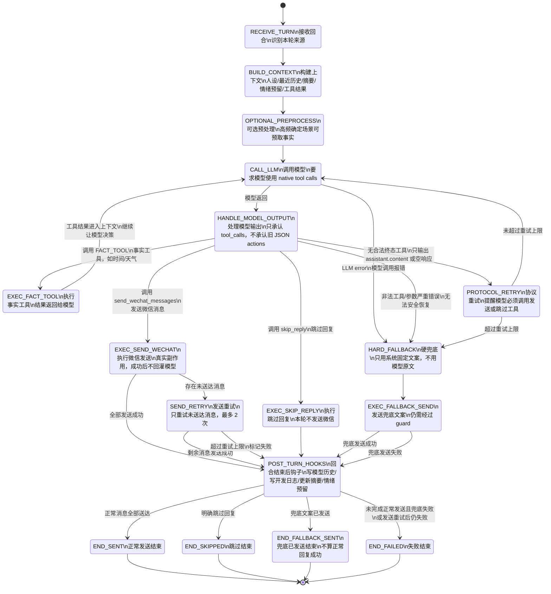

# Goal Chat Agent 第 0 层状态机图

> 版本：v0.1  
> 类型：Level-0 State Machine Diagram（第 0 层总体状态机图）  
> 用途：描述一轮微信聊天 agent 回合的总体生命周期。  
> 注意：本图只画主干与扩展口，不画主动消息、情绪板块、新工具的内部细节。

---

## 1. 第 0 层状态机图



---

## 2. 状态说明表

| 状态 | 中文含义 | 主要职责 | 关键规则 |
|---|---|---|---|
| `RECEIVE_TURN` | 接收回合 | 接收一次触发，识别来源。 | 当前主要来源是用户消息；未来可接主动消息。 |
| `BUILD_CONTEXT` | 构建上下文 | 组装人设、最近历史、小总结、每日总结、情绪预留等。 | 历史服务模型，不等于开发日志。 |
| `OPTIONAL_PREPROCESS` | 可选预处理 | 对确定性高频场景做预取事实。 | 可提前查时间/天气，但不能直接生成回复。 |
| `CALL_LLM` | 调用模型 | 请求模型输出下一步工具调用。 | 必须使用 `native tool calls`（原生工具调用）。 |
| `HANDLE_MODEL_OUTPUT` | 处理模型输出 | 判断模型调用了哪类工具。 | 只承认 `tool_calls`，不承认旧 JSON actions。 |
| `EXEC_FACT_TOOL` | 执行事实工具 | 执行时间、天气等查询。 | 结果返回模型，继续 `CALL_LLM`。 |
| `PROTOCOL_RETRY` | 协议重试 | 模型没有调用终态工具时提醒重试。 | 不把 `assistant.content` 塞回模型。 |
| `EXEC_SEND_WECHAT` | 执行微信发送 | 发送模型通过工具提交的消息。 | 成功后不把 tool result 回灌模型。 |
| `SEND_RETRY` | 发送重试 | 发送失败后重试未送达消息。 | 初始发送 + 最多 2 次重试；已成功消息绝不重发。 |
| `EXEC_SKIP_REPLY` | 执行跳过回复 | 明确结束本轮且不发微信。 | 当前默认少用，但出口必须存在。 |
| `HARD_FALLBACK` | 硬兜底 | 正常模型流程失败后生成固定兜底文案。 | 不使用模型普通文本。 |
| `EXEC_FALLBACK_SEND` | 发送兜底文案 | 把固定兜底文案发到微信。 | 仍必须经过 guard。 |
| `POST_TURN_HOOKS` | 回合结束后钩子 | 写历史、写日志、更新摘要、预留情绪更新。 | 根据终态决定写什么，不要混淆历史和日志。 |
| `END_SENT` | 正常发送结束 | 正常回复已成功送达。 | 写用户历史 + 助手成功发送文本。 |
| `END_SKIPPED` | 跳过结束 | 明确不回复。 | 写用户历史，不写助手历史。 |
| `END_FALLBACK_SENT` | 兜底已发送结束 | 系统兜底消息已发出。 | 不算正常回复成功。 |
| `END_FAILED` | 失败结束 | 本轮未完成正常回复。 | 写失败日志，不写助手成功历史。 |

---

## 3. 主干流程

### 3.1 正常回复流程

```text
RECEIVE_TURN（接收回合）
→ BUILD_CONTEXT（构建上下文）
→ OPTIONAL_PREPROCESS（可选预处理）
→ CALL_LLM（调用模型）
→ HANDLE_MODEL_OUTPUT（处理模型输出）
→ EXEC_SEND_WECHAT（执行微信发送）
→ POST_TURN_HOOKS（回合结束后钩子）
→ END_SENT（正常发送结束）
```

---

### 3.2 事实工具流程

```text
CALL_LLM（调用模型）
→ HANDLE_MODEL_OUTPUT（处理模型输出）
→ EXEC_FACT_TOOL（执行事实工具）
→ CALL_LLM（再次调用模型）
→ EXEC_SEND_WECHAT（执行微信发送）或 EXEC_SKIP_REPLY（执行跳过回复）
```

事实工具只查信息，不直接回复。

---

### 3.3 协议违规流程

```text
CALL_LLM（调用模型）
→ HANDLE_MODEL_OUTPUT（处理模型输出）
→ PROTOCOL_RETRY（协议重试）
→ CALL_LLM（再次调用模型）
```

触发条件：

- 模型只输出 `assistant.content`（模型普通文本输出）。
- 模型没有 `tool_calls`（工具调用字段）。
- 模型输出空响应。
- 模型没有调用合法终态工具。

注意：旧 JSON actions 不算合法工具调用。

---

### 3.4 微信发送失败流程

```text
EXEC_SEND_WECHAT（执行微信发送）
→ SEND_RETRY（发送重试）
→ POST_TURN_HOOKS（回合结束后钩子）
→ END_SENT（正常发送结束）或 END_FAILED（失败结束）
```

规则：

- 初始发送 + 最多 2 次重试。
- 已成功发送的消息不再重发。
- 不重新调用模型。
- 失败详情进开发日志。
- 未送达内容不写成助手成功历史。

---

### 3.5 硬兜底流程

```text
CALL_LLM（调用模型）失败
或 PROTOCOL_RETRY（协议重试）超过上限
→ HARD_FALLBACK（硬兜底）
→ EXEC_FALLBACK_SEND（发送兜底文案）
→ POST_TURN_HOOKS（回合结束后钩子）
→ END_FALLBACK_SENT（兜底已发送结束）或 END_FAILED（失败结束）
```

硬兜底不使用模型原文。

---

## 4. 状态机核心约束

1. `assistant.content`（模型普通文本输出）永远不能直接发微信。
2. 旧 JSON actions 不再兼容。
3. 模型每轮最终必须调用 `send_wechat_messages`（发送微信消息）或 `skip_reply`（跳过回复）。
4. `get_time`（获取时间）、`get_weather`（获取天气）等事实工具执行后必须回到模型。
5. `send_wechat_messages`（发送微信消息）成功后直接终止本轮，不把发送结果回灌模型。
6. 发送失败后只重试未送达消息，不重新调用模型。
7. 硬兜底不算正常回复成功。
8. 所有可见微信输出必须经过 guard（输出保护）。
9. 历史只服务模型上下文，日志才服务开发者排查。
10. 未来主动消息、情绪板块、新工具都不能绕过本状态机。

---

## 5. 扩展口位置

| 扩展口 | 所在状态 | 用途 |
|---|---|---|
| `TURN_SOURCE`（回合来源） | `RECEIVE_TURN` | 未来接入主动消息。 |
| `CONTEXT_COMPONENTS`（上下文组件） | `BUILD_CONTEXT` | 接入最近历史、小总结、每日总结、情绪状态、人设等。 |
| `PRE_FETCH_FACT`（预取事实） | `OPTIONAL_PREPROCESS` | 对明确的时间、天气问题提前查事实。 |
| `TOOL_CLASSIFICATION`（工具分类） | `HANDLE_MODEL_OUTPUT` | 接入未来新增工具。 |
| `SEND_POLICY`（发送策略） | `EXEC_SEND_WECHAT` / `SEND_RETRY` | 控制重试、去重、送达状态。 |
| `POST_TURN_HOOKS`（回合结束后钩子） | `POST_TURN_HOOKS` | 写历史、日志、摘要、情绪更新。 |

---

## 6. 第 0 层边界

第 0 层负责：

- 回合生命周期。
- 主状态流转。
- 终态定义。
- 工具分类方向。
- 失败和兜底边界。
- 历史与日志边界。
- 未来扩展口位置。

第 0 层不负责：

- prompt 具体文本。
- 工具函数内部实现。
- 情绪计算公式。
- 主动消息触发算法。
- UI 展示。
- 数据库字段细节。

---

## 7. 推荐下一步拆分

第 0 层确认后，再继续拆：

1. 第 1 层：`CALL_LLM` 与 `HANDLE_MODEL_OUTPUT` 细化。
2. 第 1 层：`EXEC_SEND_WECHAT` 与 `SEND_RETRY` 细化。
3. 第 1 层：`BUILD_CONTEXT` 与三层历史结构细化。
4. 第 1 层：`POST_TURN_HOOKS` 写历史、写日志、摘要更新细化。
5. 第 1 层：`PROACTIVE_TRIGGER` 主动消息入口细化。
