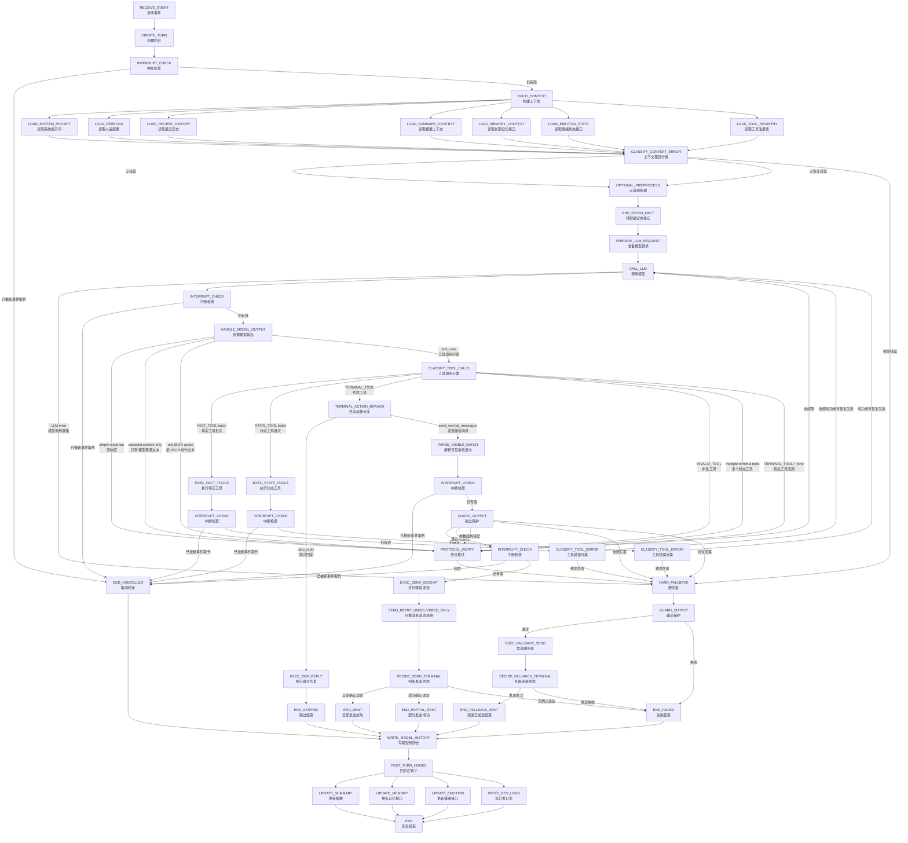
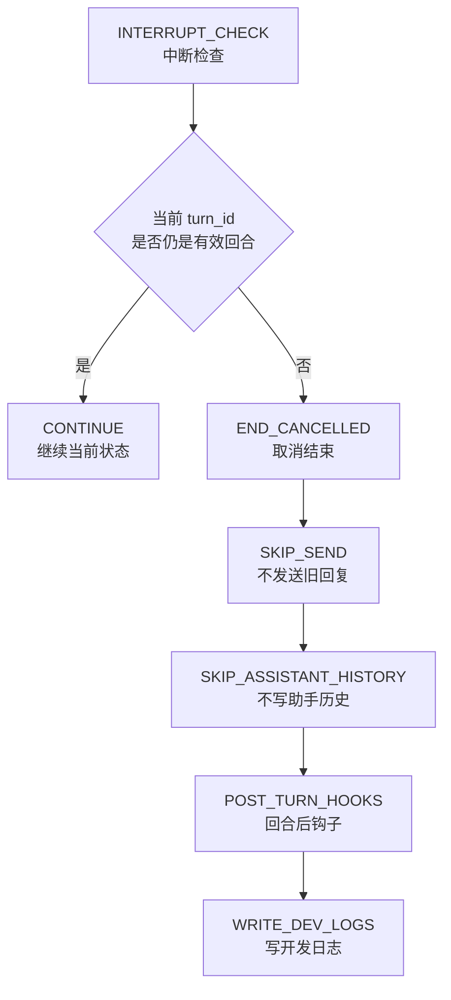
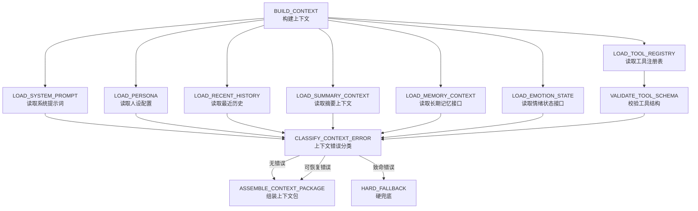
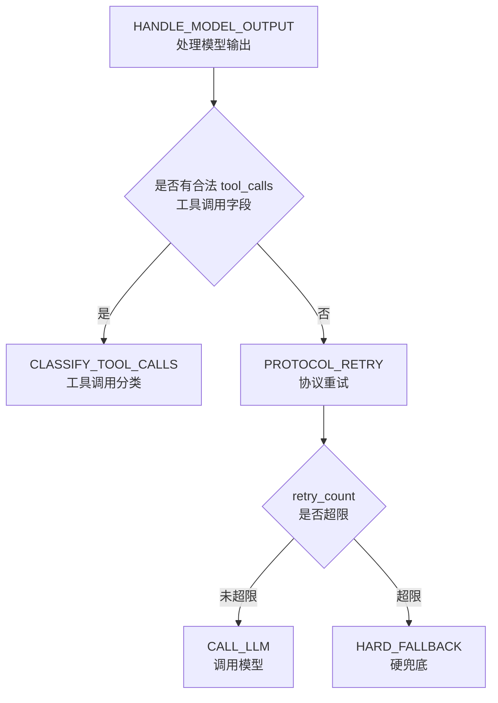
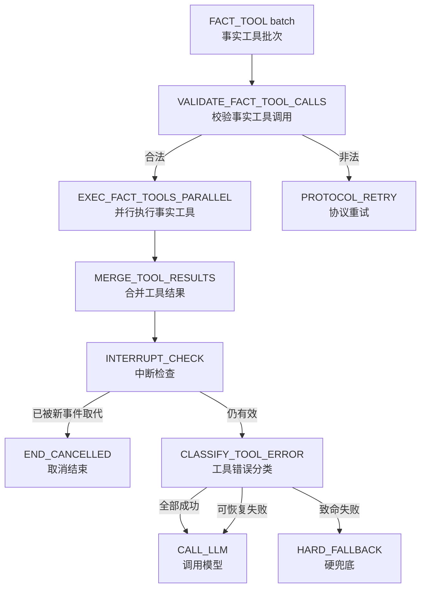
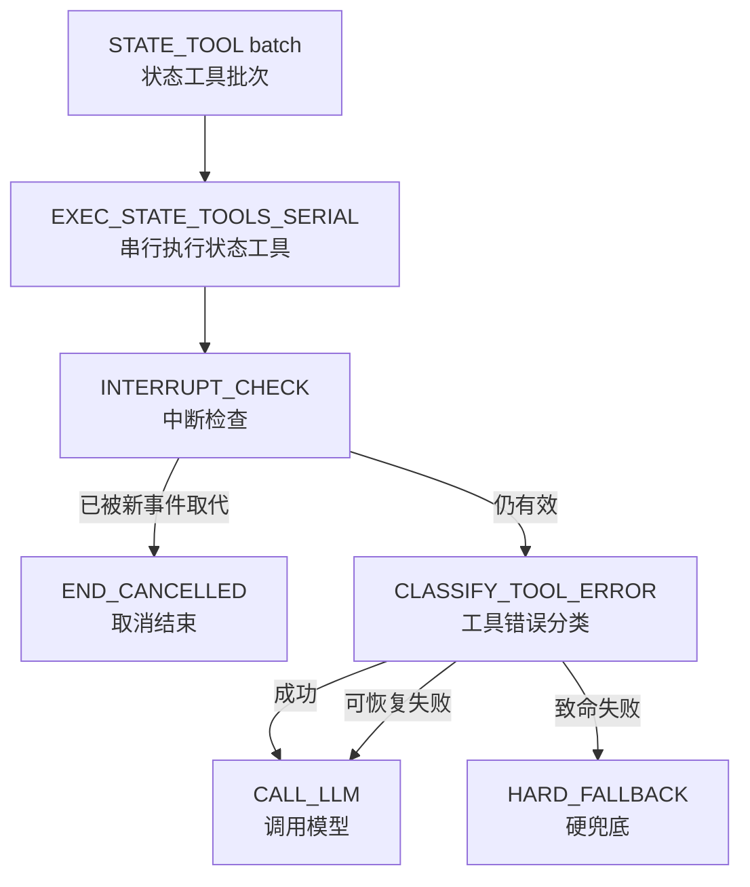
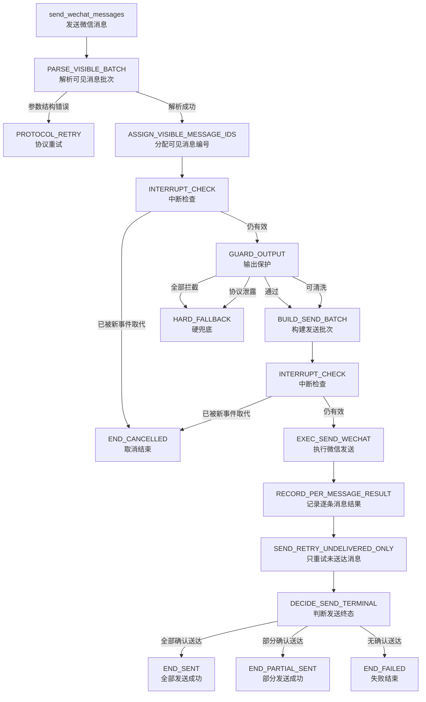
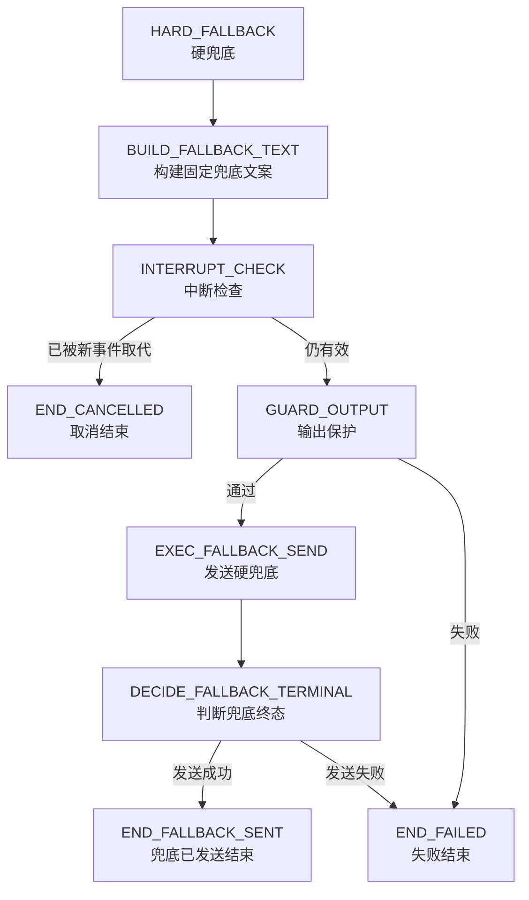
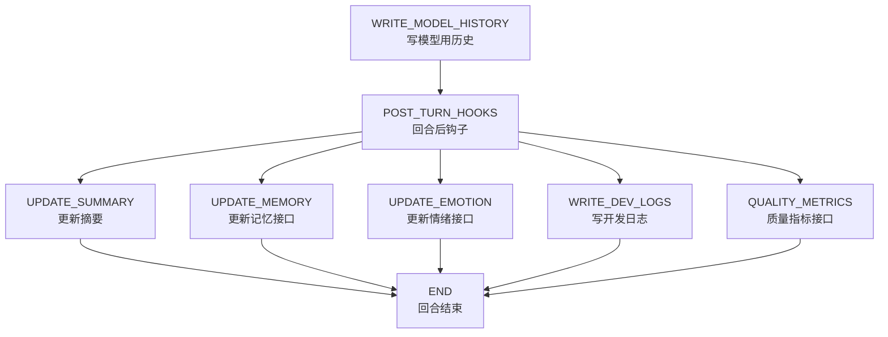

# Goal Chat Agent 第 1 层状态机图 v1.2

> 文档定位：第 1 层状态机图（Level-1 State Machine Diagram）v1.2  
> 适用项目：Goal Chat Agent / 微信聊天 Agent  
> 设计方向：先做基础功能的整体细化改造；可单独添加的功能延迟设计。  
> 输出格式：Markdown（`.md`）+ Mermaid 状态机图。  
> 基准来源：`Goal Chat Agent 底层架构设计总则 v0.2`、`Goal Chat Agent 第 0 层状态机图 v0.2`。

---

## 0. v1.2 的设计目标与范围

`v1.2`（第 1 层状态机图第 1.2 版）的目标不是增加新功能，而是把基础主链路细化到可以指导代码改造的程度。

本轮优先保证一件事：

```text
用户消息进入系统
→ 创建回合
→ 检查中断
→ 构建上下文
→ 可选预处理
→ 调用模型
→ 处理 native tool calls（原生工具调用）
→ 执行事实工具或终态工具
→ 输出保护
→ 微信发送
→ 判断终态
→ 写模型历史
→ 执行回合后钩子
→ 结束回合
```

本轮不追求一次性把 `PROACTIVE_TRIGGER`（主动消息触发）、`FULL_MEMORY_SYSTEM`（完整记忆系统）、`EMOTION_ENGINE`（情绪引擎）等功能全部做深。它们可以后续单独添加，但不能绕过本轮主链路。

---

## 1. 本轮必须细化的基础功能

| 模块 | 中文说明 | 本轮处理方式 |
|---|---|---|
| `USER_MESSAGE` | 用户消息 | 当前唯一完整实现的回合来源。 |
| `RECEIVE_EVENT` | 接收事件 | 接收微信侧输入事件。 |
| `CREATE_TURN` | 创建回合 | 为每次输入创建唯一回合。 |
| `INTERRUPT_CHECK` | 中断检查 | 防止旧回合回复干扰新消息。 |
| `BUILD_CONTEXT` | 构建上下文 | 组装模型需要看的信息。 |
| `CLASSIFY_CONTEXT_ERROR` | 上下文错误分类 | 区分可恢复错误和致命错误。 |
| `OPTIONAL_PREPROCESS` | 可选预处理 | 预取确定性事实，不生成回复。 |
| `CALL_LLM` | 调用模型 | 调用 LLM Gateway（模型网关）。 |
| `HANDLE_MODEL_OUTPUT` | 处理模型输出 | 判断模型是否返回合法工具调用。 |
| `CLASSIFY_TOOL_CALLS` | 工具调用分类 | 区分事实工具、状态工具、终态工具、非法工具。 |
| `FACT_TOOL` | 事实工具 | 支持 `get_time`（获取时间）、`get_weather`（获取天气）等。 |
| `TERMINAL_TOOL` | 终态工具 | 支持 `send_wechat_messages`（发送微信消息）、`skip_reply`（跳过回复）。 |
| `PROTOCOL_RETRY` | 协议重试 | 模型未按协议调用工具时提醒重试。 |
| `GUARD_OUTPUT` | 输出保护 | 所有微信可见输出必须经过保护。 |
| `EXEC_SEND_WECHAT` | 执行微信发送 | 真正调用微信发送器。 |
| `SEND_RETRY_UNDELIVERED_ONLY` | 只重试未送达消息 | 避免重复发送已送达消息。 |
| `HARD_FALLBACK` | 硬兜底 | 正常链路失败时发送固定保命文案。 |
| `WRITE_MODEL_HISTORY` | 写模型用历史 | 只写真实发生且模型需要知道的聊天内容。 |
| `POST_TURN_HOOKS` | 回合后钩子 | 统一执行摘要、记忆、情绪、开发日志等后处理。 |

---

## 2. 本轮不细化、后续可单独添加的功能

| 功能 | 中文说明 | 本轮边界 |
|---|---|---|
| `PROACTIVE_TRIGGER` | 主动消息触发 | 只保留回合来源入口，不设计触发策略。 |
| `FULL_MEMORY_SYSTEM` | 完整记忆系统 | 只保留读取和更新位置，不设计候选提取、审核、去重算法。 |
| `EMOTION_ENGINE` | 情绪引擎 | 只保留读取和更新位置，不设计计算公式。 |
| `STATE_TOOL_SET` | 状态工具集合 | 只保留流转规则，不启用具体状态工具。 |
| `search_web` | 联网搜索 | 后续可作为事实工具添加。 |
| `read_calendar` | 读取日历 | 后续可作为事实工具添加。 |
| `SCHEDULED_EVENT` | 定时事件 | 后续可作为回合来源添加。 |
| `SYSTEM_RESUME` | 系统恢复触发 | 后续单独设计恢复语义。 |
| `QUALITY_METRICS` | 质量指标 | 后续可作为回合后钩子添加。 |

这些功能后续可以加，但必须遵守一个底线：

```text
任何微信可见输出，都必须走：
TERMINAL_TOOL（终态工具）
→ GUARD_OUTPUT（输出保护）
→ EXEC_SEND_WECHAT（执行微信发送）
→ 发送结果终态
→ WRITE_MODEL_HISTORY（写模型用历史）
→ POST_TURN_HOOKS（回合后钩子）
```

---

## 3. v1.2 总状态机图



---

## 4. `TURN_SOURCE`（回合来源）与 `CREATE_TURN`（创建回合）

### 4.1 `TURN_SOURCE`（回合来源）

`TURN_SOURCE`（回合来源）表示本轮回合为什么被创建。

| 字段 | 中文说明 | 本轮是否实现 |
|---|---|---:|
| `USER_MESSAGE` | 用户消息 | 是 |
| `PROACTIVE_TRIGGER` | 主动消息触发 | 否，只保留接口 |
| `SYSTEM_RESUME` | 系统恢复触发 | 否，只保留接口 |
| `SCHEDULED_EVENT` | 定时事件 | 否，只保留接口 |

本轮只有 `USER_MESSAGE`（用户消息）需要完整实现。其他来源只允许作为未来扩展口出现，不能单独绕过主状态机。

### 4.2 `CREATE_TURN`（创建回合）必须生成的回合字段

| 字段 | 中文说明 | 说明 |
|---|---|---|
| `turn_id` | 回合编号 | 每轮唯一，用于追踪状态机生命周期。 |
| `source` | 回合来源 | 来自 `TURN_SOURCE`（回合来源）。 |
| `user_id` | 用户编号 | 当前微信用户或会话标识。 |
| `input_message_ids` | 输入消息编号列表 | 本轮吸收的用户消息编号。 |
| `created_at` | 创建时间 | 用于日志、超时、中断判断。 |
| `interrupt_token` | 中断令牌 | 判断当前回合是否仍有效。 |
| `status` | 回合状态 | 如 `RUNNING`（运行中）、`CANCELLED`（已取消）、`ENDED`（已结束）。 |
| `terminal_state` | 终态 | 回合结束后写入，如 `END_SENT`（全部发送成功）。 |

### 4.3 创建回合后的强制检查

`CREATE_TURN`（创建回合）之后必须立刻进入：

```text
INTERRUPT_CHECK（中断检查）
```

如果发现本轮已经被新事件替代，直接进入：

```text
END_CANCELLED（取消结束）
```

---

## 5. `INTERRUPT_CHECK`（中断检查）完整流程

微信聊天是实时系统，不能让旧回合在用户发了新消息以后继续发送旧回复。

### 5.1 必须执行中断检查的位置

| 检查点 | 中文说明 | 原因 |
|---|---|---|
| `CREATE_TURN`（创建回合）之后 | 初始中断检查 | 避免刚创建就已过期。 |
| `CALL_LLM`（调用模型）返回后 | 模型返回后检查 | 模型调用可能耗时，期间用户可能发新消息。 |
| 长耗时 `FACT_TOOL`（事实工具）返回后 | 工具返回后检查 | 天气、搜索等工具可能耗时。 |
| 长耗时 `STATE_TOOL`（状态工具）返回后 | 状态工具返回后检查 | 未来状态更新可能耗时。 |
| `GUARD_OUTPUT`（输出保护）前 | 保护前检查 | 避免对过期回复继续处理。 |
| `EXEC_SEND_WECHAT`（执行微信发送）前 | 发送前检查 | 最关键，防止旧回复真正发出。 |
| `EXEC_FALLBACK_SEND`（发送硬兜底）前 | 兜底发送前检查 | 兜底也不能发给已经被新消息替代的会话。 |

### 5.2 中断触发条件

| 条件 | 中文说明 | 结果 |
|---|---|---|
| `newer_user_message_exists` | 存在更新的用户消息 | 当前回合进入 `END_CANCELLED`（取消结束）。 |
| `turn_replaced` | 当前回合被合并或替代 | 当前回合进入 `END_CANCELLED`（取消结束）。 |
| `proactive_trigger_invalidated` | 主动消息触发条件失效 | 当前回合进入 `END_CANCELLED`（取消结束）。 |
| `manual_cancelled` | 被系统手动取消 | 当前回合进入 `END_CANCELLED`（取消结束）。 |
| `higher_priority_event_exists` | 存在更高优先级事件 | 当前回合进入 `END_CANCELLED`（取消结束）。 |

### 5.3 中断后的处理规则

进入 `END_CANCELLED`（取消结束）后：

```text
不发送旧回复
不写 assistant 普通历史
不写记忆候选
通过 POST_TURN_HOOKS（回合后钩子）写开发日志
如果用户消息已被新回合吸收，则本回合不重复写用户历史
```

### 5.4 中断流程图



---

## 6. `BUILD_CONTEXT`（构建上下文）与 `CLASSIFY_CONTEXT_ERROR`（上下文错误分类）

### 6.1 `BUILD_CONTEXT`（构建上下文）子状态



### 6.2 上下文包字段

| 字段 | 中文说明 | 说明 |
|---|---|---|
| `system_prompt` | 系统提示词 | 基础行为约束，缺失通常是致命错误。 |
| `persona` | 人设配置 | 可降级为默认人设。 |
| `recent_history` | 最近历史 | 模型理解近几轮对话所需。 |
| `summary_context` | 摘要上下文 | 可缺失，缺失时降级继续。 |
| `memory_context` | 记忆上下文 | 本轮只保留接口，可为空。 |
| `emotion_state` | 情绪状态 | 本轮只保留接口，可为空。 |
| `tool_registry` | 工具注册表 | native tool calls（原生工具调用）必须依赖。 |
| `tool_schema` | 工具结构 | 给模型看的工具参数结构。 |
| `turn_metadata` | 回合元信息 | 包含来源、时间、中断令牌等。 |
| `context_warnings` | 上下文警告 | 记录可恢复错误，供日志使用，不直接发给用户。 |

### 6.3 可恢复上下文错误

可恢复错误的处理方式：记录警告，降级继续，进入 `OPTIONAL_PREPROCESS`（可选预处理）。

| 错误 | 中文说明 | 降级策略 |
|---|---|---|
| `LOAD_SUMMARY_CONTEXT failed` | 摘要读取失败 | 不带摘要继续。 |
| `LOAD_MEMORY_CONTEXT failed` | 记忆读取失败 | 不带长期记忆继续。 |
| `LOAD_EMOTION_STATE failed` | 情绪状态读取失败 | 使用默认情绪状态或空状态。 |
| `LOAD_PERSONA failed` | 人设读取失败 | 使用默认人设。 |
| `LOAD_RECENT_HISTORY partial failed` | 最近历史部分读取失败 | 使用可用部分，记录日志。 |

### 6.4 致命上下文错误

致命错误的处理方式：进入 `HARD_FALLBACK`（硬兜底）。如果微信发送器也不可用，则进入 `END_FAILED`（失败结束）。

| 错误 | 中文说明 | 流转 |
|---|---|---|
| `missing user message` | 用户消息丢失 | `HARD_FALLBACK`（硬兜底）或 `END_FAILED`（失败结束）。 |
| `LOAD_SYSTEM_PROMPT failed` | 系统提示词读取失败 | `HARD_FALLBACK`（硬兜底）。 |
| `LOAD_TOOL_REGISTRY failed` | 工具注册表读取失败 | `HARD_FALLBACK`（硬兜底）。 |
| `VALIDATE_TOOL_SCHEMA failed` | 工具结构校验失败 | `HARD_FALLBACK`（硬兜底）。 |
| `send_wechat_messages schema missing` | 发送微信工具结构缺失 | `HARD_FALLBACK`（硬兜底）。 |
| `skip_reply schema missing` | 跳过回复工具结构缺失 | `HARD_FALLBACK`（硬兜底）。 |

---

## 7. `OPTIONAL_PREPROCESS`（可选预处理）

`OPTIONAL_PREPROCESS`（可选预处理）发生在 `BUILD_CONTEXT`（构建上下文）之后、`CALL_LLM`（调用模型）之前。

它的目标是补充确定性事实，减少模型无谓工具调用，但它不能生成最终回复。

### 7.1 可做的事情

| 子状态 | 中文说明 | 例子 |
|---|---|---|
| `PRE_FETCH_FACT` | 预取确定性事实 | 当前时间、当前日期。 |
| `PRE_FETCH_WEATHER_IF_OBVIOUS` | 明显天气问题预取天气 | 用户直接问“今天下雨吗”。 |
| `LIGHT_INTENT_CLASSIFY` | 轻量意图分类 | 判断是否明显无需回复，但不能直接终态。 |

### 7.2 禁止做的事情

`OPTIONAL_PREPROCESS`（可选预处理）禁止：

```text
禁止生成微信回复
禁止直接调用 EXEC_SEND_WECHAT（执行微信发送）
禁止写 assistant 历史
禁止决定 END_SENT（全部发送成功）或 END_SKIPPED（跳过结束）
禁止绕过 CALL_LLM（调用模型）
```

### 7.3 错误处理

| 错误 | 中文说明 | 流转 |
|---|---|---|
| `pre_fetch_time failed` | 预取时间失败 | 记录警告，继续 `CALL_LLM`（调用模型）。 |
| `pre_fetch_weather failed` | 预取天气失败 | 记录警告，继续 `CALL_LLM`（调用模型）。 |
| `preprocess internal fatal` | 预处理内部致命错误 | `HARD_FALLBACK`（硬兜底）。 |

---

## 8. `CALL_LLM`（调用模型）与模型输出协议循环

### 8.1 模型请求准备

`PREPARE_LLM_REQUEST`（准备模型请求）必须包含：

| 内容 | 中文说明 |
|---|---|
| `system_prompt` | 系统提示词 |
| `context_package` | 上下文包 |
| `tool_schema` | 工具结构 |
| `turn_metadata` | 回合元信息 |
| `pre_fetched_facts` | 预取事实 |

### 8.2 合法模型输出

模型必须通过 `native tool calls`（原生工具调用）返回动作。

合法终态动作只有两个：

```text
send_wechat_messages（发送微信消息）
skip_reply（跳过回复）
```

### 8.3 非法模型输出

以下情况进入 `PROTOCOL_RETRY`（协议重试）：

| 输出 | 中文说明 |
|---|---|
| `empty response` | 空响应 |
| `assistant.content only` | 只有模型普通文本，没有工具调用 |
| `old JSON action` | 旧 JSON 动作文本 |
| `INVALID_TOOL` | 非法工具 |
| `multiple terminal tools` | 多个终态工具 |
| `TERMINAL_TOOL + other` | 终态工具和其他工具混用 |

### 8.4 协议重试规则



建议第一版：

```text
max_protocol_retries = 1
```

也就是第一次协议违规时提醒模型重试；再次失败进入 `HARD_FALLBACK`（硬兜底）。具体次数可以配置，但状态机必须有上限。

---

## 9. `TOOL_CALLS`（工具调用）分类与组合规则

### 9.1 工具类型

| 类型 | 中文说明 | 是否本轮启用 | 执行后流转 |
|---|---|---:|---|
| `FACT_TOOL` | 事实工具 | 是 | 执行后将工具结果回灌模型，回到 `CALL_LLM`（调用模型）。 |
| `STATE_TOOL` | 状态工具 | 否，只保留接口 | 执行后必须回到 `CALL_LLM`（调用模型）。 |
| `TERMINAL_TOOL` | 终态工具 | 是 | 执行后进入明确终态，不回灌模型。 |
| `INVALID_TOOL` | 非法工具 | 是，作为错误处理 | 进入 `PROTOCOL_RETRY`（协议重试）。 |

### 9.2 工具组合规则

| 工具组合 | 是否允许 | 处理方式 |
|---|---:|---|
| 多个 `FACT_TOOL`（事实工具） | 允许 | 并行执行，结果合并后回灌模型。 |
| 一个 `TERMINAL_TOOL`（终态工具） | 允许 | 执行终态动作。 |
| 多个 `TERMINAL_TOOL`（终态工具） | 禁止 | 进入 `PROTOCOL_RETRY`（协议重试）。 |
| `TERMINAL_TOOL`（终态工具）+ 任意其他工具 | 禁止 | 进入 `PROTOCOL_RETRY`（协议重试）。 |
| 多个 `STATE_TOOL`（状态工具） | 未来允许 | 建议串行执行，避免副作用顺序混乱。 |
| `FACT_TOOL`（事实工具）+ `STATE_TOOL`（状态工具） | 未来谨慎允许 | 无终态工具时，可先事实工具后状态工具，最后回到模型。 |
| 未注册工具 | 禁止 | 进入 `PROTOCOL_RETRY`（协议重试）。 |

---

## 10. `FACT_TOOL`（事实工具）并行执行与错误处理

本轮基础事实工具包括：

```text
get_time（获取时间）
get_weather（获取天气）
```

### 10.1 多个事实工具并行流程



### 10.2 工具结果合并规则

合并后的工具结果必须保留：

| 字段 | 中文说明 |
|---|---|
| `tool_call_id` | 工具调用编号 |
| `tool_name` | 工具名称 |
| `status` | 执行状态 |
| `payload` | 工具返回内容 |
| `error_type` | 错误类型 |
| `is_recoverable` | 是否可恢复 |

结果回灌模型时，建议按原始 `tool_calls`（工具调用字段）的顺序排列，避免模型误解工具结果对应关系。

### 10.3 事实工具错误分类

| 错误 | 中文说明 | 类型 | 流转 |
|---|---|---|---|
| `get_weather timeout` | 天气工具超时 | 可恢复 | 回灌失败结果给模型，回到 `CALL_LLM`（调用模型）。 |
| `get_time failed` | 时间工具失败 | 可恢复 | 回灌失败结果给模型，回到 `CALL_LLM`（调用模型）。 |
| `invalid tool args` | 工具参数错误 | 协议错误 | 进入 `PROTOCOL_RETRY`（协议重试）。 |
| `tool registry corrupted` | 工具注册表损坏 | 致命 | 进入 `HARD_FALLBACK`（硬兜底）。 |
| `tool executor unavailable` | 工具执行器不可用 | 致命 | 进入 `HARD_FALLBACK`（硬兜底）。 |

注意：`FACT_TOOL`（事实工具）不能直接组织微信回复，也不能直接写历史。

---

## 11. `STATE_TOOL`（状态工具）预留流转规则

本轮不启用具体 `STATE_TOOL`（状态工具），但必须把未来流转规则写清楚。

### 11.1 允许的未来状态工具例子

| 工具 | 中文说明 | 本轮状态 |
|---|---|---|
| `propose_memory_update` | 提出记忆更新 | 未来可添加。 |
| `update_user_tags` | 更新用户标签 | 未来可添加。 |
| `update_emotion_state` | 更新情绪状态 | 未来可添加。 |
| `record_preference` | 记录偏好 | 未来可添加。 |

### 11.2 禁止第一版开放的状态工具

```text
write_memory（写记忆）
```

原因：模型可能把误解、玩笑、猜测直接写入长期记忆，污染系统。

### 11.3 状态工具执行后必须回模型



核心规则：

```text
STATE_TOOL（状态工具）执行后，必须回到 CALL_LLM（调用模型）。
不能直接结束回合。
不能直接发送微信。
不能悬空。
```

---

## 12. `TERMINAL_TOOL`（终态工具）分支

本轮支持两个 `TERMINAL_TOOL`（终态工具）：

| 工具 | 中文说明 | 结果 |
|---|---|---|
| `send_wechat_messages` | 发送微信消息 | 进入发送链路。 |
| `skip_reply` | 跳过回复 | 进入 `END_SKIPPED`（跳过结束）。 |

### 12.1 `skip_reply`（跳过回复）

`skip_reply`（跳过回复）表示模型明确决定本轮不回复。

```text
skip_reply（跳过回复）
→ EXEC_SKIP_REPLY（执行跳过回复）
→ END_SKIPPED（跳过结束）
```

禁止用“空消息列表”猜测跳过。跳过必须是显式工具调用。

### 12.2 `send_wechat_messages`（发送微信消息）

`send_wechat_messages`（发送微信消息）进入发送链路：

```text
send_wechat_messages（发送微信消息）
→ PARSE_VISIBLE_BATCH（解析可见消息批次）
→ INTERRUPT_CHECK（中断检查）
→ GUARD_OUTPUT（输出保护）
→ INTERRUPT_CHECK（中断检查）
→ EXEC_SEND_WECHAT（执行微信发送）
→ SEND_RETRY_UNDELIVERED_ONLY（只重试未送达消息）
→ DECIDE_SEND_TERMINAL（判断发送终态）
```

终态工具结果不能回灌模型。

---

## 13. `SEND_PATH`（发送路径）与逐条发送结果

### 13.1 发送路径状态机图



### 13.2 可见消息记录字段

每条待发送消息都必须有独立记录，不能只记录整个 batch（批次）的成功失败。

| 字段 | 中文说明 | 说明 |
|---|---|---|
| `visible_message_id` | 可见消息编号 | 本轮内部唯一。 |
| `batch_index` | 批次序号 | 保持模型给出的消息顺序。 |
| `raw_text` | 原始文本 | 模型工具参数中的原始文本。 |
| `guarded_text` | 保护后文本 | 经过输出保护后的最终文本。 |
| `guard_status` | 输出保护状态 | 如 `PASSED`（通过）、`SANITIZED`（已清洗）、`BLOCKED`（已拦截）。 |
| `delivery_status` | 送达状态 | 逐条记录发送结果。 |
| `attempt_count` | 尝试次数 | 记录该条消息发送尝试次数。 |
| `wechat_message_id` | 微信消息编号 | 微信侧返回的消息编号，如有。 |
| `error_code` | 错误码 | 发送失败原因。 |

### 13.3 `delivery_status`（送达状态）定义

| 状态 | 中文说明 | 是否可重试 | 是否写入 assistant 历史 |
|---|---|---:|---:|
| `PENDING` | 待发送 | 是 | 否 |
| `SENT_CONFIRMED` | 已确认送达 | 否 | 是 |
| `FAILED_CONFIRMED` | 已确认失败 | 是 | 否 |
| `UNKNOWN_DELIVERY` | 送达未知 | 默认否 | 否 |
| `BLOCKED_BY_GUARD` | 被输出保护拦截 | 否 | 否 |

### 13.4 只重试未送达消息

`SEND_RETRY_UNDELIVERED_ONLY`（只重试未送达消息）的规则：

```text
只重试 delivery_status = FAILED_CONFIRMED（已确认失败）或 PENDING（待发送）的消息。
绝不重试 delivery_status = SENT_CONFIRMED（已确认送达）的消息。
```

对于 `UNKNOWN_DELIVERY`（送达未知）：

```text
如果微信发送器不支持 idempotency_key（幂等键）或去重机制，默认不重试。
如果未来发送器支持幂等发送，可以在确认不会重复送达的前提下重试。
```

这是为了避免最坏情况：用户已经收到一条消息，但系统因为超时误以为失败，又重复发送一次。

### 13.5 发送终态判断

| 条件 | 终态 | 中文说明 |
|---|---|---|
| 所有消息都是 `SENT_CONFIRMED`（已确认送达） | `END_SENT` | 全部发送成功 |
| 至少一条 `SENT_CONFIRMED`（已确认送达），但不是全部 | `END_PARTIAL_SENT` | 部分发送成功 |
| 没有任何 `SENT_CONFIRMED`（已确认送达） | `END_FAILED` | 失败结束 |

---

## 14. `HARD_FALLBACK`（硬兜底）链路

`HARD_FALLBACK`（硬兜底）是系统保命，不是模型正常聊天。

### 14.1 触发来源

| 来源 | 中文说明 |
|---|---|
| `LLM error` | 模型调用报错 |
| `protocol retry exceeded` | 协议重试超限 |
| `guard rejected all` | 输出保护全部拦截 |
| `protocol leakage` | 协议泄露 |
| `fatal context error` | 致命上下文错误 |
| `fatal tool error` | 致命工具错误 |
| `internal state machine error` | 状态机内部错误 |

### 14.2 兜底流程图



### 14.3 兜底规则

```text
硬兜底必须使用系统固定文案。
硬兜底不能使用 assistant.content（模型普通文本输出）。
硬兜底也必须经过 GUARD_OUTPUT（输出保护）。
硬兜底成功后进入 END_FALLBACK_SENT（兜底已发送结束）。
硬兜底失败后进入 END_FAILED（失败结束）。
硬兜底不算 END_SENT（全部发送成功）。
```

### 14.4 兜底历史标记

默认规则：

```text
END_FALLBACK_SENT（兜底已发送结束）不写普通 assistant 历史。
```

如果未来因为特殊需求必须写入模型历史，必须单独标记为：

```text
assistant:fallback（兜底助手消息）
```

禁止把硬兜底消息写成普通 `assistant`（助手消息），否则模型会误以为这是正常聊天内容。

---

## 15. `WRITE_MODEL_HISTORY`（写模型用历史）规则

`WRITE_MODEL_HISTORY`（写模型用历史）只保存模型需要知道的真实聊天内容。它不是开发日志，不是错误日志，不是工具日志。

### 15.1 历史写入矩阵

| 终态 | 写用户消息 | 写 assistant 消息 | 特殊标记 | 写记忆候选 |
|---|---:|---:|---|---:|
| `END_SENT`（全部发送成功） | 是 | 是，全部确认送达消息 | 普通 `assistant`（助手消息） | 可选，后续记忆系统处理 |
| `END_PARTIAL_SENT`（部分发送成功） | 是 | 只写 `SENT_CONFIRMED`（已确认送达）消息 | 普通 `assistant`（助手消息） | 只基于确认送达内容 |
| `END_SKIPPED`（跳过结束） | 是 | 否 | 无 | 通常否 |
| `END_FALLBACK_SENT`（兜底已发送结束） | 可写 | 默认不写 | 如必须写，标记 `assistant:fallback`（兜底助手消息） | 否 |
| `END_FAILED`（失败结束） | 可写 | 否 | 无 | 否 |
| `END_CANCELLED`（取消结束） | 视是否被新回合吸收 | 否 | 无 | 否 |

### 15.2 主动消息历史标记

虽然本轮不实现主动消息，但必须保留历史标记规则。

如果未来 `PROACTIVE_TRIGGER`（主动消息触发）成功发送消息，写入模型历史时必须标记为：

```text
assistant:proactive（主动助手消息）
```

不能把主动消息写成用户消息，也不能让模型误以为主动消息是用户触发的回复。

### 15.3 禁止写入模型历史的内容

```text
未送达消息
发送失败消息
UNKNOWN_DELIVERY（送达未知）消息
协议重试提示
guard 拦截原因
工具报错堆栈
开发日志
旧 JSON actions（旧 JSON 动作）
模型 assistant.content（普通文本输出）违规内容
硬兜底普通 assistant 历史
```

---

## 16. `POST_TURN_HOOKS`（回合后钩子）

`POST_TURN_HOOKS`（回合后钩子）发生在 `WRITE_MODEL_HISTORY`（写模型用历史）之后。

### 16.1 回合后钩子图



### 16.2 钩子权限

允许：

```text
更新摘要
更新记忆接口
更新情绪接口
写开发日志
写质量指标
```

禁止：

```text
修改本轮终态
补发微信
把失败内容伪装成成功历史
把内部错误写入模型聊天历史
把未送达内容写入记忆
```

### 16.3 `WRITE_DEV_LOGS`（写开发日志）位置

`WRITE_DEV_LOGS`（写开发日志）必须属于 `POST_TURN_HOOKS`（回合后钩子），不能提前和 `WRITE_MODEL_HISTORY`（写模型用历史）混在一起。

开发日志可以记录：

```text
协议重试次数
上下文可恢复错误
工具错误
guard 拦截原因
发送失败详情
逐条消息 delivery_status（送达状态）
终态
中断原因
```

但这些内容不能进入普通模型历史。

---

## 17. 后续可升级方向

本轮没有细化的功能可以按以下方向单独升级。

### 17.1 主动消息升级

未来可新增：

```text
PROACTIVE_SCHEDULER（主动消息调度器）
PROACTIVE_TRIGGER（主动消息触发）
PROACTIVE_CONTEXT_BUILD（主动消息上下文构建）
```

但发送仍必须走：

```text
CALL_LLM（调用模型）
→ send_wechat_messages（发送微信消息）或 skip_reply（跳过回复）
→ GUARD_OUTPUT（输出保护）
→ EXEC_SEND_WECHAT（执行微信发送）
```

历史必须标记：

```text
assistant:proactive（主动助手消息）
```

### 17.2 完整记忆系统升级

未来可新增：

```text
EXTRACT_MEMORY_CANDIDATES（提取记忆候选）
FILTER_MEMORY_CANDIDATES（过滤记忆候选）
DEDUPE_MEMORY（记忆去重）
WRITE_LONG_TERM_MEMORY（写入长期记忆）
RETRIEVE_MEMORY（检索记忆）
```

第一版仍不建议开放：

```text
write_memory（写记忆）
```

给模型自由调用。

### 17.3 情绪系统升级

未来可新增：

```text
LOAD_EMOTION_STATE（读取情绪状态）
UPDATE_EMOTION（更新情绪）
EMOTION_DECAY（情绪衰减）
```

但情绪模块不能直接生成微信回复，也不能直接发送微信。

### 17.4 状态工具升级

未来可启用：

```text
propose_memory_update（提出记忆更新）
update_user_tags（更新用户标签）
record_preference（记录偏好）
```

但必须遵守：

```text
STATE_TOOL（状态工具）执行后必须回到 CALL_LLM（调用模型）。
```

### 17.5 发送幂等升级

未来微信发送器可以增加：

```text
idempotency_key（幂等键）
delivery_query（送达查询）
duplicate_suppression（重复抑制）
```

这样可以更安全地处理 `UNKNOWN_DELIVERY`（送达未知）状态。

---

## 18. 英文字段速查表

| 英文字段 | 中文说明 |
|---|---|
| `RECEIVE_EVENT` | 接收事件 |
| `CREATE_TURN` | 创建回合 |
| `TURN_SOURCE` | 回合来源 |
| `USER_MESSAGE` | 用户消息 |
| `PROACTIVE_TRIGGER` | 主动消息触发 |
| `SYSTEM_RESUME` | 系统恢复触发 |
| `SCHEDULED_EVENT` | 定时事件 |
| `turn_id` | 回合编号 |
| `source` | 回合来源 |
| `user_id` | 用户编号 |
| `input_message_ids` | 输入消息编号列表 |
| `created_at` | 创建时间 |
| `interrupt_token` | 中断令牌 |
| `status` | 回合状态 |
| `terminal_state` | 终态 |
| `INTERRUPT_CHECK` | 中断检查 |
| `END_CANCELLED` | 取消结束 |
| `BUILD_CONTEXT` | 构建上下文 |
| `LOAD_SYSTEM_PROMPT` | 读取系统提示词 |
| `LOAD_PERSONA` | 读取人设配置 |
| `LOAD_RECENT_HISTORY` | 读取最近历史 |
| `LOAD_SUMMARY_CONTEXT` | 读取摘要上下文 |
| `LOAD_MEMORY_CONTEXT` | 读取长期记忆接口 |
| `LOAD_EMOTION_STATE` | 读取情绪状态接口 |
| `LOAD_TOOL_REGISTRY` | 读取工具注册表 |
| `VALIDATE_TOOL_SCHEMA` | 校验工具结构 |
| `CLASSIFY_CONTEXT_ERROR` | 上下文错误分类 |
| `context_warnings` | 上下文警告 |
| `OPTIONAL_PREPROCESS` | 可选预处理 |
| `PRE_FETCH_FACT` | 预取确定性事实 |
| `PRE_FETCH_WEATHER_IF_OBVIOUS` | 明显天气问题预取天气 |
| `LIGHT_INTENT_CLASSIFY` | 轻量意图分类 |
| `PREPARE_LLM_REQUEST` | 准备模型请求 |
| `CALL_LLM` | 调用模型 |
| `LLM Gateway` | 模型网关 |
| `HANDLE_MODEL_OUTPUT` | 处理模型输出 |
| `native tool calls` | 原生工具调用 |
| `tool_calls` | 工具调用字段 |
| `assistant.content` | 模型普通文本输出 |
| `old JSON action` | 旧 JSON 动作文本 |
| `PROTOCOL_RETRY` | 协议重试 |
| `retry_count` | 重试次数 |
| `max_protocol_retries` | 最大协议重试次数 |
| `CLASSIFY_TOOL_CALLS` | 工具调用分类 |
| `FACT_TOOL` | 事实工具 |
| `STATE_TOOL` | 状态工具 |
| `TERMINAL_TOOL` | 终态工具 |
| `INVALID_TOOL` | 非法工具 |
| `EXEC_FACT_TOOLS` | 执行事实工具 |
| `EXEC_FACT_TOOLS_PARALLEL` | 并行执行事实工具 |
| `VALIDATE_FACT_TOOL_CALLS` | 校验事实工具调用 |
| `MERGE_TOOL_RESULTS` | 合并工具结果 |
| `CLASSIFY_TOOL_ERROR` | 工具错误分类 |
| `tool_call_id` | 工具调用编号 |
| `tool_name` | 工具名称 |
| `payload` | 工具返回内容 |
| `error_type` | 错误类型 |
| `is_recoverable` | 是否可恢复 |
| `get_time` | 获取时间 |
| `get_weather` | 获取天气 |
| `EXEC_STATE_TOOLS` | 执行状态工具 |
| `EXEC_STATE_TOOLS_SERIAL` | 串行执行状态工具 |
| `propose_memory_update` | 提出记忆更新 |
| `update_user_tags` | 更新用户标签 |
| `update_emotion_state` | 更新情绪状态 |
| `record_preference` | 记录偏好 |
| `write_memory` | 写记忆 |
| `TERMINAL_ACTION_BRANCH` | 终态动作分支 |
| `send_wechat_messages` | 发送微信消息 |
| `skip_reply` | 跳过回复 |
| `EXEC_SKIP_REPLY` | 执行跳过回复 |
| `END_SKIPPED` | 跳过结束 |
| `PARSE_VISIBLE_BATCH` | 解析可见消息批次 |
| `ASSIGN_VISIBLE_MESSAGE_IDS` | 分配可见消息编号 |
| `GUARD_OUTPUT` | 输出保护 |
| `BUILD_SEND_BATCH` | 构建发送批次 |
| `EXEC_SEND_WECHAT` | 执行微信发送 |
| `RECORD_PER_MESSAGE_RESULT` | 记录逐条消息结果 |
| `SEND_RETRY_UNDELIVERED_ONLY` | 只重试未送达消息 |
| `DECIDE_SEND_TERMINAL` | 判断发送终态 |
| `visible_message_id` | 可见消息编号 |
| `batch_index` | 批次序号 |
| `raw_text` | 原始文本 |
| `guarded_text` | 保护后文本 |
| `guard_status` | 输出保护状态 |
| `delivery_status` | 送达状态 |
| `attempt_count` | 尝试次数 |
| `wechat_message_id` | 微信消息编号 |
| `error_code` | 错误码 |
| `PENDING` | 待发送 |
| `SENT_CONFIRMED` | 已确认送达 |
| `FAILED_CONFIRMED` | 已确认失败 |
| `UNKNOWN_DELIVERY` | 送达未知 |
| `BLOCKED_BY_GUARD` | 被输出保护拦截 |
| `END_SENT` | 全部发送成功 |
| `END_PARTIAL_SENT` | 部分发送成功 |
| `END_FAILED` | 失败结束 |
| `HARD_FALLBACK` | 硬兜底 |
| `BUILD_FALLBACK_TEXT` | 构建固定兜底文案 |
| `EXEC_FALLBACK_SEND` | 发送硬兜底 |
| `DECIDE_FALLBACK_TERMINAL` | 判断兜底终态 |
| `END_FALLBACK_SENT` | 兜底已发送结束 |
| `assistant:fallback` | 兜底助手消息 |
| `assistant:proactive` | 主动助手消息 |
| `WRITE_MODEL_HISTORY` | 写模型用历史 |
| `POST_TURN_HOOKS` | 回合后钩子 |
| `UPDATE_SUMMARY` | 更新摘要 |
| `UPDATE_MEMORY` | 更新记忆接口 |
| `UPDATE_EMOTION` | 更新情绪接口 |
| `WRITE_DEV_LOGS` | 写开发日志 |
| `QUALITY_METRICS` | 质量指标 |
| `END` | 回合结束 |
| `idempotency_key` | 幂等键 |
| `delivery_query` | 送达查询 |
| `duplicate_suppression` | 重复抑制 |

---

## 19. v1.2 最低验收标准

实现后至少必须通过以下验收：

1. 模型只输出 `assistant.content`（模型普通文本输出）时，不会直接发微信。
2. 旧 `JSON action`（JSON 动作）不会被解析为合法动作。
3. 模型必须调用 `send_wechat_messages`（发送微信消息）或 `skip_reply`（跳过回复）才能结束本轮。
4. `CREATE_TURN`（创建回合）后必须执行 `INTERRUPT_CHECK`（中断检查）。
5. `CALL_LLM`（调用模型）返回后必须执行 `INTERRUPT_CHECK`（中断检查）。
6. 长耗时工具返回后必须执行 `INTERRUPT_CHECK`（中断检查）。
7. `GUARD_OUTPUT`（输出保护）前必须执行 `INTERRUPT_CHECK`（中断检查）。
8. `EXEC_SEND_WECHAT`（执行微信发送）前必须执行 `INTERRUPT_CHECK`（中断检查）。
9. `BUILD_CONTEXT`（构建上下文）错误必须进入 `CLASSIFY_CONTEXT_ERROR`（上下文错误分类）。
10. 可恢复上下文错误必须降级继续，致命上下文错误必须进入 `HARD_FALLBACK`（硬兜底）或 `END_FAILED`（失败结束）。
11. `OPTIONAL_PREPROCESS`（可选预处理）不能生成回复、不能发送微信、不能写 assistant 历史。
12. 多个 `FACT_TOOL`（事实工具）允许并行执行，结果合并后回灌模型。
13. `FACT_TOOL`（事实工具）错误必须进入 `CLASSIFY_TOOL_ERROR`（工具错误分类）。
14. `STATE_TOOL`（状态工具）即使本轮不启用，也必须保留未来执行后回 `CALL_LLM`（调用模型）的规则。
15. `TERMINAL_TOOL`（终态工具）不能和其他工具混用。
16. 多个 `TERMINAL_TOOL`（终态工具）必须视为协议违规。
17. 所有微信可见输出必须经过 `GUARD_OUTPUT`（输出保护）。
18. `HARD_FALLBACK`（硬兜底）也必须经过 `GUARD_OUTPUT`（输出保护）。
19. 发送结果必须逐条记录 `delivery_status`（送达状态）。
20. 只允许重试 `FAILED_CONFIRMED`（已确认失败）或 `PENDING`（待发送）的消息。
21. 绝不重试 `SENT_CONFIRMED`（已确认送达）的消息。
22. `UNKNOWN_DELIVERY`（送达未知）默认不写成功历史，默认不重试，除非未来有幂等机制。
23. `END_PARTIAL_SENT`（部分发送成功）只写确认送达的 assistant 消息。
24. `END_FALLBACK_SENT`（兜底已发送结束）不写普通 assistant 历史。
25. 如必须写兜底历史，必须标记 `assistant:fallback`（兜底助手消息）。
26. 未来主动消息写历史时必须标记 `assistant:proactive`（主动助手消息）。
27. `WRITE_DEV_LOGS`（写开发日志）必须放在 `POST_TURN_HOOKS`（回合后钩子）中。
28. `POST_TURN_HOOKS`（回合后钩子）不能修改本轮终态，不能补发微信。

---

## 20. 本次 v1.2 修订对照表

| 反馈编号 | 问题 | v1.2 处理结果 |
|---:|---|---|
| 1 | 遗漏 `INTERRUPT_CHECK`（中断检查）完整流程 | 已补完整检查点、触发条件、中断后流转。 |
| 2 | 未明确上下文错误分类 | 已补 `CLASSIFY_CONTEXT_ERROR`（上下文错误分类）统一流转。 |
| 3 | 遗漏 `OPTIONAL_PREPROCESS`（可选预处理） | 已补预处理位置、允许事项、禁止事项、错误处理。 |
| 4 | 未细化多个 `FACT_TOOL`（事实工具）并行 | 已补并行执行、结果合并、错误分类。 |
| 5 | 未明确 `STATE_TOOL`（状态工具）执行后流转 | 已补未来状态工具必须回 `CALL_LLM`（调用模型）。 |
| 6 | 未细化工具错误分类 | 已补 `CLASSIFY_TOOL_ERROR`（工具错误分类）。 |
| 7 | 开发日志写入位置冲突 | 已修正为 `WRITE_DEV_LOGS`（写开发日志）属于 `POST_TURN_HOOKS`（回合后钩子）。 |
| 8 | 遗漏硬兜底特殊标记 | 已补 `assistant:fallback`（兜底助手消息）规则。 |
| 9 | 未明确 `BUILD_CONTEXT`（构建上下文）致命错误兜底 | 已补致命上下文错误进入 `HARD_FALLBACK`（硬兜底）或 `END_FAILED`（失败结束）。 |
| 10 | 未提主动消息历史标记 | 已补 `assistant:proactive`（主动助手消息）规则。 |
| 11 | 未细化部分发送成功重试边界 | 已补逐条消息状态、只重试确认失败或待发送消息、禁止重试已确认送达消息。 |

---

## 21. 一句话总结

`v1.2`（第 1 层状态机图第 1.2 版）只做基础功能的整体细化，不抢跑复杂功能；但它必须把中断、错误分类、工具组合、发送重试、历史标记和回合后钩子这些底层边界钉死。

后续任何功能，包括主动消息、记忆、情绪、搜索、日历，都只能作为扩展接入这条主链路，不能另起一套发送系统。
