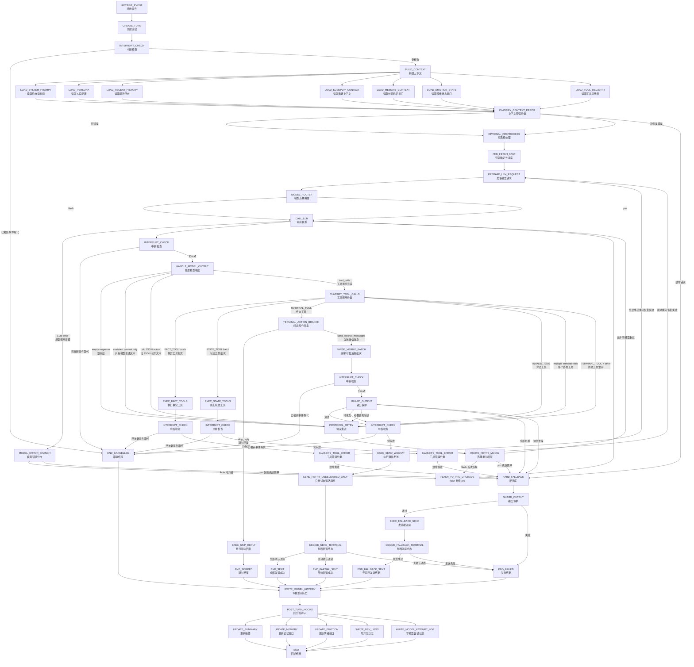

# Goal Chat Agent 第 1 层状态机图 v1.3：模型选择路由

> 文档定位：第 1 层状态机图（Level-1 State Machine Diagram）v1.3  
> 适用项目：Goal Chat Agent / 微信聊天 Agent / AI 陪伴聊天项目  
> 设计方向：在 v1.2 主链路基础上，新增 flash / pro 模型选择路由。  
> 输出格式：Markdown（`.md`）+ Mermaid 状态机图。  
> 基准来源：`Goal Chat Agent 第 1 层状态机图 v1.2`。

---

## 0. v1.3 的设计目标与范围

`v1.3`（第 1 层状态机图第 1.3 版）的目标不是增加新的聊天能力，而是在现有主链路中增加一个轻量的模型选择路由。

项目定位是：

```text
这是一个微信 AI 陪伴聊天项目。
目标不是让 AI 每轮都像专家系统一样深度分析，
而是让 AI 像真人一样在微信里自然、及时、稳定地聊天。
```

因此本轮设计核心是：

```text
日常聊天默认使用 flash。
flash 不行时，再升级 pro。
开发者可以手动指定 flash 或 pro。
模型路由只决定用哪个模型，不决定是否发送、不绕过输出保护、不直接写历史。
```

v1.3 只新增：

```text
MODEL_ROUTER（模型选择路由）
MODEL_PROFILE（模型配置档案）
MODEL_ATTEMPT_LOG（模型尝试记录）
FLASH_TO_PRO_UPGRADE（flash 升级 pro）
```

v1.3 不新增：

```text
不新增完整记忆系统
不新增情绪引擎
不新增主动消息策略
不新增联网搜索
不新增模型自评系统
不新增回复质量打分系统
```

---

## 1. v1.3 与 v1.2 的关系

v1.2 已经钉死了主链路：

```text
用户消息进入系统
→ 创建回合
→ 检查中断
→ 构建上下文
→ 可选预处理
→ 调用模型
→ 处理 native tool calls（原生工具调用）
→ 执行事实工具或终态工具
→ 输出保护
→ 微信发送
→ 判断终态
→ 写模型历史
→ 执行回合后钩子
→ 结束回合
```

v1.3 不改变这条主链路，只在以下位置插入模型路由：

```text
PREPARE_LLM_REQUEST（准备模型请求）
→ MODEL_ROUTER（模型选择路由）
→ CALL_LLM（调用模型）
```

一句话：

```text
v1.3 只是让 CALL_LLM 知道本轮该用 flash 还是 pro。
```

---

## 2. 本轮必须细化的新增模块

| 模块 | 中文说明 | 本轮处理方式 |
|---|---|---|
| `MODEL_ROUTER` | 模型选择路由 | 决定本次 `CALL_LLM` 使用 flash 还是 pro。 |
| `MODEL_PROFILE` | 模型配置档案 | 保存 flash/pro 的模型名、超时、温度、最大 token 等配置。 |
| `ROUTING_MODE` | 路由模式 | 支持 `auto`、`manual_flash`、`manual_pro`。 |
| `ROUTING_REASON` | 路由原因 | 记录为什么选择当前模型。 |
| `MODEL_ATTEMPT_LOG` | 模型尝试记录 | 记录每次模型调用、失败、升级、耗时。 |
| `FLASH_TO_PRO_UPGRADE` | flash 升级 pro | flash 出现协议违规或调用失败时升级 pro。 |
| `MODEL_CALL_BUDGET` | 模型调用预算 | 限制一轮最多调用几次模型，防止无限重试。 |

---

## 3. 本轮不做的事情

| 功能 | 中文说明 | 不做原因 |
|---|---|---|
| `LLM_JUDGE_ROUTER` | 让模型判断该用哪个模型 | 会多一次模型调用，慢、贵、不稳定。 |
| `choose_model` 工具 | 让模型通过 tool call 选择模型 | 模型选择是系统行为，不是聊天动作。 |
| `QUALITY_SCORER` | 回复质量评分器 | 第一版难以定义“好回复”，容易把系统搞复杂。 |
| `POST_GENERATION_REWRITE` | 回复后重写 | 可能影响发送链路、中断检查和历史写入。 |
| `USER_CHAT_MODEL_COMMAND` | 让普通微信聊天文本切模型 | 用户说“你用 pro 回我”可能只是聊天内容，不应直接当系统命令。 |

底线：

```text
模型路由不能绕过 v1.2 主链路。
所有微信可见输出仍必须走 TERMINAL_TOOL → GUARD_OUTPUT → EXEC_SEND_WECHAT。
```

---

## 4. v1.3 总状态机图



---

## 5. `MODEL_ROUTER`（模型选择路由）定位

### 5.1 放置位置

`MODEL_ROUTER` 必须放在：

```text
PREPARE_LLM_REQUEST（准备模型请求）之后
CALL_LLM（调用模型）之前
```

也就是：

```text
PREPARE_LLM_REQUEST
→ MODEL_ROUTER
→ CALL_LLM
```

### 5.2 它能做什么

允许：

```text
选择 flash 或 pro
读取路由配置
读取本轮上下文长度
读取本轮是否为协议重试
读取上一轮模型错误信息
记录 routing_reason（路由原因）
记录 selected_model（选中的模型）
```

### 5.3 它不能做什么

禁止：

```text
不能生成微信回复
不能调用 EXEC_SEND_WECHAT（执行微信发送）
不能直接写 assistant 历史
不能决定 skip_reply（跳过回复）
不能直接结束回合
不能绕过 GUARD_OUTPUT（输出保护）
不能改变 send_wechat_messages 的工具协议
```

---

## 6. `ROUTING_MODE`（路由模式）

v1.3 支持三种路由模式。

| 模式 | 中文说明 | 用途 |
|---|---|---|
| `auto` | 自动模式 | 默认模式。日常聊天走 flash，异常时升级 pro。 |
| `manual_flash` | 手动固定 flash | 用于省成本、压测、日常自然度体验。 |
| `manual_pro` | 手动固定 pro | 用于调试复杂问题、项目分析、架构讨论。 |

### 6.1 默认模式

建议默认配置：

```text
routing_mode = auto
```

原因：

```text
项目是微信陪伴聊天，不是专家问答系统。
大多数时候用户需要的是快、自然、像真人，而不是每句话都深度分析。
```

### 6.2 手动模式来源

第一版只建议支持：

```text
配置文件切换
开发者后台切换
本地调试参数切换
```

第一版不建议支持：

```text
普通微信聊天文本直接切换模型
```

例如用户说：

```text
你用 pro 回我
```

系统不应立刻当成模型切换命令。它可能只是聊天内容。

---

## 7. `auto`（自动模式）规则

### 7.1 默认使用 flash

以下情况默认使用 flash：

| 场景 | 中文说明 |
|---|---|
| `daily_chat` | 日常闲聊。 |
| `greeting` | 早安、晚安、在吗、起床了吗。 |
| `companionship` | 陪伴、安慰、共情。 |
| `short_reply` | 用户消息很短，适合轻回复。 |
| `simple_question` | 简单问答。 |
| `simple_tool_question` | 简单时间、天气问题。 |
| `skip_reply_candidate` | 明显不需要回复的场景，由模型决定是否调用 `skip_reply`。 |

大白话：

```text
只要像普通微信聊天，就先用 flash。
```

### 7.2 升级 pro 的情况

以下情况可以升级 pro：

| 升级原因 | 中文说明 | 建议动作 |
|---|---|---|
| `flash_protocol_violation` | flash 没按工具协议输出 | 升级 pro 重试。 |
| `flash_empty_response` | flash 空响应 | 升级 pro 重试。 |
| `flash_assistant_content_only` | flash 只输出普通文本，没有 tool call | 升级 pro 重试。 |
| `flash_old_json_action` | flash 输出旧 JSON 动作 | 升级 pro 重试。 |
| `flash_invalid_tool` | flash 调用了非法工具 | 升级 pro 重试。 |
| `flash_terminal_mixed` | flash 把终态工具和其他工具混用 | 升级 pro 重试。 |
| `flash_llm_error` | flash API 报错或超时 | 可升级 pro。 |
| `long_context` | 上下文明显过长 | 可直接 pro。 |
| `serious_user_distress` | 用户认真倾诉复杂问题 | 可直接 pro。 |
| `developer_complex_task` | 开发者讨论代码、架构、状态机 | 可直接 pro。 |

第一版最重要的是：

```text
flash 协议违规 → 不让 flash 原地硬重试，直接升级 pro。
```

---

## 8. `MODEL_PROFILE`（模型配置档案）

### 8.1 配置示例

```yaml
llm:
  routing_mode: auto  # auto / manual_flash / manual_pro
  default_model: flash

  router:
    max_model_attempts_per_turn: 2
    upgrade_flash_to_pro_on_protocol_violation: true
    upgrade_flash_to_pro_on_llm_error: true
    direct_pro_on_long_context: true
    direct_pro_on_developer_complex_task: true
    direct_pro_on_serious_user_distress: true

  models:
    flash:
      provider: deepseek
      model: deepseek-flash
      timeout_seconds: 20
      temperature: 0.8
      max_tokens: 800

    pro:
      provider: deepseek
      model: deepseek-pro
      timeout_seconds: 40
      temperature: 0.7
      max_tokens: 1200
```

### 8.2 配置解释

| 字段 | 中文说明 |
|---|---|
| `routing_mode` | 路由模式。 |
| `default_model` | 默认模型。建议为 `flash`。 |
| `max_model_attempts_per_turn` | 每个回合最多模型调用次数。第一版建议为 2。 |
| `upgrade_flash_to_pro_on_protocol_violation` | flash 协议违规时是否升级 pro。 |
| `upgrade_flash_to_pro_on_llm_error` | flash 调用错误时是否升级 pro。 |
| `direct_pro_on_long_context` | 上下文过长时是否直接 pro。 |
| `direct_pro_on_developer_complex_task` | 开发者复杂任务是否直接 pro。 |
| `direct_pro_on_serious_user_distress` | 用户严重倾诉时是否直接 pro。 |
| `provider` | 模型供应商。这里都是 DeepSeek。 |
| `model` | 具体模型名。 |
| `timeout_seconds` | 超时时间。 |
| `temperature` | 模型温度。日常聊天可稍高，严肃任务可稍低。 |
| `max_tokens` | 最大输出长度。 |

---

## 9. `MODEL_ATTEMPT_LOG`（模型尝试记录）

每次 `CALL_LLM` 都必须记录一次模型尝试。

### 9.1 字段定义

| 字段 | 中文说明 | 说明 |
|---|---|---|
| `attempt_index` | 尝试序号 | 本轮第几次调用模型。 |
| `selected_model` | 选中的模型 | `flash` 或 `pro`。 |
| `routing_mode` | 路由模式 | `auto`、`manual_flash`、`manual_pro`。 |
| `routing_reason` | 路由原因 | 如 `daily_chat`、`flash_protocol_violation`。 |
| `provider` | 模型供应商 | DeepSeek。 |
| `model_name` | 模型名称 | 实际传给 API 的模型名。 |
| `started_at` | 开始时间 | 用于耗时统计。 |
| `finished_at` | 结束时间 | 用于耗时统计。 |
| `latency_ms` | 耗时毫秒 | 模型调用耗时。 |
| `result_type` | 调用结果类型 | `success`、`llm_error`、`protocol_violation`。 |
| `error_type` | 错误类型 | 如 `timeout`、`empty_response`、`assistant_content_only`。 |
| `upgraded_from` | 从哪个模型升级 | 如从 `flash` 升级到 `pro`。 |

### 9.2 示例

```json
{
  "attempt_index": 1,
  "selected_model": "flash",
  "routing_mode": "auto",
  "routing_reason": "daily_chat",
  "provider": "deepseek",
  "model_name": "deepseek-flash",
  "latency_ms": 850,
  "result_type": "protocol_violation",
  "error_type": "assistant_content_only"
}
```

升级后：

```json
{
  "attempt_index": 2,
  "selected_model": "pro",
  "routing_mode": "auto",
  "routing_reason": "flash_protocol_violation",
  "provider": "deepseek",
  "model_name": "deepseek-pro",
  "latency_ms": 2100,
  "result_type": "success",
  "upgraded_from": "flash"
}
```

---

## 10. 协议重试与模型升级

v1.2 已经规定：模型必须通过 `native tool calls`（原生工具调用）返回动作，合法终态动作只有：

```text
send_wechat_messages（发送微信消息）
skip_reply（跳过回复）
```

v1.3 对协议重试补充一条模型升级规则。

### 10.1 flash 协议违规

```text
flash 输出协议违规
→ 记录 MODEL_ATTEMPT_LOG
→ FLASH_TO_PRO_UPGRADE
→ 用 pro 重新 CALL_LLM
```

适用违规：

```text
empty response（空响应）
assistant.content only（只有模型普通文本）
old JSON action（旧 JSON 动作文本）
INVALID_TOOL（非法工具）
multiple terminal tools（多个终态工具）
TERMINAL_TOOL + other（终态工具和其他工具混用）
```

### 10.2 pro 协议违规

```text
pro 输出协议违规
→ 不再升级
→ 如果未超协议重试次数，可同模型重试
→ 超限后进入 HARD_FALLBACK（硬兜底）
```

第一版建议：

```text
max_model_attempts_per_turn = 2
```

即：

```text
flash 一次
pro 一次
```

不要让一个微信回合无限调用模型。

---

## 11. 模型错误处理

### 11.1 flash 调用失败

| 错误 | 中文说明 | 建议流转 |
|---|---|---|
| `flash_timeout` | flash 超时 | 升级 pro。 |
| `flash_api_error` | flash API 报错 | 升级 pro。 |
| `flash_rate_limited` | flash 被限流 | 可升级 pro，或进入硬兜底。 |
| `flash_context_too_long` | flash 上下文过长 | 直接改用 pro。 |

### 11.2 pro 调用失败

| 错误 | 中文说明 | 建议流转 |
|---|---|---|
| `pro_timeout` | pro 超时 | 进入 `HARD_FALLBACK`（硬兜底）。 |
| `pro_api_error` | pro API 报错 | 进入 `HARD_FALLBACK`（硬兜底）。 |
| `pro_rate_limited` | pro 被限流 | 进入 `HARD_FALLBACK`（硬兜底）。 |
| `pro_context_too_long` | pro 上下文仍过长 | 进入 `HARD_FALLBACK`（硬兜底），后续再优化摘要。 |

第一版不建议：

```text
pro 失败后再降级 flash。
```

原因：

```text
pro 被选中通常说明 flash 已经不可靠，降级 flash 可能继续出错。
```

---

## 12. 与 `GUARD_OUTPUT`（输出保护）的关系

模型路由不能替代输出保护。

### 12.1 正常规则

```text
模型选 flash 或 pro
→ 模型调用 send_wechat_messages
→ PARSE_VISIBLE_BATCH
→ GUARD_OUTPUT
→ EXEC_SEND_WECHAT
```

### 12.2 guard 拦截后是否升级 pro

第一版建议保守处理：

```text
GUARD_OUTPUT 全部拦截
→ 进入 HARD_FALLBACK
```

不建议第一版自动让 pro 重写。

原因：

```text
guard 拦截说明微信可见内容已经不安全或不合规。
这时优先保命，不要为了“回复质量”继续复杂化链路。
```

未来如果要做，可以单独增加：

```text
GUARD_RETRY_WITH_PRO（输出保护后 pro 重写）
```

但这不属于 v1.3。

---

## 13. 与 `WRITE_MODEL_HISTORY`（写模型用历史）的关系

模型路由日志不能混入普通聊天历史。

### 13.1 允许写入模型历史的内容

仍然只允许写：

```text
用户真实发送的消息
已经确认送达的 assistant 微信可见消息
明确 skip_reply 的本轮用户消息
```

### 13.2 禁止写入模型历史的内容

禁止把以下内容写入普通模型历史：

```text
selected_model
routing_reason
MODEL_ATTEMPT_LOG
flash 升级 pro 的原因
模型 API 错误
协议违规原因
开发日志
```

这些只能进：

```text
WRITE_DEV_LOGS（写开发日志）
MODEL_ATTEMPT_LOG（模型尝试记录）
```

---

## 14. 与 `POST_TURN_HOOKS`（回合后钩子）的关系

v1.3 在 `POST_TURN_HOOKS` 中新增一个记录动作：

```text
WRITE_MODEL_ATTEMPT_LOG（写模型尝试记录）
```

它可以记录：

```text
本轮用了 flash 还是 pro
是否从 flash 升级 pro
模型调用耗时
协议违规次数
模型错误类型
最终是否成功发送
```

但它不能：

```text
修改本轮终态
补发微信
把失败回复写入聊天历史
把模型错误展示给用户
```

---

## 15. 路由规则伪代码

```python
def route_model(turn, llm_request, routing_state):
    if config.routing_mode == "manual_flash":
        return ModelChoice("flash", reason="manual_flash")

    if config.routing_mode == "manual_pro":
        return ModelChoice("pro", reason="manual_pro")

    # auto 模式
    if routing_state.previous_model == "flash" and routing_state.previous_error in {
        "empty_response",
        "assistant_content_only",
        "old_json_action",
        "invalid_tool",
        "multiple_terminal_tools",
        "terminal_tool_mixed",
        "llm_timeout",
        "llm_api_error",
    }:
        return ModelChoice("pro", reason="flash_failed_upgrade_to_pro")

    if llm_request.context_tokens > config.long_context_threshold:
        return ModelChoice("pro", reason="long_context")

    if turn.intent_hint == "developer_complex_task":
        return ModelChoice("pro", reason="developer_complex_task")

    if turn.intent_hint == "serious_user_distress":
        return ModelChoice("pro", reason="serious_user_distress")

    return ModelChoice("flash", reason="daily_chat")
```

注意：

```text
intent_hint（意图提示）只能来自轻量规则或开发者入口，不能为了路由再调用一个模型。
```

---

## 16. 推荐落地顺序

### 第一阶段：手动切换

目标：先确保 flash/pro 都能被 LLM Gateway 正确调用。

```text
manual_flash 可用
manual_pro 可用
selected_model 写日志
routing_reason 写日志
```

### 第二阶段：auto 默认 flash

目标：日常微信聊天默认 flash。

```text
auto 模式下，普通消息默认 flash
不改变工具协议
不改变发送链路
不改变历史写入
```

### 第三阶段：flash 失败升级 pro

目标：flash 不守协议时，pro 接管。

```text
flash assistant.content only → pro
flash empty response → pro
flash invalid tool → pro
flash API error → pro
```

### 第四阶段：体验测试与规则微调

目标：根据真实微信聊天体验调整阈值。

```text
观察哪些场景 flash 已经够用
观察哪些场景必须 pro
观察升级比例
观察平均响应时间
观察协议违规率
```

---

## 17. 配置建议

### 17.1 开发阶段建议

```yaml
llm:
  routing_mode: auto
  default_model: flash
  router:
    max_model_attempts_per_turn: 2
    upgrade_flash_to_pro_on_protocol_violation: true
    upgrade_flash_to_pro_on_llm_error: true
    direct_pro_on_long_context: true
    direct_pro_on_developer_complex_task: true
    direct_pro_on_serious_user_distress: true
```

### 17.2 省成本测试建议

```yaml
llm:
  routing_mode: manual_flash
```

### 17.3 调试复杂功能建议

```yaml
llm:
  routing_mode: manual_pro
```

---

## 18. 英文字段速查表

| 英文字段 | 中文说明 |
|---|---|
| `MODEL_ROUTER` | 模型选择路由 |
| `MODEL_PROFILE` | 模型配置档案 |
| `ROUTING_MODE` | 路由模式 |
| `auto` | 自动模式 |
| `manual_flash` | 手动固定 flash |
| `manual_pro` | 手动固定 pro |
| `selected_model` | 选中的模型 |
| `routing_reason` | 路由原因 |
| `daily_chat` | 日常聊天 |
| `greeting` | 打招呼 |
| `companionship` | 陪伴聊天 |
| `short_reply` | 短回复 |
| `simple_question` | 简单问题 |
| `simple_tool_question` | 简单工具问题 |
| `skip_reply_candidate` | 可能跳过回复的场景 |
| `FLASH_TO_PRO_UPGRADE` | flash 升级 pro |
| `flash_protocol_violation` | flash 协议违规 |
| `flash_empty_response` | flash 空响应 |
| `flash_assistant_content_only` | flash 只输出普通文本 |
| `flash_old_json_action` | flash 输出旧 JSON 动作 |
| `flash_invalid_tool` | flash 调用非法工具 |
| `flash_terminal_mixed` | flash 终态工具混用 |
| `flash_llm_error` | flash 模型调用错误 |
| `long_context` | 上下文过长 |
| `serious_user_distress` | 用户严重倾诉 |
| `developer_complex_task` | 开发者复杂任务 |
| `MODEL_ATTEMPT_LOG` | 模型尝试记录 |
| `attempt_index` | 尝试序号 |
| `provider` | 模型供应商 |
| `model_name` | 模型名称 |
| `latency_ms` | 调用耗时毫秒 |
| `result_type` | 调用结果类型 |
| `error_type` | 错误类型 |
| `upgraded_from` | 从哪个模型升级 |
| `MODEL_CALL_BUDGET` | 模型调用预算 |
| `max_model_attempts_per_turn` | 每轮最大模型调用次数 |
| `ROUTE_RETRY_MODEL` | 选择重试模型 |
| `MODEL_ERROR_BRANCH` | 模型错误分支 |
| `WRITE_MODEL_ATTEMPT_LOG` | 写模型尝试记录 |
| `GUARD_RETRY_WITH_PRO` | 输出保护后使用 pro 重写，未来可选功能 |

---

## 19. v1.3 最低验收标准

实现后至少必须通过以下验收：

1. `manual_flash` 模式下，所有正常模型调用都使用 flash。
2. `manual_pro` 模式下，所有正常模型调用都使用 pro。
3. `auto` 模式下，普通日常微信聊天默认使用 flash。
4. `MODEL_ROUTER` 必须位于 `PREPARE_LLM_REQUEST` 之后、`CALL_LLM` 之前。
5. `MODEL_ROUTER` 不能生成微信回复。
6. `MODEL_ROUTER` 不能直接调用 `EXEC_SEND_WECHAT`。
7. `MODEL_ROUTER` 不能直接写普通 assistant 历史。
8. `MODEL_ROUTER` 不能绕过 `GUARD_OUTPUT`。
9. flash 输出 `assistant.content only` 时，不能直接发微信。
10. flash 输出 `assistant.content only` 时，应升级 pro 或进入受控兜底。
11. flash 输出 `empty response` 时，应升级 pro 或进入受控兜底。
12. flash 输出旧 `JSON action` 时，应升级 pro 或进入受控兜底。
13. flash 调用非法工具时，应升级 pro 或进入受控兜底。
14. flash 终态工具混用时，应升级 pro 或进入受控兜底。
15. flash API 报错或超时时，可升级 pro。
16. pro API 报错或超时时，应进入 `HARD_FALLBACK`，不建议再降级 flash。
17. 每轮必须记录 `selected_model`。
18. 每轮必须记录 `routing_mode`。
19. 每轮必须记录 `routing_reason`。
20. 每次模型调用必须写入 `MODEL_ATTEMPT_LOG` 或等价开发日志。
21. `MODEL_ATTEMPT_LOG` 不得进入普通聊天历史。
22. `selected_model`、`routing_reason` 不得暴露给微信用户。
23. 每个回合必须有最大模型调用次数限制。
24. 第一版建议 `max_model_attempts_per_turn = 2`。
25. flash 升级 pro 后，仍必须遵守 native tool calls 协议。
26. pro 成功输出后，仍必须经过 `HANDLE_MODEL_OUTPUT`。
27. pro 发送内容前，仍必须经过 `GUARD_OUTPUT`。
28. pro 成功发送后，仍按 v1.2 规则写模型历史。
29. `GUARD_OUTPUT` 全部拦截后，第一版应进入 `HARD_FALLBACK`，不建议继续自动重写。
30. 模型路由不能改变 `END_SENT`、`END_PARTIAL_SENT`、`END_FAILED`、`END_SKIPPED`、`END_FALLBACK_SENT`、`END_CANCELLED` 的终态定义。

---

## 20. 本次 v1.3 修订对照表

| 反馈编号 | 需求 | v1.3 处理结果 |
|---:|---|---|
| 1 | 新增 flash / pro 模型选择 | 增加 `MODEL_ROUTER`。 |
| 2 | 项目是日常微信陪伴聊天 | 明确 `auto` 模式默认 flash。 |
| 3 | flash 大部分时间够用 | 普通聊天、陪伴、短回复默认 flash。 |
| 4 | flash 不行再上 pro | 增加 `FLASH_TO_PRO_UPGRADE`。 |
| 5 | 可手动选择模型 | 支持 `manual_flash` 和 `manual_pro`。 |
| 6 | 不要影响主链路 | 路由只插在 `PREPARE_LLM_REQUEST` 与 `CALL_LLM` 之间。 |
| 7 | 不要破坏工具协议 | 模型仍必须通过 native tool calls 返回动作。 |
| 8 | 方便体验测试 | 新增 `MODEL_ATTEMPT_LOG`、`selected_model`、`routing_reason`。 |
| 9 | 防止无限重试 | 新增 `MODEL_CALL_BUDGET`，建议每轮最多 2 次模型调用。 |
| 10 | 不做过度设计 | 明确不做模型自评、回复质量打分、模型选模型。 |

---

## 21. 一句话总结

`v1.3`（第 1 层状态机图第 1.3 版）只做一件事：

```text
让微信陪伴聊天默认用 flash 保持轻快自然；
当 flash 不守协议、空回复、调用失败或场景明显复杂时，再升级 pro；
但无论用哪个模型，都不能绕过工具协议、输出保护、微信发送、历史写入和终态判断。
```

后续开发记忆、情绪、主动消息前，必须先把这个模型路由边界做稳。否则以后出现问题时，你会分不清到底是模型能力问题、路由问题、提示词问题，还是发送链路问题。
