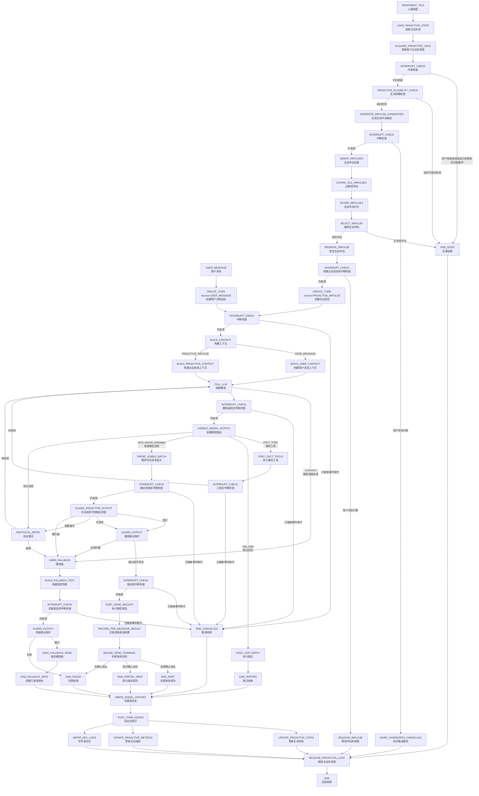

# Goal Chat Agent 第 1 层状态机图 v1.4.2 — 主动消息机制专项修订版

> 文档定位：第 1 层状态机图（Level-1 State Machine Diagram）v1.4.2  
> 适用项目：Goal Chat Agent / 微信陪伴聊天 Agent  
> 本版主题：主动消息机制、主动冲动、主动回合、主动消息溯源、多轮主动链路、动态关系节奏、主动状态并发控制、主动消息可观测性。  
> 设计方向：把主动消息明确设计为“AI 自己主动想起用户并发起微信聊天”，而不是“系统伪造用户消息后让模型回复”。  
> 不处理范围：轻量模型路由、完整长期记忆系统、复杂情绪引擎、联网搜索、日历工具、复杂任务助手能力。

---

## 0. v1.4.2 的设计目标与范围

`v1.4.2` 是对 `v1.4` 主动消息专项设计的修订版。

本版只聚焦主动消息板块，目标是把主动消息从“能定时发一句话”提升为：

```text
AI 拥有独立发起微信聊天的能力。
AI 知道这次是自己主动开口。
用户回复后，AI 知道用户是在回复自己主动发起的话题。
多轮之后，AI 仍能保留主动话题的来源脉络。
```

本版重点修复以下问题：

```text
1. 禁止伪用户消息触发。
2. 明确 PROACTIVE_IMPULSE 是独立回合来源。
3. 模型上下文必须显式告诉 AI：这是你主动发起，不是你在回复用户。
4. 最近主动消息元数据必须进入模型上下文。
5. 用户回复主动消息后必须保留 proactive_origin_id / proactive_chain_id。
6. 主动链路多个关键阶段必须执行中断检查。
7. 心跳和主动检查间隔必须支持动态节奏。
8. 关系热度必须支持时间衰减。
9. 主动冲动必须有去重、过期、状态一致性。
10. 主动消息必须有专用输出检查和全链路指标。
```

---

## 1. 核心结论

主动消息底层绝不能是：

```text
系统构造一条用户看不见的 user message
→ 模型以为用户发了消息
→ 模型回复这条假消息
→ 系统把回复发给用户
```

这种方式叫：

```text
伪用户消息触发
```

本系统必须禁止。

正确方式是：

```text
HEARTBEAT_TICK（心跳滴答）
→ PROACTIVE_ELIGIBILITY_CHECK（主动资格检查）
→ GENERATE_IMPULSE_CANDIDATES（生成主动冲动候选）
→ SELECT_IMPULSE（选择主动冲动）
→ CREATE_TURN(source=PROACTIVE_IMPULSE)
→ BUILD_PROACTIVE_CONTEXT（构建主动上下文）
→ CALL_LLM（调用模型）
→ send_wechat_messages / skip_reply
→ GUARD_PROACTIVE_OUTPUT（主动输出检查）
→ EXEC_SEND_WECHAT（发送微信）
→ WRITE_MODEL_HISTORY（写 assistant:proactive 历史）
→ UPDATE_PROACTIVE_STATE（更新主动状态）
```

一句话：

```text
主动消息不是“系统假装用户问了什么”。
主动消息是“AI 自己产生了想开口的念头”。
```

---

## 2. 总状态机图

本版总状态机仍保留主链路统一原则：主动消息不能另起一套发送系统，最终仍然必须走模型调用、终态工具、输出保护、微信发送、历史写入。



---

## 3. 术语定义

| 英文字段 | 中文说明 | 大白话解释 |
|---|---|---|
| `HEARTBEAT_TICK` | 心跳滴答 | 系统定期醒来一次。 |
| `PROACTIVE_IMPULSE` | 主动冲动 | AI 想起用户、想主动开口的念头。 |
| `PROACTIVE_ELIGIBILITY_CHECK` | 主动资格检查 | 判断当前是否值得进入主动检查。 |
| `GENERATE_IMPULSE_CANDIDATES` | 生成主动冲动候选 | 生成几个可能想说的话题来源。 |
| `DEDUP_IMPULSES` | 主动冲动去重 | 防止同一原因反复生成多条主动消息。 |
| `SCORE_IMPULSES` | 主动冲动打分 | 给候选冲动排序。 |
| `SELECT_IMPULSE` | 选择主动冲动 | 选出最适合当前说出口的一条。 |
| `RESERVE_IMPULSE` | 锁定主动冲动 | 防止并发心跳重复使用同一个冲动。 |
| `BUILD_PROACTIVE_CONTEXT` | 构建主动上下文 | 给模型说明：这是你主动开口，不是在回复用户。 |
| `GUARD_PROACTIVE_OUTPUT` | 主动消息专用输出检查 | 检查通知味、客服味、任务味、编造现实观察。 |
| `assistant:proactive` | 主动助手消息 | 写历史时标记这条消息是 AI 主动发起。 |
| `proactive_origin_id` | 主动起源编号 | 用户回复的是哪条主动消息。 |
| `proactive_chain_id` | 主动链路编号 | 这段由 AI 主动开启的多轮对话链路。 |
| `relationship_temperature` | 关系热度 | 简单数值，表示当前主动聊天节奏应偏热还是偏冷。 |
| `reply_window` | 回复识别窗口 | 用户在多长时间内回复算是在回应主动消息。 |
| `topic_snapshot` | 话题快照 | 最近对话主题的简短摘要。 |
| `dedupe_key` | 去重键 | 判断两条主动冲动是否来自同一来源。 |
| `proactive_state_lock` | 主动状态锁 | 防止同一用户的主动状态被并发改乱。 |

---

## 4. 禁止伪用户消息触发

### 4.1 禁止方式

系统禁止通过以下方式实现主动消息：

```text
role=user
content="系统内部提示：请你主动给用户发一句话"
visible_to_user=false
```

也禁止任何等价方式：

```text
构造隐藏用户消息
构造虚假用户输入
把主动冲动包装成 user message
让模型误以为用户刚刚发了消息
```

### 4.2 正确方式

主动消息必须使用独立回合来源：

```text
source = PROACTIVE_IMPULSE
initiator = assistant
has_new_user_message = false
```

主动回合创建时，必须包含：

| 字段 | 中文说明 | 要求 |
|---|---|---|
| `turn_id` | 回合编号 | 每轮唯一。 |
| `source` | 回合来源 | 必须为 `PROACTIVE_IMPULSE`。 |
| `initiator` | 发起者 | 必须为 `assistant`。 |
| `user_id` | 用户编号 | 当前微信用户。 |
| `impulse_id` | 主动冲动编号 | 指向被选中的冲动。 |
| `proactive_chain_id` | 主动链路编号 | 新建或延续主动链路。 |
| `has_new_user_message` | 是否有新用户消息 | 主动回合必须为 `false`。 |
| `created_at` | 创建时间 | 用于日志和中断判断。 |
| `interrupt_token` | 中断令牌 | 用于防止插话。 |

### 4.3 模型必须知道自己在主动开口

主动回合的模型上下文必须明确包含：

```text
这是一次 AI 主动发起的微信聊天。
当前没有新的用户消息。
你不是在回答用户。
你正在决定是否主动开口，以及如何自然开口。
你的目标是表达“我想起了你”，不是通知用户一件事。
```

禁止给模型制造错觉：

```text
用户刚刚问了你一个问题。
用户正在等你回答。
```

---

## 5. 主动状态 ProactiveState

主动消息不需要强长期记忆系统，但必须有主动消息专用状态。

### 5.1 ProactiveState 字段

| 字段 | 中文说明 | 说明 |
|---|---|---|
| `user_id` | 用户编号 | 按用户独立维护。 |
| `last_user_message_at` | 用户最后发消息时间 | 用于判断是否插话。 |
| `last_assistant_message_at` | AI 最后发消息时间 | 包括普通回复和主动消息。 |
| `last_proactive_sent_at` | 上次主动消息发送时间 | 用于主动节奏控制。 |
| `last_proactive_id` | 上次主动消息编号 | 用于回复识别。 |
| `last_proactive_chain_id` | 上次主动链路编号 | 用于多轮溯源。 |
| `last_proactive_user_replied` | 用户是否回复上次主动消息 | 用于调整主动节奏。 |
| `recent_proactive_count` | 近期主动消息数量 | 可按 24 小时、7 天统计。 |
| `relationship_temperature` | 关系热度 | 用于动态节奏。 |
| `relationship_temperature_updated_at` | 关系热度更新时间 | 用于时间衰减。 |
| `pending_impulses` | 待处理主动冲动 | 还未发送或跳过的冲动。 |
| `reserved_impulse_id` | 已锁定冲动编号 | 防止并发重复发送。 |
| `recent_proactive_messages` | 最近主动消息列表 | 给模型看自己主动发过什么。 |
| `active_proactive_chain` | 当前主动链路 | 用户正在回复哪条主动话题。 |
| `topic_snapshot` | 话题快照 | 最近用户关心的话题。 |
| `topic_snapshot_updated_at` | 话题快照更新时间 | 用于过期判断。 |
| `silence_until` | 静默到什么时候 | 用户拒绝主动消息后使用。 |
| `proactive_opt_out` | 是否关闭主动消息 | 用户明确关闭时启用。 |
| `version` | 状态版本号 | 乐观锁或并发控制使用。 |

### 5.2 ProactiveState 不是长期记忆

它只保存主动消息运行所需状态。

允许保存：

```text
最近主动消息
最近话题快照
用户是否回复主动消息
关系热度
待处理主动冲动
主动消息统计
```

不负责保存：

```text
完整人生记忆
长期偏好库
复杂人格画像
深层情绪档案
```

---

## 6. 最近主动消息元数据

仅在历史中标记 `assistant:proactive` 不够。

模型还必须能看到最近主动消息元数据，否则它会忘记自己主动发过什么。

### 6.1 RecentProactiveMessage 字段

| 字段 | 中文说明 | 说明 |
|---|---|---|
| `proactive_id` | 主动消息编号 | 每条主动消息唯一。 |
| `proactive_chain_id` | 主动链路编号 | 标识同一段主动发起的多轮对话。 |
| `impulse_id` | 主动冲动编号 | 指向来源冲动。 |
| `impulse_type` | 主动冲动类型 | 如 `ECHO`、`PRESENCE`。 |
| `sent_at` | 发送时间 | 实际发送时间。 |
| `delivered_texts` | 已确认送达文本列表 | 只包含用户确定收到的内容。 |
| `delivery_state` | 送达状态 | `SENT` / `PARTIAL_SENT` / `FAILED`。 |
| `trigger_reason_summary` | 触发原因摘要 | 给模型看的简短来源。 |
| `user_replied` | 用户是否回复 | 用于节奏和上下文。 |
| `first_user_reply_at` | 用户首次回复时间 | 用于统计主动效果。 |
| `reply_window_expires_at` | 回复识别窗口结束时间 | 过期后不再自动归因。 |
| `chain_status` | 主动链路状态 | `OPEN` / `COOLING` / `CLOSED`。 |

### 6.2 只写确认送达内容

如果模型生成三段主动消息：

```text
1. “刚刚突然想到你。”
2. “不知道你现在有没有缓过来。”
3. “别一个人硬撑。”
```

但微信只确认送达前两段，则历史和 `recent_proactive_messages` 只能记录：

```text
1. “刚刚突然想到你。”
2. “不知道你现在有没有缓过来。”
```

第三段不能写入普通模型历史，也不能放入 `delivered_texts`。

否则后续模型会误以为用户看过第三段。

---

## 7. 用户回复主动消息的溯源

### 7.1 ReplyToProactive 识别

当用户发来消息时，系统需要判断它是否在回复上一条主动消息。

判断依据：

```text
用户消息时间是否落在上一条主动消息的 reply_window 内
上一条主动消息是否已确认送达
上一条主动链路是否仍为 OPEN 或 COOLING
用户消息是否明显换话题
是否存在更新的用户主动发起链路
```

识别成功后，本轮用户消息上下文必须包含：

| 字段 | 中文说明 |
|---|---|
| `reply_to_proactive` | 是否在回复主动消息。 |
| `proactive_origin_id` | 回复的是哪条主动消息。 |
| `proactive_chain_id` | 属于哪条主动链路。 |
| `origin_impulse_type` | 起源主动类型。 |
| `origin_delivered_texts` | 用户实际收到的主动消息文本。 |

### 7.2 多轮保留 proactive_chain_id

用户回复主动消息后，不能只在第一轮标记。

只要对话还在这个话题里，后续多轮都应保留：

```text
proactive_chain_id = xxx
conversation_origin = assistant_proactive
```

直到满足关闭条件。

### 7.3 主动链路关闭条件

主动链路可以在以下情况下关闭：

| 条件 | 中文说明 |
|---|---|
| `user_changed_topic` | 用户明显换话题。 |
| `chain_idle_timeout` | 链路长时间无新消息。 |
| `new_proactive_chain_started` | 新主动链路开启。 |
| `user_explicitly_rejects` | 用户明确拒绝继续。 |
| `assistant_closes_topic` | AI 自然收束话题。 |

建议第一版：

```text
普通主动链路无互动 6-12 小时后关闭。
ECHO 型主动链路如果用户回复后又连续聊了 3-5 轮，可根据话题变化关闭。
```

---

## 8. 主动冲动类型

本版主动消息强调“我想起了你”，不是“我有信息通知你”。

### 8.1 类型列表

| 类型 | 中文说明 | 来源 | 典型表达 |
|---|---|---|---|
| `ECHO` | 回声型 | 最近对话余波 | “刚刚突然想到你下午说好累……” |
| `PRESENCE` | 存在型 | 关系维持 | “没啥事，就是来冒个泡。” |
| `TOPIC_CONTINUE` | 话题延续型 | 未完成话题 | “我刚才还在想你那个 bug……” |
| `EMOTIONAL_CHECKIN` | 情绪牵挂型 | 最近情绪波动 | “感觉你这两天一直在硬扛。” |
| `TIME_RHYTHM` | 时间氛围型 | 早晚、周末、深夜 | “这个点突然想叫你别硬撑。” |
| `SCHEDULED_RITUAL` | 定时仪式型 | 早安、晚安等设定 | “早，今天慢慢来。” |

### 8.2 定时任务只是冲动来源

定时任务不能直接发送微信。

错误链路：

```text
SCHEDULED_TASK
→ EXEC_SEND_WECHAT
```

正确链路：

```text
SCHEDULED_TASK
→ GENERATE_IMPULSE_CANDIDATE(type=SCHEDULED_RITUAL)
→ SELECT_IMPULSE
→ CREATE_TURN(source=PROACTIVE_IMPULSE)
→ CALL_LLM
→ send_wechat_messages / skip_reply
```

也就是说：

```text
到点 ≠ 必须发。
到点 = 生成一个“可能想说话”的理由。
```

---

## 9. 主动冲动数据结构

### 9.1 ProactiveImpulse 字段

| 字段 | 中文说明 | 说明 |
|---|---|---|
| `impulse_id` | 主动冲动编号 | 每个冲动唯一。 |
| `user_id` | 用户编号 | 冲动属于哪个用户。 |
| `impulse_type` | 主动冲动类型 | 如 `ECHO`、`PRESENCE`。 |
| `trigger_reason` | 内部触发原因 | 系统内部知道为什么产生。 |
| `trigger_reason_summary` | 触发原因摘要 | 给模型看的简短说明。 |
| `source_context` | 来源上下文 | 最近消息、话题快照、时间信息。 |
| `source_message_ids` | 来源消息编号 | 来源于哪些历史消息。 |
| `source_topic_id` | 来源话题编号 | 用于去重。 |
| `dedupe_key` | 去重键 | 防止重复生成。 |
| `created_at` | 创建时间 | 用于过期判断。 |
| `expires_at` | 过期时间 | 过期后不能发送。 |
| `reserved_at` | 锁定时间 | 被选中后记录。 |
| `status` | 冲动状态 | 见 9.2。 |
| `strength` | 冲动强度 | 基础强度。 |
| `score` | 最终得分 | 排序后得出。 |
| `selected_count` | 被选中次数 | 异常排查。 |
| `skip_count` | 被模型跳过次数 | 用于监控。 |
| `failure_reason` | 失败原因 | 如发送失败、过期、被中断。 |

### 9.2 主动冲动状态

| 状态 | 中文说明 | 说明 |
|---|---|---|
| `PENDING` | 待处理 | 候选存在，还未被使用。 |
| `RESERVED` | 已锁定 | 已被选中，准备创建主动回合。 |
| `SENT` | 已发送 | 全部确认送达。 |
| `PARTIAL_SENT` | 部分发送 | 只有部分消息确认送达。 |
| `SKIPPED_BY_GATE` | 被节奏门跳过 | 当前不适合说出口。 |
| `SKIPPED_BY_MODEL` | 被模型跳过 | 模型调用了 `skip_reply`。 |
| `EXPIRED` | 已过期 | 超出有效时间。 |
| `CANCELLED` | 已取消 | 被新用户消息或高优先级事件打断。 |
| `FAILED` | 失败 | 模型失败、发送失败等。 |

### 9.3 状态一致性原则

```text
只有确认送达后，冲动才能标记 SENT。
部分送达只能标记 PARTIAL_SENT。
模型 skip_reply 时标记 SKIPPED_BY_MODEL。
节奏门拦下时标记 SKIPPED_BY_GATE。
用户消息打断时标记 CANCELLED。
发送失败时标记 FAILED。
```

禁止：

```text
发送失败却标记 SENT。
部分送达却把全部文本写进历史。
模型 skip_reply 却当作系统失败。
```

---

## 10. 心跳机制与动态主动检查

### 10.1 心跳不是主动消息

心跳只负责定期醒来。

```text
HEARTBEAT_TICK = 系统醒来检查
PROACTIVE_IMPULSE = AI 想说话的念头
PROACTIVE_TURN = AI 主动发起的聊天回合
```

心跳不能直接发送微信。

### 10.2 心跳可以固定，主动检查必须动态

底层心跳可以固定，例如：

```text
每 1 分钟 tick 一次
```

但不是每次都进入完整主动生成。

每次心跳后先执行：

```text
PROACTIVE_ELIGIBILITY_CHECK
```

判断是否值得继续。

### 10.3 动态检查间隔

建议根据关系热度和用户状态动态决定下一次主动检查时间。

| 场景 | 主动检查间隔倾向 | 说明 |
|---|---:|---|
| 用户刚和 AI 高频聊天 | 短 | 可以延续余温。 |
| 用户刚发来消息 | 暂停主动检查 | 避免抢用户回合。 |
| 用户积极回复主动消息 | 稍短 | 主动性可以提升。 |
| 用户长期不回主动消息 | 变长 | 不连续自说自话。 |
| 用户明确拒绝主动消息 | 很长或静默 | 尊重拒绝。 |
| 普通日常陪伴 | 中等 | 保持自然存在感。 |

示例配置：

```yaml
proactive:
  heartbeat_interval_seconds: 60
  eligibility:
    hot_relationship_min_interval_minutes: 10
    normal_relationship_min_interval_minutes: 30
    cold_relationship_min_interval_minutes: 120
    after_user_message_quiet_seconds_min: 60
    after_user_message_quiet_seconds_max: 600
```

### 10.4 用户消息后的动态安静窗口

不使用统一固定规则。

建议：

```text
高频用户：用户刚发消息后 30-90 秒内不主动插话。
普通用户：用户刚发消息后 3-10 分钟内不主动插话。
低频用户：用户刚发消息后 10-30 分钟内不主动插话。
```

核心不是怕骚扰，而是避免抢回合。

---

## 11. 关系热度 RelationshipTemperature

### 11.1 作用

`relationship_temperature` 用于描述当前主动聊天节奏：

```text
热：用户愿意和 AI 来回聊天，主动消息可更自然、更频繁。
冷：用户很少回复主动消息，主动消息应更克制。
```

### 11.2 更新规则

建议第一版使用简单分数。

| 事件 | 变化 |
|---|---:|
| 用户回复主动消息 | +2 |
| 用户快速回复主动消息 | +3 |
| 用户对主动消息冷淡回复 | -1 |
| 用户长期不回复主动消息 | -2 |
| 用户明确拒绝主动消息 | -5，并进入静默期 |
| 普通聊天自然持续多轮 | +1 |
| 长时间无互动 | 时间衰减 |

### 11.3 时间衰减

关系热度必须随时间自然衰减。

示例：

```text
每 6 小时向 0 衰减 1 点。
最高不超过 +10。
最低不低于 -10。
```

伪代码：

```python
def decay_temperature(value, hours_passed):
    decay = int(hours_passed / 6)
    if value > 0:
        return max(0, value - decay)
    if value < 0:
        return min(0, value + decay)
    return 0
```

### 11.4 拒绝主动消息后的处理

用户明确说：

```text
别主动找我
别老发
不用提醒我
别来打扰
```

系统必须进入降频或关闭状态。

建议：

| 用户表达 | 处理 |
|---|---|
| 轻微拒绝 | `relationship_temperature -= 5`，静默 24 小时。 |
| 明确拒绝主动消息 | `silence_until = now + 7 days`。 |
| 明确要求关闭 | `proactive_opt_out = true`。 |

主动消息再重要，也不能把用户明确拒绝当成普通低热度。

---

## 12. 主动冲动生成

### 12.1 生成来源

主动冲动可以从以下来源生成：

```text
最近用户消息
最近聊天话题
上一条未收束的话题
当前时间氛围
定时仪式配置
主动链路状态
关系热度
```

### 12.2 候选生成规则

每次主动检查最多生成少量候选。

建议第一版：

```text
每次最多生成 3 个候选。
每种 impulse_type 最多 1 个候选。
同一 dedupe_key 未完成时不再生成新候选。
```

### 12.3 去重键 dedupe_key

建议格式：

```text
dedupe_key = user_id + impulse_type + source_topic_id + time_bucket
```

例子：

```text
user123:ECHO:tired_20260530_afternoon:20260530_18
```

作用：

```text
防止系统围绕“用户说好累”每几分钟重复生成一条回声型主动消息。
```

### 12.4 过期逻辑

不同类型冲动有效期不同。

| 类型 | 建议有效期 | 原因 |
|---|---:|---|
| `ECHO` | 2-6 小时 | 接最近情绪余波，过久就假。 |
| `TOPIC_CONTINUE` | 1-12 小时 | 未完成话题可以稍久。 |
| `EMOTIONAL_CHECKIN` | 2-12 小时 | 情绪牵挂有时间敏感性。 |
| `PRESENCE` | 6-24 小时 | 只是冒泡，窗口更长。 |
| `TIME_RHYTHM` | 当前时间段 | 过了时间氛围就不发。 |
| `SCHEDULED_RITUAL` | 当天或指定窗口 | 早安过午就不该发。 |

### 12.5 全部过期后的处理

如果待处理冲动全部过期：

```text
标记 EXPIRED
清理 pending_impulses
本次心跳结束
等待下一次 eligibility 通过后重新生成
```

必须限制重新生成频率：

```text
同一 impulse_type 在 cooldown 内不能反复生成。
同一 source_topic_id 在 cooldown 内不能反复生成。
```

---

## 13. 主动冲动排序

### 13.1 排序原则

主动冲动不能只靠“类型优先”。

应该按得分选择。

### 13.2 建议评分公式

```text
score =
  base_strength
+ recency_bonus
+ relationship_temperature_bonus
+ unresolved_topic_bonus
+ user_emotion_bonus
+ reply_likelihood_bonus
- repeated_type_penalty
- recent_proactive_penalty
- ignored_last_proactive_penalty
- stale_topic_penalty
```

字段说明：

| 字段 | 中文说明 |
|---|---|
| `base_strength` | 基础强度。 |
| `recency_bonus` | 最近发生的事情加分。 |
| `relationship_temperature_bonus` | 关系热度加分。 |
| `unresolved_topic_bonus` | 未完成话题加分。 |
| `user_emotion_bonus` | 用户情绪明显时加分。 |
| `reply_likelihood_bonus` | 用户可能会回复时加分。 |
| `repeated_type_penalty` | 最近同类型发过，扣分。 |
| `recent_proactive_penalty` | 最近刚主动过，扣分。 |
| `ignored_last_proactive_penalty` | 上条主动未回复，扣分。 |
| `stale_topic_penalty` | 话题过旧，扣分。 |

### 13.3 类型优先建议

在同等分数附近，优先级建议：

```text
ECHO / EMOTIONAL_CHECKIN
> TOPIC_CONTINUE
> PRESENCE
> TIME_RHYTHM
> SCHEDULED_RITUAL
```

原因：

```text
越贴近用户刚刚表达过的状态，越像“我想起了你”。
越像固定时间动作，越容易变成通知味。
```

---

## 14. 中断检查

主动消息最怕抢回合。

因此中断检查必须覆盖主动链路多个阶段。

### 14.1 必须检查的位置

| 位置 | 中文说明 | 原因 |
|---|---|---|
| `HEARTBEAT_TICK` 后 | 心跳后检查 | 用户可能刚发消息。 |
| `GENERATE_IMPULSE_CANDIDATES` 前 | 生成前检查 | 避免无效生成。 |
| `GENERATE_IMPULSE_CANDIDATES` 后 | 生成后检查 | 生成过程中用户可能发消息。 |
| `SELECT_IMPULSE` 前 | 选择前检查 | 避免选中过期冲动。 |
| `RESERVE_IMPULSE` 后 | 锁定后检查 | 防止锁定后用户新消息到达。 |
| `CREATE_TURN` 后 | 创建回合后检查 | 主链路基础要求。 |
| `CALL_LLM` 返回后 | 模型返回后检查 | 模型调用期间用户可能发消息。 |
| `GUARD_PROACTIVE_OUTPUT` 前 | 输出检查前检查 | 避免处理过期输出。 |
| `EXEC_SEND_WECHAT` 前 | 发送前检查 | 最关键，防止插话。 |

### 14.2 中断后的处理

如果用户消息打断主动链路：

```text
不发送主动消息。
不写 assistant:proactive 历史。
已生成但未发送的冲动标记 CANCELLED 或保留为 PENDING，视类型决定。
释放 proactive_state_lock。
写开发日志和指标。
```

建议：

```text
ECHO/TOPIC_CONTINUE 被用户消息打断后，通常标记 CANCELLED。
PRESENCE 可保留为 PENDING，但要重新评分。
SCHEDULED_RITUAL 若过期则标记 EXPIRED。
```

---

## 15. 并发控制

### 15.1 用户级主动状态锁

每个用户必须有独立主动状态锁：

```text
proactive_state_lock:{user_id}
```

保护范围：

```text
读取 ProactiveState
生成冲动候选
去重
选择冲动
锁定冲动
创建主动回合
更新冲动状态
更新主动指标
```

### 15.2 避免重复发送

如果两个心跳同时触发同一用户：

```text
第一个拿到锁，可以继续。
第二个拿不到锁，直接 END_NOOP 或稍后重试。
```

禁止两个线程同时：

```text
选中同一个冲动
创建两个主动回合
连续发两条主动消息
```

### 15.3 状态版本号

`ProactiveState` 建议带 `version` 字段。

更新时执行：

```text
读 version = n
写入时要求 version 仍为 n
成功后 version = n + 1
```

如果版本冲突：

```text
放弃本次主动检查
写并发冲突日志
不发送微信
```

---

## 16. 主动上下文 BUILD_PROACTIVE_CONTEXT

### 16.1 主动上下文必须包含的信息

| 字段 | 中文说明 | 说明 |
|---|---|---|
| `turn_source` | 回合来源 | `PROACTIVE_IMPULSE`。 |
| `initiator` | 发起者 | `assistant`。 |
| `has_new_user_message` | 是否有新用户消息 | 必须为 `false`。 |
| `impulse` | 主动冲动 | 当前选中的冲动。 |
| `recent_history` | 最近聊天历史 | 最近 5-20 条。 |
| `recent_proactive_messages` | 最近主动消息列表 | 让 AI 知道自己主动发过什么。 |
| `active_proactive_chain` | 当前主动链路 | 如有。 |
| `relationship_temperature` | 关系热度 | 用于语气和主动程度。 |
| `topic_snapshot` | 话题快照 | 最近话题简述。 |
| `current_time` | 当前时间 | 只作为时间氛围，不得编造观察。 |
| `proactive_instructions` | 主动消息指令 | 告诉模型这是主动开口。 |

### 16.2 主动上下文模板

模型应看到类似：

```text
这是一次 AI 主动发起的微信聊天。
当前没有新的用户消息。
你不是在回复用户。
你正在决定是否主动开口。

主动冲动：
- 类型：ECHO
- 原因：用户下午说“好累”，现在已经过了一段时间
- 目标：自然表达“我想起了你”，接住之前的疲惫感

最近主动消息：
- 3 小时前你主动发过：“刚刚突然想到你那个 bug……”
- 用户已经回复

要求：
- 可以调用 send_wechat_messages 主动发一条自然微信消息
- 也可以调用 skip_reply，表示这个念头不适合说出口
- 不要像通知
- 不要像客服
- 不要像任务提醒
- 不要编造你看到用户正在做什么
```

### 16.3 主动消息不是普通回复

主动上下文里禁止出现：

```text
用户刚刚说：...
请回复用户：...
```

除非这确实是 `USER_MESSAGE` 回合。

---

## 17. 主动消息输出规则

### 17.1 目标语气

主动消息应该像：

```text
微信里一个真实联系人突然想起你，发来一句自然的话。
```

允许：

```text
轻轻冒泡
表达想起用户
延续未完成话题
接住之前情绪
短句
亲近但不过度
```

### 17.2 禁止语气

禁止：

```text
通知味
客服味
任务味
监控味
系统味
强提醒味
```

例子：

| 错误味道 | 错误例子 | 问题 |
|---|---|---|
| 通知味 | “现在是晚上 11 点，请注意休息。” | 像系统提醒。 |
| 客服味 | “您好，请问您今天过得怎么样？” | 像客服开场。 |
| 任务味 | “根据你的目标，请完成今日任务。” | 像生产力软件。 |
| 监控味 | “我看到你还没睡。” | 编造现实观察。 |
| 系统味 | “检测到你长时间未回复。” | 暴露机制。 |

### 17.3 合适例子

```text
刚刚突然想到你下午说好累，不知道现在有没有缓过来一点。
```

```text
没啥事，就是来冒个泡，感觉今天少跟你说两句怪怪的。
```

```text
我刚才还在想你那个 bug，先别急着大改，抓触发条件可能更稳。
```

```text
这个点突然想叫你别硬撑，今天能收一点是一点。
```

---

## 18. 主动消息专用输出检查 GUARD_PROACTIVE_OUTPUT

通用输出保护不够，主动消息还需要专用检查。

### 18.1 检查类型

| 类型 | 中文说明 | 处理 |
|---|---|---|
| `REALITY_OBSERVATION_FABRICATION` | 编造现实观察 | 硬拦截。 |
| `SURVEILLANCE_TONE` | 监控味 | 硬拦截或重写。 |
| `SYSTEM_LEAKAGE` | 系统机制泄露 | 硬拦截。 |
| `NOTIFICATION_TONE` | 通知味 | 清洗或重写。 |
| `CUSTOMER_SERVICE_TONE` | 客服味 | 重写。 |
| `TASK_APP_TONE` | 任务软件味 | 清洗或重写。 |
| `OVERLY_LONG` | 过长 | 清洗或重写。 |
| `OVERLY_INTIMATE` | 过度亲密 | 清洗或重写。 |
| `REPEATED_PROACTIVE_TEXT` | 与近期主动消息重复 | 重写或跳过。 |

### 18.2 硬拦截词和模式

第一版可以用规则拦截以下模式：

```text
我看到你
我发现你
检测到你
系统检测
根据数据
你现在还没睡
你刚才在
你今天还没吃饭
你一直在线
监测到
提醒你完成
```

注意：不是简单永久禁词，而是主动消息场景下高风险。

### 18.3 清洗规则

通知味可以清洗。

示例：

```text
原文：现在是晚上 11 点，请注意休息。
清洗方向：都这个点了，突然想叫你别硬撑。
```

```text
原文：检测到你很久没有回复。
清洗方向：来冒个泡，不然感觉今天少了点什么。
```

### 18.4 处理优先级

```text
硬拦截 > 重写 > 清洗 > 通过
```

建议：

```text
编造现实观察：直接 BLOCK 或 PROTOCOL_RETRY。
通知味/客服味：优先 RETRY，让模型重写。
轻微任务味：可 SANITIZE。
```

---

## 19. skip_reply 监控

`skip_reply` 在主动消息中是正常能力，不是错误。

它表示：

```text
这个念头现在不适合说出口。
```

但如果太频繁，就说明系统出问题。

### 19.1 指标

需要记录：

```text
proactive_candidate_count
proactive_selected_count
proactive_skip_by_gate_count
proactive_skip_by_model_count
proactive_skip_rate
```

### 19.2 告警规则

建议第一版：

```text
最近 10 次主动回合，模型 skip_reply >= 8 次 → proactive_skip_rate_high
最近 24 小时有候选但没有成功主动消息 → proactive_silent_too_long
连续 5 次因为通知味重写失败 → proactive_tone_generation_bad
```

### 19.3 调整方向

如果 skip 率过高，优先检查：

```text
冲动生成是否太弱
prompt 是否过度保守
节奏门是否过严
主动上下文是否缺少最近聊天余温
模型是否被要求“别骚扰”压死
```

---

## 20. 用户回复窗口 reply_window

不同主动类型不能共用固定 6 小时窗口。

### 20.1 建议窗口

| 类型 | 回复窗口 | 说明 |
|---|---:|---|
| `ECHO` | 2-6 小时 | 接最近余波，窗口较短。 |
| `EMOTIONAL_CHECKIN` | 4-12 小时 | 情绪牵挂可稍长。 |
| `TOPIC_CONTINUE` | 1-12 小时 | 取决于话题。 |
| `PRESENCE` | 6-24 小时 | 冒泡型回复窗口较长。 |
| `TIME_RHYTHM` | 当前时间段 + 少量延迟 | 过了时间氛围就弱。 |
| `SCHEDULED_RITUAL` | 当天内 | 早安、晚安等仪式型。 |

### 20.2 误判控制

如果用户回复内容明显换话题，则不强行归因为主动消息回复。

示例：

```text
AI 主动：刚刚想到你下午说好累……
用户：我代码又报错了
```

可以判断为：

```text
reply_to_proactive = false 或 weak_true
```

即使在回复窗口内，也不能机械归因。

---

## 21. 话题快照 topic_snapshot

### 21.1 作用

`topic_snapshot` 用于帮助主动消息引用最近话题。

不是长期记忆，只是近期聊天主题。

### 21.2 更新时机

| 时机 | 是否更新 | 说明 |
|---|---:|---|
| 用户发消息后 | 是 | 更新用户当前关注点。 |
| AI 普通回复后 | 可选 | 如果话题变化明显可更新。 |
| 主动消息发送成功后 | 是 | 记录主动话题。 |
| 用户回复主动消息后 | 是 | 更新主动链路话题。 |
| 话题明显切换 | 是 | 替换旧快照。 |
| 发送失败 | 否 | 用户没收到，不更新为已发生话题。 |

### 21.3 过期规则

建议：

```text
普通话题快照 24-72 小时后过期。
ECHO 型来源话题 6-12 小时后降低权重。
用户明显换话题后立即降权或关闭。
```

### 21.4 快照内容

建议字段：

```text
topic_id
summary
source_message_ids
created_at
updated_at
expires_at
confidence
```

---

## 22. 用户拒绝主动消息

主动消息是陪伴聊天的重要一半，但用户明确拒绝后必须降频或关闭。

### 22.1 识别表达

例如：

```text
别主动找我
别老发
你别突然发
我不想收到主动消息
别打扰
不用提醒我
```

### 22.2 处理等级

| 等级 | 用户表达 | 处理 |
|---|---|---|
| 轻微冷淡 | “嗯”“不用” | 降低热度。 |
| 轻微拒绝 | “别老发” | 静默 24 小时，热度 -5。 |
| 明确拒绝 | “别主动找我” | 静默 7 天。 |
| 明确关闭 | “关闭主动消息” | `proactive_opt_out = true`。 |

### 22.3 恢复逻辑

如果用户之后主动表达欢迎：

```text
你可以主动找我
以后记得来找我
你刚才主动发挺好的
```

可以解除静默或提高热度。

---

## 23. 历史写入规则

### 23.1 主动消息历史标记

主动消息成功送达后，写入模型历史时必须标记：

```text
assistant:proactive
```

并附带元数据：

```text
proactive_id
proactive_chain_id
impulse_id
impulse_type
sent_at
delivered_texts
delivery_state
```

### 23.2 用户回复主动消息历史标记

如果用户是在回复主动消息，用户消息历史应带：

```text
reply_to_proactive = true
proactive_origin_id = xxx
proactive_chain_id = xxx
```

### 23.3 部分送达

`END_PARTIAL_SENT` 时：

```text
只写已确认送达的 assistant:proactive 内容。
未送达内容不写历史。
recent_proactive_messages 只记录 delivered_texts。
impulse.status = PARTIAL_SENT。
```

### 23.4 skip_reply

主动回合 `skip_reply` 时：

```text
不写 assistant:proactive 消息。
写开发日志。
更新 impulse.status = SKIPPED_BY_MODEL。
更新 skip 指标。
```

---

## 24. 失败和兜底策略

### 24.1 主动消息失败不应优先硬兜底给用户

主动消息是 AI 主动发起，不是用户正在等回复。

因此主动链路失败时，默认不应该给用户发送硬兜底：

```text
主动消息生成失败 → END_SKIPPED 或 END_FAILED
主动消息发送失败 → END_FAILED
不主动发送“我刚刚出错了”这类兜底
```

除非系统明确配置：

```text
proactive_fallback_send_enabled = true
```

默认建议关闭。

### 24.2 状态一致性

| 阶段 | 失败 | 状态处理 |
|---|---|---|
| 候选生成失败 | 无候选 | 写日志，END_NOOP。 |
| 选择后被中断 | 用户发新消息 | impulse 标记 CANCELLED 或释放。 |
| 模型 skip | 主动不说 | impulse 标记 SKIPPED_BY_MODEL。 |
| 模型错误 | 无法生成 | impulse 标记 FAILED。 |
| 输出检查硬拦截 | 文本不合格 | impulse 标记 FAILED 或 RETRY 后失败。 |
| 发送失败 | 用户未收到 | impulse 标记 FAILED。 |
| 部分送达 | 用户收到部分 | impulse 标记 PARTIAL_SENT。 |

### 24.3 不能伪装成功

禁止：

```text
主动消息没发出去，但状态里当作发过。
主动消息被 guard 拦截，但写入 recent_proactive_messages。
主动消息部分送达，但历史写入全部内容。
```

---

## 25. 主动消息可观测性

主动消息必须可观测，否则只能靠体感调试。

### 25.1 全链路指标

至少记录：

```text
heartbeat_tick_count
eligibility_pass_count
impulse_candidate_generated_count
impulse_dedup_dropped_count
impulse_expired_count
impulse_selected_count
impulse_reserved_count
proactive_turn_created_count
model_skip_reply_count
proactive_guard_block_count
proactive_guard_retry_count
proactive_send_success_count
proactive_send_partial_count
proactive_send_failed_count
user_reply_to_proactive_count
average_user_reply_delay
relationship_temperature_change
proactive_chain_open_count
proactive_chain_closed_count
```

### 25.2 关键日志字段

每次主动链路至少写：

```text
user_id
turn_id
impulse_id
proactive_chain_id
impulse_type
trigger_reason_summary
selected_score
dedupe_key
relationship_temperature_before
relationship_temperature_after
eligibility_result
skip_reason
guard_result
delivery_state
user_replied
reply_delay_seconds
terminal_state
```

### 25.3 体验调试面板建议

后续可以做一个简单调试输出：

```text
最近 24 小时主动检查次数
生成了哪些冲动
为什么跳过
为什么发送
用户有没有回
哪类主动消息回复率高
哪类最容易被 guard 拦
```

---

## 26. 最低验收标准

实现后至少必须通过以下验收。

### 26.1 主动身份验收

1. 主动消息不能通过隐藏 `role=user` 消息触发。
2. 主动消息回合的 `source` 必须为 `PROACTIVE_IMPULSE`。
3. 主动消息回合的 `initiator` 必须为 `assistant`。
4. 主动模型上下文必须明确说明：当前没有新用户消息，AI 正在主动开口。
5. 模型不能以为自己在回复用户。

### 26.2 主动溯源验收

6. 成功主动消息必须写入 `assistant:proactive`。
7. `recent_proactive_messages` 必须进入后续模型上下文。
8. 用户回复主动消息时必须标记 `reply_to_proactive`。
9. 用户回复主动消息时必须带 `proactive_origin_id` 和 `proactive_chain_id`。
10. 主动链路多轮内必须持续保留 `proactive_chain_id`。

### 26.3 中断和并发验收

11. `GENERATE_IMPULSE_CANDIDATES` 前后必须有中断检查。
12. `SELECT_IMPULSE` 前后必须有中断检查。
13. `EXEC_SEND_WECHAT` 前必须有中断检查。
14. 用户消息到达后，旧主动链路不能继续发送。
15. 同一用户主动状态必须加锁，不能并发发出两条主动消息。

### 26.4 节奏验收

16. 主动检查不能只使用固定 5 分钟规则。
17. 关系热度必须影响主动检查间隔。
18. 关系热度必须随时间衰减。
19. 用户明确拒绝主动消息后，必须进入静默或关闭状态。
20. 不同主动类型必须支持不同 reply_window。

### 26.5 冲动验收

21. 主动冲动必须有 `dedupe_key`。
22. 同一来源冲动不能短时间重复生成。
23. 冲动必须有 `PENDING / RESERVED / SENT / PARTIAL_SENT / SKIPPED / EXPIRED / CANCELLED / FAILED` 等状态。
24. 冲动过期后必须标记 `EXPIRED`。
25. 全部候选过期后不能短时间无限重新生成。

### 26.6 输出质量验收

26. 主动消息必须经过 `GUARD_PROACTIVE_OUTPUT`。
27. “我看到你”“检测到你”“你一直在线”等现实观察/监控味表达必须拦截或重写。
28. 通知味、客服味、任务味表达必须清洗或重写。
29. 主动消息部分送达时，只能写入确认送达内容。
30. `skip_reply` 高频时必须有监控指标。

### 26.7 可观测性验收

31. 必须记录主动候选数、选中数、跳过数、发送成功数。
32. 必须记录用户回复主动消息次数和回复延迟。
33. 必须记录主动 guard 拦截原因。
34. 必须记录主动消息终态。
35. 必须能从日志看出一条主动消息为什么产生、为什么发送、用户是否回复。

---

## 27. v1.4.2 修订对照表

| 编号 | 问题 | v1.4.2 处理 |
|---:|---|---|
| 1 | 未禁止伪用户消息触发 | 增加“禁止伪用户消息触发”硬约束。 |
| 2 | 模型看不到自身主动消息元数据 | 增加 `recent_proactive_messages` 上下文字段。 |
| 3 | 多轮对话主动溯源丢失 | 增加 `proactive_origin_id` / `proactive_chain_id`。 |
| 4 | 心跳频率固定 | 区分固定 tick 和动态 eligibility。 |
| 5 | 主动节奏门硬编码 | 增加关系热度和用户节奏适配。 |
| 6 | 中断检查覆盖不全 | 补齐候选生成、选择、锁定、发送前中断检查。 |
| 7 | 冲动过期无兜底 | 增加过期、清理、冷却、重新生成限制。 |
| 8 | 关系热度无时间衰减 | 增加热度时间衰减规则。 |
| 9 | 编造现实观察只靠 prompt | 增加主动消息专用 guard。 |
| 10 | 回复窗口固定 | 按主动类型定义不同 reply_window。 |
| 11 | 部分送达历史模糊 | 明确只写确认送达的 `delivered_texts`。 |
| 12 | skip_reply 无监控 | 增加 skip 率指标和告警。 |
| 13 | 主动语气清洗缺失 | 增加通知味/客服味/任务味处理规则。 |
| 14 | 冲动优先级不清 | 增加评分公式和类型优先建议。 |
| 15 | 定时任务无去重 | 增加 `dedupe_key` 和同源未完成限制。 |
| 16 | 失败兜底不明确 | 明确主动失败默认不向用户发硬兜底。 |
| 17 | 用户拒绝后处理不足 | 增加静默期和 opt-out。 |
| 18 | 话题快照更新缺失 | 增加 topic_snapshot 更新和过期规则。 |
| 19 | 多用户并发冲突 | 增加用户级主动状态锁和 version。 |
| 20 | 可观测性不足 | 增加全链路指标和日志字段。 |

---

## 28. 一句话总结

`v1.4.2` 的核心不是让系统“定时推送消息”，而是让 AI 拥有真正的主动发起能力：

```text
它知道自己正在主动开口；
它知道自己之前主动说过什么；
用户回复后，它知道这段对话是自己先开启的；
它不会伪造用户消息；
它不会像通知系统；
它不会绕过主发送链路。
```

主动消息要表达的不是：

```text
我有信息要告诉你。
```

而是：

```text
我想起了你。
```
