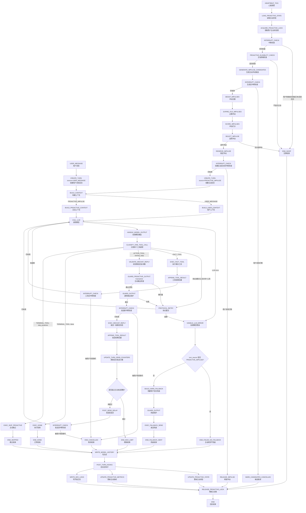

# Goal Chat Agent 第 1 层状态机图 v1.4.3 — 主动消息机制严格 CC 模式适配版

> 文档定位：第 1 层状态机图（Level-1 State Machine Diagram）v1.4.3  
> 适用项目：Goal Chat Agent / 微信陪伴聊天 Agent  
> 本版主题：在严格 CC 模式下重构主动消息机制。  
> 上一版来源：v1.4.2 主动冲动专项设计。  
> 核心变化：主动消息不再使用旧的 `send_wechat_messages / skip_reply / 批量发送终态` 语义，而是统一纳入当前严格工具循环：  
> `tool_choice=required`、每次 LLM 只能调用一个工具、`wechat_reply` 是 ACTION_TOOL、`done / skip_proactive` 是终态工具。

---

## 0. v1.4.3 修订目标

`v1.4.3` 不是缩减版，而是对 `v1.4.2` 的架构适配版。

`v1.4.2` 的主动消息原则继续保留：

```text
1. 禁止伪用户消息触发。
2. 主动消息必须是 source=PROACTIVE_IMPULSE 的独立回合。
3. 模型必须知道自己正在主动开口。
4. 用户回复后必须保留 proactive_origin_id / proactive_chain_id。
5. 主动消息必须有中断、并发、去重、过期、guard、指标。
```

`v1.4.3` 主要修正：

```text
1. 移除旧的 send_wechat_messages 终态批量发送语义。
2. 改为当前严格 CC 模式下的 wechat_reply ACTION_TOOL。
3. 主动回合每次 LLM 调用也必须只调用一个工具。
4. 主动回合的 visible send 动作由 wechat_reply 完成。
5. 主动回合不能使用 skip_reply，改用 skip_proactive。
6. 主动回合不能靠 wechat_reply 结束，必须由 done 或 skip_proactive 结束。
7. 主动消息默认最多允许 1 条 wechat_reply，除非配置显式允许多条。
8. 主动消息失败默认不走硬兜底发送。
```

---

## 1. 严格 CC 模式定义

当前系统统一遵循：

```text
CALL_LLM
→ HANDLE_MODEL_OUTPUT
→ CLASSIFY_ONE_TOOL_CALL
→ EXEC_TOOL
→ tool result 回灌
→ CALL_LLM
→ ...
→ TERMINAL_TOOL
→ POST_TURN_PIPELINE
```

每次模型调用必须满足：

```text
1. 必须产生 tool_call。
2. 每次只能有一个 tool_call。
3. 不允许 assistant.content 直接作为微信可见回复。
4. 可见微信消息必须通过 wechat_reply 工具发送。
5. 工具执行结果以 tool role message 回灌下一次模型调用。
6. 回合必须由终态工具或最大限制结束。
```

### 1.1 工具分类

| 工具 | 类别 | 是否终态 | 说明 |
|---|---|---:|---|
| `wechat_reply` | ACTION_TOOL | 否 | 发送一条微信可见消息，发送后继续回到 `CALL_LLM`。 |
| `get_time` | FACT_TOOL | 否 | 查时间，结果回灌模型。 |
| `get_weather` | FACT_TOOL | 否 | 查天气，结果回灌模型。 |
| `done` | TERMINAL_TOOL | 是 | 普通用户回合或主动回合的正常结束。 |
| `skip_proactive` | TERMINAL_TOOL | 是 | 主动冲动不适合说出口，主动回合跳过结束。 |

注意：

```text
skip_proactive 只用于 PROACTIVE_IMPULSE 回合。
普通 USER_MESSAGE 回合不使用 skip_proactive。
```

---

## 2. 核心结论

主动消息底层绝不能是：

```text
系统构造隐藏 user message
→ 模型以为用户发了消息
→ 模型回复假用户消息
→ 系统把回复发给微信
```

正确方式是：

```text
HEARTBEAT_TICK
→ PROACTIVE_ELIGIBILITY_CHECK
→ GENERATE_IMPULSE_CANDIDATES
→ DEDUP_IMPULSES
→ EXPIRE_OLD_IMPULSES
→ SCORE_IMPULSES
→ SELECT_IMPULSE
→ RESERVE_IMPULSE
→ CREATE_TURN(source=PROACTIVE_IMPULSE)
→ BUILD_PROACTIVE_CONTEXT
→ CALL_LLM(tool_choice=required, allowed_tools=[wechat_reply, skip_proactive, done])
→ 模型调用 wechat_reply / skip_proactive / done
→ 如果 wechat_reply：发送一条微信，结果回灌，再 CALL_LLM
→ 如果 skip_proactive：主动跳过结束
→ 如果 done：主动回合结束
→ WRITE_MODEL_HISTORY
→ UPDATE_PROACTIVE_STATE
→ UPDATE_PROACTIVE_METRICS
```

一句话：

```text
主动消息不是“旧发送链路旁路推送”。
主动消息是在严格 CC 模式里创建的 assistant-initiated turn。
```

---

## 3. 总状态机图



---

## 4. 术语定义

| 英文字段 | 中文说明 | 大白话解释 |
|---|---|---|
| `HEARTBEAT_TICK` | 心跳滴答 | 系统定期醒来一次。 |
| `PROACTIVE_IMPULSE` | 主动冲动 | AI 想起用户、想主动开口的念头。 |
| `PROACTIVE_ELIGIBILITY_CHECK` | 主动资格检查 | 判断当前是否值得进入主动检查。 |
| `GENERATE_IMPULSE_CANDIDATES` | 生成主动冲动候选 | 生成几个可能想说的话题来源。 |
| `DEDUP_IMPULSES` | 主动冲动去重 | 防止同一原因反复生成多条主动消息。 |
| `SCORE_IMPULSES` | 主动冲动打分 | 给候选冲动排序。 |
| `SELECT_IMPULSE` | 选择主动冲动 | 选出最适合当前说出口的一条。 |
| `RESERVE_IMPULSE` | 锁定主动冲动 | 防止并发心跳重复使用同一个冲动。 |
| `BUILD_PROACTIVE_CONTEXT` | 构建主动上下文 | 给模型说明：这是你主动开口，不是在回复用户。 |
| `wechat_reply` | 微信回复工具 | 严格 CC 模式下唯一可见微信发送动作。 |
| `skip_proactive` | 主动跳过工具 | 表示这个主动念头不适合说出口。 |
| `done` | 结束工具 | 表示本回合结束。 |
| `assistant:proactive` | 主动助手消息 | 写历史时标记这条消息是 AI 主动发起。 |
| `proactive_origin_id` | 主动起源编号 | 用户回复的是哪条主动消息。 |
| `proactive_chain_id` | 主动链路编号 | 这段由 AI 主动开启的多轮对话链路。 |
| `relationship_temperature` | 关系热度 | 简单数值，表示当前主动聊天节奏应偏热还是偏冷。 |
| `reply_window` | 回复识别窗口 | 用户在多长时间内回复算是在回应主动消息。 |
| `topic_snapshot` | 话题快照 | 最近对话主题的简短摘要。 |
| `dedupe_key` | 去重键 | 判断两条主动冲动是否来自同一来源。 |
| `proactive_state_lock` | 主动状态锁 | 防止同一用户的主动状态被并发改乱。 |

---

## 5. 与 v1.4.2 的关键差异

### 5.1 移除旧发送语义

`v1.4.2` 中的以下节点废弃：

```text
send_wechat_messages
skip_reply
PARSE_VISIBLE_BATCH
DECIDE_SEND_TERMINAL
END_SENT
END_PARTIAL_SENT
```

原因：

```text
当前系统不是批量发送终态工具架构。
当前系统是严格 CC 单工具循环。
每次可见发送只能由 wechat_reply 发送一条。
wechat_reply 发送后不结束回合。
模型必须继续调用 done 或 skip_proactive 来结束。
```

### 5.2 新增主动专用终态工具 skip_proactive

`skip_proactive` 表示：

```text
模型理解了主动冲动，但判断此刻不适合说出口。
```

它不是错误，也不是发送失败。

参数建议：

```json
{
  "reason": "insufficient_evidence | too_soon | too_intrusive | low_value | repeated | unsafe | user_might_be_busy",
  "note": "简短说明为什么不主动发"
}
```

执行结果：

```text
1. impulse.status = SKIPPED_BY_MODEL
2. 不写 assistant:proactive 历史
3. 写开发日志
4. 更新 skip 指标
5. 回合结束
```

### 5.3 done 在主动回合中的语义

`done` 仍然是终态工具。

主动回合中：

```text
done(status="replied")
```

表示：

```text
主动消息已经通过 wechat_reply 发出，模型确认本主动回合结束。
```

主动回合中：

```text
done(status="no_reply")
```

不推荐，但允许作为兼容分支。推荐模型使用 `skip_proactive` 表示主动不发。

### 5.4 wechat_reply 在主动回合中的限制

主动回合中 `wechat_reply`：

```text
1. 是 ACTION_TOOL。
2. 只发送一条微信消息。
3. 成功或失败结果回灌模型。
4. 不直接结束回合。
5. 主动回合默认最多调用一次 wechat_reply。
6. 如需多条主动消息，必须由配置显式打开。
```

默认配置建议：

```yaml
proactive:
  max_wechat_reply_per_proactive_turn: 1
  allow_multi_message_proactive: false
```

---

## 6. 主动回合 allowed_tools

### 6.1 普通用户回合

普通用户消息回合可允许：

```text
get_time
get_weather
wechat_reply
done
```

未来可扩展：

```text
memory_write
state_update
```

### 6.2 主动消息回合

主动消息回合默认只允许：

```text
wechat_reply
skip_proactive
done
```

默认不允许：

```text
get_weather
get_time
search
memory_write
external side-effect tools
```

原因：

```text
主动消息不应借主动回合扩展成任务执行。
主动消息的主要问题是“要不要自然开口”，不是查事实。
```

如果某个主动冲动需要时间信息，应由 `BUILD_PROACTIVE_CONTEXT` 直接注入当前时间和 temporal context，而不是让模型在主动回合里调用 `get_time`。

---

## 7. 禁止伪用户消息触发

### 7.1 禁止方式

系统禁止通过以下方式实现主动消息：

```text
role=user
content="系统内部提示：请你主动给用户发一句话"
visible_to_user=false
```

也禁止任何等价方式：

```text
构造隐藏用户消息
构造虚假用户输入
把主动冲动包装成 user message
让模型误以为用户刚刚发了消息
```

### 7.2 正确方式

主动消息必须使用独立回合来源：

```text
source = PROACTIVE_IMPULSE
initiator = assistant
has_new_user_message = false
```

主动回合创建时，必须包含：

| 字段 | 中文说明 | 要求 |
|---|---|---|
| `turn_id` | 回合编号 | 每轮唯一。 |
| `source` | 回合来源 | 必须为 `PROACTIVE_IMPULSE`。 |
| `initiator` | 发起者 | 必须为 `assistant`。 |
| `user_id` | 用户编号 | 当前微信用户。 |
| `impulse_id` | 主动冲动编号 | 指向被选中的冲动。 |
| `proactive_chain_id` | 主动链路编号 | 新建或延续主动链路。 |
| `has_new_user_message` | 是否有新用户消息 | 主动回合必须为 `false`。 |
| `created_at` | 创建时间 | 用于日志和中断判断。 |
| `interrupt_token` | 中断令牌 | 用于防止插话。 |

---

## 8. BUILD_PROACTIVE_CONTEXT 严格 CC 版

主动上下文必须包含：

```text
turn_source = PROACTIVE_IMPULSE
initiator = assistant
has_new_user_message = false
impulse_id
impulse_type
proactive_chain_id
recent_history
recent_proactive_messages
reply_window
relationship_temperature
topic_snapshot
current_time / temporal_context
allowed_tools
```

主动上下文必须明确告诉模型：

```text
这是一次 AI 主动发起的微信聊天。
当前没有新的用户消息。
你不是在回答用户。
你正在判断这个主动冲动是否适合说出口。
如果适合，只能调用 wechat_reply 发一条自然微信消息。
如果不适合，调用 skip_proactive。
如果已经通过 wechat_reply 发出主动消息，下一步应调用 done 结束回合。
```

禁止出现：

```text
用户刚刚说：
请回复用户：
```

除非当前回合来源确实是 `USER_MESSAGE`。

---

## 9. 主动回合工具调用协议

### 9.1 第一轮 LLM 调用

主动回合第一轮只允许：

```text
wechat_reply
skip_proactive
```

可选允许：

```text
done
```

但推荐第一轮不要直接 `done`，避免语义含混。

### 9.2 如果模型调用 wechat_reply

流程：

```text
CALL_LLM
→ wechat_reply
→ GUARD_PROACTIVE_OUTPUT
→ GUARD_OUTPUT
→ INTERRUPT_CHECK
→ EXEC_WECHAT_REPLY
→ APPEND_TOOL_RESULT
→ POST_SEND_DELAY
→ INTERRUPT_CHECK
→ CALL_LLM
```

第二轮模型应该调用：

```text
done(status="replied")
```

如果第二轮继续调用 `wechat_reply`：

```text
若 max_wechat_reply_per_proactive_turn = 1，则进入协议违规或 END_MAX_LIMIT。
若配置允许多条主动消息，则继续发送，但每条发送前必须中断检查。
```

### 9.3 如果模型调用 skip_proactive

流程：

```text
CALL_LLM
→ skip_proactive
→ EXEC_SKIP_PROACTIVE
→ END_SKIPPED
→ UPDATE_PROACTIVE_STATE
```

### 9.4 如果模型协议违规

协议违规包括：

```text
1. 没有 tool_call。
2. 多个 tool_call。
3. 主动回合调用了不允许的工具。
4. 主动回合超过最大 wechat_reply 次数。
5. 主动回合在已发送后仍继续发送，且配置不允许。
```

处理：

```text
未超过 MAX_PROTOCOL_RETRIES → PROTOCOL_RETRY
超过限制 → END_FAILED_NO_FALLBACK
```

主动回合协议失败默认不向用户发送兜底。

---

## 10. ProactiveState 主动状态

主动消息不需要强长期记忆系统，但必须有主动消息专用状态。

### 10.1 ProactiveState 字段

| 字段 | 中文说明 | 说明 |
|---|---|---|
| `user_id` | 用户编号 | 按用户独立维护。 |
| `last_user_message_at` | 用户最后发消息时间 | 用于判断是否插话。 |
| `last_assistant_message_at` | AI 最后发消息时间 | 包括普通回复和主动消息。 |
| `last_proactive_sent_at` | 上次主动消息发送时间 | 用于主动节奏控制。 |
| `last_proactive_id` | 上次主动消息编号 | 用于回复识别。 |
| `last_proactive_chain_id` | 上次主动链路编号 | 用于多轮溯源。 |
| `last_proactive_user_replied` | 用户是否回复上次主动消息 | 用于调整主动节奏。 |
| `recent_proactive_count` | 近期主动消息数量 | 可按 24 小时、7 天统计。 |
| `relationship_temperature` | 关系热度 | 用于动态节奏。 |
| `relationship_temperature_updated_at` | 关系热度更新时间 | 用于时间衰减。 |
| `pending_impulses` | 待处理主动冲动 | 还未发送或跳过的冲动。 |
| `reserved_impulse_id` | 已锁定冲动编号 | 防止并发重复发送。 |
| `recent_proactive_messages` | 最近主动消息列表 | 给模型看自己主动发过什么。 |
| `active_proactive_chain` | 当前主动链路 | 用户正在回复哪条主动话题。 |
| `topic_snapshot` | 话题快照 | 最近用户关心的话题。 |
| `topic_snapshot_updated_at` | 话题快照更新时间 | 用于过期判断。 |
| `silence_until` | 静默到什么时候 | 用户拒绝主动消息后使用。 |
| `proactive_opt_out` | 是否关闭主动消息 | 用户明确关闭时启用。 |
| `version` | 状态版本号 | 乐观锁或并发控制使用。 |

### 10.2 strict CC 补充字段

| 字段 | 中文说明 | 说明 |
|---|---|---|
| `active_turn_id` | 活跃回合编号 | 当前主动回合 ID。 |
| `active_turn_source` | 活跃回合来源 | 应为 `PROACTIVE_IMPULSE`。 |
| `proactive_wechat_reply_count` | 主动回合已发送条数 | 用于限制主动消息条数。 |
| `proactive_llm_step_count` | 主动回合模型步数 | 用于避免无限循环。 |
| `last_tool_call_name` | 上次工具名 | 调试严格工具循环。 |
| `last_tool_result_summary` | 上次工具结果摘要 | 避免日志过大。 |
| `terminal_tool_name` | 终态工具名 | 区分 `done`、`skip_proactive`、限制结束、失败。 |

### 10.3 ProactiveState 不是长期记忆

它只保存主动消息运行所需状态。

允许保存：

```text
最近主动消息
最近话题快照
用户是否回复主动消息
关系热度
待处理主动冲动
主动消息统计
```

不负责保存：

```text
完整人生记忆
长期偏好库
复杂人格画像
深层情绪档案
```

---

## 11. 最近主动消息元数据

仅在历史中标记 `assistant:proactive` 不够。

模型还必须能看到最近主动消息元数据，否则它会忘记自己主动发过什么。

### 11.1 RecentProactiveMessage 字段

| 字段 | 中文说明 | 说明 |
|---|---|---|
| `proactive_id` | 主动消息编号 | 每条主动消息唯一。 |
| `proactive_chain_id` | 主动链路编号 | 标识同一段主动发起的多轮对话。 |
| `impulse_id` | 主动冲动编号 | 指向来源冲动。 |
| `impulse_type` | 主动冲动类型 | 如 `ECHO`、`PRESENCE`。 |
| `sent_at` | 发送时间 | 实际发送时间。 |
| `delivered_texts` | 已确认送达文本列表 | 只包含用户确定收到的内容。 |
| `delivery_state` | 送达状态 | `SENT` / `PARTIAL_SENT` / `FAILED`。 |
| `trigger_reason_summary` | 触发原因摘要 | 给模型看的简短来源。 |
| `user_replied` | 用户是否回复 | 用于节奏和上下文。 |
| `first_user_reply_at` | 用户首次回复时间 | 用于统计主动效果。 |
| `reply_window_expires_at` | 回复识别窗口结束时间 | 过期后不再自动归因。 |
| `chain_status` | 主动链路状态 | `OPEN` / `COOLING` / `CLOSED`。 |

### 11.2 只写确认送达内容

如果模型生成主动消息，但微信只确认送达一部分，则历史和 `recent_proactive_messages` 只能记录确认送达的内容。

禁止：

```text
未送达内容写入普通模型历史。
未送达内容放入 delivered_texts。
模型后续以为用户看过未送达内容。
```

---

## 12. 用户回复主动消息的溯源

当用户消息进入时，系统判断是否回复主动消息。

判断依据：

```text
1. last_proactive_id 存在。
2. last_proactive delivery_state 为 SENT 或 PARTIAL_SENT。
3. 当前用户消息时间在 reply_window 内。
4. active_proactive_chain 为 OPEN 或 COOLING。
5. 用户消息没有明显开启全新话题。
```

识别成功后，本轮 `USER_MESSAGE` 上下文必须包含：

```json
{
  "reply_to_proactive": true,
  "proactive_origin_id": "...",
  "proactive_chain_id": "...",
  "origin_impulse_type": "...",
  "origin_delivered_texts": ["..."]
}
```

多轮保持：

```text
只要 proactive_chain_id 未关闭，后续用户回合继续带 conversation_origin=assistant_proactive。
```

关闭条件：

```text
1. 用户明显换话题。
2. 链路 idle timeout。
3. 新主动链路开启。
4. 用户明确拒绝继续。
5. assistant 自然收束。
```

---

## 13. 主动冲动类型

`v1.4.3` 继续保留大而全主动冲动设计：

| 类型 | 中文说明 | 来源 | 典型表达 |
|---|---|---|---|
| `ECHO` | 回声型 | 最近对话余波 | “刚刚突然想到你下午说好累……” |
| `PRESENCE` | 存在型 | 关系维持 | “没啥事，就是来冒个泡。” |
| `TOPIC_CONTINUE` | 话题延续型 | 未完成话题 | “我刚才还在想你那个 bug……” |
| `EMOTIONAL_CHECKIN` | 情绪牵挂型 | 最近情绪波动 | “感觉你这两天一直在硬扛。” |
| `TIME_RHYTHM` | 时间氛围型 | 早晚、周末、深夜 | “这个点突然想叫你别硬撑。” |
| `SCHEDULED_RITUAL` | 定时仪式型 | 早安、晚安等设定 | “早，今天慢慢来。” |

但所有冲动最终必须进入同一条 strict CC 主链路：

```text
impulse
→ CREATE_TURN(source=PROACTIVE_IMPULSE)
→ BUILD_PROACTIVE_CONTEXT
→ CALL_LLM
→ wechat_reply / skip_proactive / done
```

禁止任何冲动直接：

```text
→ EXEC_SEND_WECHAT
```

---

## 14. 主动冲动数据结构

### 14.1 ProactiveImpulse 字段

| 字段 | 中文说明 | 说明 |
|---|---|---|
| `impulse_id` | 主动冲动编号 | 每个冲动唯一。 |
| `user_id` | 用户编号 | 冲动属于哪个用户。 |
| `impulse_type` | 主动冲动类型 | 如 `ECHO`、`PRESENCE`。 |
| `trigger_reason` | 内部触发原因 | 系统内部知道为什么产生。 |
| `trigger_reason_summary` | 触发原因摘要 | 给模型看的简短说明。 |
| `source_context` | 来源上下文 | 最近消息、话题快照、时间信息。 |
| `source_message_ids` | 来源消息编号 | 来源于哪些历史消息。 |
| `source_topic_id` | 来源话题编号 | 用于去重。 |
| `dedupe_key` | 去重键 | 防止重复生成。 |
| `created_at` | 创建时间 | 用于过期判断。 |
| `expires_at` | 过期时间 | 过期后不能发送。 |
| `reserved_at` | 锁定时间 | 被选中后记录。 |
| `status` | 冲动状态 | 见 14.2。 |
| `strength` | 冲动强度 | 基础强度。 |
| `score` | 最终得分 | 排序后得出。 |
| `selected_count` | 被选中次数 | 异常排查。 |
| `skip_count` | 被模型跳过次数 | 用于监控。 |
| `failure_reason` | 失败原因 | 如发送失败、过期、被中断。 |

### 14.2 主动冲动状态

| 状态 | 中文说明 | 说明 |
|---|---|---|
| `PENDING` | 待处理 | 候选存在，还未被使用。 |
| `RESERVED` | 已锁定 | 已被选中，准备创建主动回合。 |
| `SENT` | 已发送 | 全部确认送达。 |
| `PARTIAL_SENT` | 部分发送 | 只有部分消息确认送达。 |
| `SKIPPED_BY_GATE` | 被节奏门跳过 | 当前不适合说出口。 |
| `SKIPPED_BY_MODEL` | 被模型跳过 | 模型调用了 `skip_proactive`。 |
| `EXPIRED` | 已过期 | 超出有效时间。 |
| `CANCELLED` | 已取消 | 被新用户消息或高优先级事件打断。 |
| `FAILED` | 失败 | 模型失败、发送失败等。 |

### 14.3 状态一致性原则

```text
只有确认送达后，冲动才能标记 SENT。
部分送达只能标记 PARTIAL_SENT。
模型 skip_proactive 时标记 SKIPPED_BY_MODEL。
节奏门拦下时标记 SKIPPED_BY_GATE。
用户消息打断时标记 CANCELLED。
发送失败时标记 FAILED。
```

禁止：

```text
发送失败却标记 SENT。
部分送达却把全部文本写进历史。
模型 skip_proactive 却当作系统失败。
```

---

## 15. 主动冲动生成、去重、过期

### 15.1 生成来源

主动冲动可以从以下来源生成：

```text
最近用户消息
最近聊天话题
上一条未收束的话题
当前时间氛围
定时仪式配置
主动链路状态
关系热度
```

### 15.2 候选生成规则

每次主动检查最多生成少量候选。

建议：

```text
每次最多生成 3 个候选。
每种 impulse_type 最多 1 个候选。
同一 dedupe_key 未完成时不再生成新候选。
```

### 15.3 去重键 dedupe_key

建议格式：

```text
dedupe_key = user_id + impulse_type + source_topic_id + time_bucket
```

例子：

```text
user123:ECHO:tired_20260530_afternoon:20260530_18
```

作用：

```text
防止系统围绕“用户说好累”每几分钟重复生成一条回声型主动消息。
```

### 15.4 过期逻辑

| 类型 | 建议有效期 | 原因 |
|---|---:|---|
| `ECHO` | 2-6 小时 | 接最近情绪余波，过久就假。 |
| `TOPIC_CONTINUE` | 1-12 小时 | 未完成话题可以稍久。 |
| `EMOTIONAL_CHECKIN` | 2-12 小时 | 情绪牵挂有时间敏感性。 |
| `PRESENCE` | 6-24 小时 | 只是冒泡，窗口更长。 |
| `TIME_RHYTHM` | 当前时间段 | 过了时间氛围就不发。 |
| `SCHEDULED_RITUAL` | 当天或指定窗口 | 早安过午就不该发。 |

### 15.5 全部过期后的处理

如果待处理冲动全部过期：

```text
标记 EXPIRED
清理 pending_impulses
本次心跳结束
等待下一次 eligibility 通过后重新生成
```

必须限制重新生成频率：

```text
同一 impulse_type 在 cooldown 内不能反复生成。
同一 source_topic_id 在 cooldown 内不能反复生成。
```

---

## 16. 主动冲动排序

### 16.1 排序原则

主动冲动不能只靠“类型优先”。

应该按得分选择。

### 16.2 建议评分公式

```text
score =
  base_strength
+ recency_bonus
+ relationship_temperature_bonus
+ unresolved_topic_bonus
+ user_emotion_bonus
+ reply_likelihood_bonus
- repeated_type_penalty
- recent_proactive_penalty
- ignored_last_proactive_penalty
- stale_topic_penalty
```

字段说明：

| 字段 | 中文说明 |
|---|---|
| `base_strength` | 基础强度。 |
| `recency_bonus` | 最近发生的事情加分。 |
| `relationship_temperature_bonus` | 关系热度加分。 |
| `unresolved_topic_bonus` | 未完成话题加分。 |
| `user_emotion_bonus` | 用户情绪明显时加分。 |
| `reply_likelihood_bonus` | 用户可能会回复时加分。 |
| `repeated_type_penalty` | 最近同类型发过，扣分。 |
| `recent_proactive_penalty` | 最近刚主动过，扣分。 |
| `ignored_last_proactive_penalty` | 上条主动未回复，扣分。 |
| `stale_topic_penalty` | 话题过旧，扣分。 |

### 16.3 类型优先建议

在同等分数附近，优先级建议：

```text
ECHO / EMOTIONAL_CHECKIN
> TOPIC_CONTINUE
> PRESENCE
> TIME_RHYTHM
> SCHEDULED_RITUAL
```

原因：

```text
越贴近用户刚刚表达过的状态，越像“我想起了你”。
越像固定时间动作，越容易变成通知味。
```

---

## 17. 心跳机制与动态主动检查

### 17.1 心跳不是主动消息

心跳只负责定期醒来。

```text
HEARTBEAT_TICK = 系统醒来检查
PROACTIVE_IMPULSE = AI 想说话的念头
PROACTIVE_TURN = AI 主动发起的聊天回合
```

心跳不能直接发送微信。

### 17.2 心跳可以固定，主动检查必须动态

底层心跳可以固定，例如：

```text
每 1 分钟 tick 一次
```

但不是每次都进入完整主动生成。

每次心跳后先执行：

```text
PROACTIVE_ELIGIBILITY_CHECK
```

判断是否值得继续。

### 17.3 动态检查间隔

建议根据关系热度和用户状态动态决定下一次主动检查时间。

| 场景 | 主动检查间隔倾向 | 说明 |
|---|---:|---|
| 用户刚和 AI 高频聊天 | 短 | 可以延续余温。 |
| 用户刚发来消息 | 暂停主动检查 | 避免抢用户回合。 |
| 用户积极回复主动消息 | 稍短 | 主动性可以提升。 |
| 用户长期不回主动消息 | 变长 | 不连续自说自话。 |
| 用户明确拒绝主动消息 | 很长或静默 | 尊重拒绝。 |
| 普通日常陪伴 | 中等 | 保持自然存在感。 |

示例配置：

```yaml
proactive:
  heartbeat_interval_seconds: 60
  eligibility:
    hot_relationship_min_interval_minutes: 10
    normal_relationship_min_interval_minutes: 30
    cold_relationship_min_interval_minutes: 120
    after_user_message_quiet_seconds_min: 60
    after_user_message_quiet_seconds_max: 600
```

### 17.4 用户消息后的动态安静窗口

不使用统一固定规则。

建议：

```text
高频用户：用户刚发消息后 30-90 秒内不主动插话。
普通用户：用户刚发消息后 3-10 分钟内不主动插话。
低频用户：用户刚发消息后 10-30 分钟内不主动插话。
```

核心不是怕骚扰，而是避免抢回合。

---

## 18. 关系热度 RelationshipTemperature

### 18.1 作用

`relationship_temperature` 用于描述当前主动聊天节奏：

```text
热：用户愿意和 AI 来回聊天，主动消息可更自然、更频繁。
冷：用户很少回复主动消息，主动消息应更克制。
```

### 18.2 更新规则

建议第一版使用简单分数。

| 事件 | 变化 |
|---|---:|
| 用户回复主动消息 | +2 |
| 用户快速回复主动消息 | +3 |
| 用户对主动消息冷淡回复 | -1 |
| 用户长期不回复主动消息 | -2 |
| 用户明确拒绝主动消息 | -5，并进入静默期 |
| 普通聊天自然持续多轮 | +1 |
| 长时间无互动 | 时间衰减 |

### 18.3 时间衰减

关系热度必须随时间自然衰减。

示例：

```text
每 6 小时向 0 衰减 1 点。
最高不超过 +10。
最低不低于 -10。
```

伪代码：

```python
def decay_temperature(value, hours_passed):
    decay = int(hours_passed / 6)
    if value > 0:
        return max(0, value - decay)
    if value < 0:
        return min(0, value + decay)
    return 0
```

### 18.4 严格 CC 约束

关系热度不能绕过 strict CC 限制。

即使热度很高：

```text
1. 仍然不能伪造用户消息。
2. 仍然不能跳过中断检查。
3. 仍然不能绕过 wechat_reply。
4. 仍然不能连续主动多条，除非配置明确允许。
5. 仍然必须由 done / skip_proactive 结束。
```

---

## 19. 主动消息中断规则

主动消息最怕抢回合。

中断检查必须覆盖：

```text
1. 心跳后。
2. eligibility 前。
3. 生成候选前后。
4. 选择冲动前。
5. reserve 后。
6. CREATE_TURN 后。
7. CALL_LLM 返回后。
8. GUARD_PROACTIVE_OUTPUT 前。
9. EXEC_WECHAT_REPLY 前。
10. POST_SEND_DELAY 后。
11. 下一次 CALL_LLM 前。
```

如果用户消息打断：

```text
1. 不再发送主动消息。
2. 未发送内容不写历史。
3. impulse 标记 CANCELLED 或 RELEASED。
4. proactive turn 标记 END_CANCELLED。
5. 用户消息创建新的 USER_MESSAGE turn。
```

建议：

```text
ECHO/TOPIC_CONTINUE 被用户消息打断后，通常标记 CANCELLED。
PRESENCE 可保留为 PENDING，但要重新评分。
SCHEDULED_RITUAL 若过期则标记 EXPIRED。
```

---

## 20. 并发控制

### 20.1 用户级主动状态锁

每个用户必须有独立主动状态锁：

```text
proactive_state_lock:{user_id}
```

保护范围：

```text
读取 ProactiveState
生成冲动候选
去重
选择冲动
锁定冲动
创建主动回合
更新冲动状态
更新主动指标
```

### 20.2 避免重复发送

如果两个心跳同时触发同一用户：

```text
第一个拿到锁，可以继续。
第二个拿不到锁，直接 END_NOOP 或稍后重试。
```

禁止两个线程同时：

```text
选中同一个冲动
创建两个主动回合
连续发两条主动消息
```

### 20.3 状态版本号

`ProactiveState` 建议带 `version` 字段。

更新时执行：

```text
读 version = n
写入时要求 version 仍为 n
成功后 version = n + 1
```

如果版本冲突：

```text
放弃本次主动检查
写并发冲突日志
不发送微信
```

---

## 21. 主动消息输出规则

### 21.1 目标语气

主动消息应该像：

```text
微信里一个真实联系人突然想起你，发来一句自然的话。
```

允许：

```text
轻轻冒泡
表达想起用户
延续未完成话题
接住之前情绪
短句
亲近但不过度
```

### 21.2 禁止语气

禁止：

```text
通知味
客服味
任务味
监控味
系统味
强提醒味
```

例子：

| 错误味道 | 错误例子 | 问题 |
|---|---|---|
| 通知味 | “现在是晚上 11 点，请注意休息。” | 像系统提醒。 |
| 客服味 | “您好，请问您今天过得怎么样？” | 像客服开场。 |
| 任务味 | “根据你的目标，请完成今日任务。” | 像生产力软件。 |
| 监控味 | “我看到你还没睡。” | 编造现实观察。 |
| 系统味 | “检测到你长时间未回复。” | 暴露机制。 |

### 21.3 合适例子

```text
刚刚突然想到你下午说好累，不知道现在有没有缓过来一点。
```

```text
没啥事，就是来冒个泡，感觉今天少跟你说两句怪怪的。
```

```text
我刚才还在想你那个 bug，先别急着大改，抓触发条件可能更稳。
```

```text
这个点突然想叫你别硬撑，今天能收一点是一点。
```

---

## 22. GUARD_PROACTIVE_OUTPUT 严格 CC 版

`GUARD_PROACTIVE_OUTPUT` 位于：

```text
wechat_reply 参数校验之后
通用 GUARD_OUTPUT 之前
EXEC_WECHAT_REPLY 之前
```

检查对象：

```text
本次 wechat_reply.text
```

处理结果：

| 结果 | 处理 |
|---|---|
| PASS | 进入通用 `GUARD_OUTPUT`。 |
| SANITIZE | 清洗后进入通用 `GUARD_OUTPUT`。 |
| RETRY | 作为协议重试回灌模型。 |
| BLOCK | 主动回合失败，不兜底。 |

重点拦截：

```text
我看到你
我发现你
检测到你
你一直在线
系统检测
根据数据
你现在还没睡
你今天还没吃饭
提醒你完成
监测到
```

注意：

```text
这些不是全局禁词。
它们只在 PROACTIVE_IMPULSE 回合中高风险。
```

---

## 23. 用户回复窗口 reply_window

不同主动类型不能共用固定 6 小时窗口。

### 23.1 建议窗口

| 类型 | 回复窗口 | 说明 |
|---|---:|---|
| `ECHO` | 2-6 小时 | 接最近余波，窗口较短。 |
| `EMOTIONAL_CHECKIN` | 4-12 小时 | 情绪牵挂可稍长。 |
| `TOPIC_CONTINUE` | 1-12 小时 | 取决于话题。 |
| `PRESENCE` | 6-24 小时 | 冒泡型回复窗口较长。 |
| `TIME_RHYTHM` | 当前时间段 + 少量延迟 | 过了时间氛围就弱。 |
| `SCHEDULED_RITUAL` | 当天内 | 早安、晚安等仪式型。 |

### 23.2 误判控制

如果用户回复内容明显换话题，则不强行归因为主动消息回复。

示例：

```text
AI 主动：刚刚想到你下午说好累……
用户：我代码又报错了
```

可以判断为：

```text
reply_to_proactive = false 或 weak_true
```

即使在回复窗口内，也不能机械归因。

---

## 24. 话题快照 topic_snapshot

### 24.1 作用

`topic_snapshot` 用于帮助主动消息引用最近话题。

不是长期记忆，只是近期聊天主题。

### 24.2 更新时机

| 时机 | 是否更新 | 说明 |
|---|---:|---|
| 用户发消息后 | 是 | 更新用户当前关注点。 |
| AI 普通回复后 | 可选 | 如果话题变化明显可更新。 |
| 主动消息发送成功后 | 是 | 记录主动话题。 |
| 用户回复主动消息后 | 是 | 更新主动链路话题。 |
| 话题明显切换 | 是 | 替换旧快照。 |
| 发送失败 | 否 | 用户没收到，不更新为已发生话题。 |

### 24.3 过期规则

建议：

```text
普通话题快照 24-72 小时后过期。
ECHO 型来源话题 6-12 小时后降低权重。
用户明显换话题后立即降权或关闭。
```

### 24.4 快照内容

建议字段：

```text
topic_id
summary
source_message_ids
created_at
updated_at
expires_at
confidence
```

---

## 25. 用户拒绝主动消息

主动消息是陪伴聊天的重要一半，但用户明确拒绝后必须降频或关闭。

### 25.1 识别表达

例如：

```text
别主动找我
别老发
你别突然发
我不想收到主动消息
别打扰
不用提醒我
```

### 25.2 处理等级

| 等级 | 用户表达 | 处理 |
|---|---|---|
| 轻微冷淡 | “嗯”“不用” | 降低热度。 |
| 轻微拒绝 | “别老发” | 静默 24 小时，热度 -5。 |
| 明确拒绝 | “别主动找我” | 静默 7 天。 |
| 明确关闭 | “关闭主动消息” | `proactive_opt_out = true`。 |

### 25.3 恢复逻辑

如果用户之后主动表达欢迎：

```text
你可以主动找我
以后记得来找我
你刚才主动发挺好的
```

可以解除静默或提高热度。

---

## 26. 主动消息历史写入

### 26.1 成功发送后

只有 `wechat_reply` 已确认送达的内容，才能写入：

```text
role = assistant
source = assistant:proactive
```

元数据：

```json
{
  "proactive_id": "...",
  "proactive_chain_id": "...",
  "impulse_id": "...",
  "impulse_type": "...",
  "sent_at": "...",
  "delivery_state": "SENT_CONFIRMED",
  "origin": "assistant_initiated"
}
```

### 26.2 done 写入

`done` 本身不写入可见 assistant 消息。

它只作为回合终态记录：

```text
turn_terminal = done
turn_status = replied / no_reply / failed
```

### 26.3 skip_proactive 写入

`skip_proactive` 不写入 assistant 可见历史。

只写：

```text
dev_log
metrics
impulse.status = SKIPPED_BY_MODEL
```

### 26.4 主动失败

主动失败默认不写 `assistant:proactive`。

包括：

```text
LLM error
guard hard block
wechat_reply failed
rate_limited 且未确认送达
protocol retry exhausted
用户插话中断
```

如果部分送达，则只写确认送达部分。

---

## 27. 主动消息失败和兜底策略

主动回合失败默认不发送硬兜底。

```text
PROACTIVE_IMPULSE + LLM error → END_FAILED_NO_FALLBACK
PROACTIVE_IMPULSE + guard hard block → END_FAILED_NO_FALLBACK
PROACTIVE_IMPULSE + wechat_reply failed → END_FAILED_NO_FALLBACK
PROACTIVE_IMPULSE + protocol retry exhausted → END_FAILED_NO_FALLBACK
```

只有配置显式开启时才允许主动兜底：

```yaml
proactive:
  fallback_send_enabled: false
```

默认：

```text
false
```

理由：

```text
主动消息不是用户正在等待的回复。
主动失败不应额外打扰用户。
```

---

## 28. 可观测性

主动消息必须可观测，否则只能靠体感调试。

### 28.1 全链路指标

至少记录：

```text
heartbeat_tick_count
eligibility_pass_count
impulse_candidate_generated_count
impulse_dedup_dropped_count
impulse_expired_count
impulse_selected_count
impulse_reserved_count
proactive_turn_created_count
model_skip_reply_count
proactive_skip_proactive_count
proactive_guard_block_count
proactive_guard_retry_count
proactive_send_success_count
proactive_send_partial_count
proactive_send_failed_count
user_reply_to_proactive_count
average_user_reply_delay
relationship_temperature_change
proactive_chain_open_count
proactive_chain_closed_count
```

### 28.2 strict CC 补充指标

新增：

```text
proactive_llm_step_count
proactive_wechat_reply_count
proactive_done_count
proactive_skip_proactive_count
proactive_protocol_retry_count
proactive_protocol_violation_count
proactive_max_reply_limit_hit_count
proactive_max_llm_step_hit_count
proactive_failed_no_fallback_count
```

### 28.3 关键日志字段

每次主动链路至少写：

```text
user_id
turn_id
turn_source
allowed_tools
tool_choice_mode
tool_call_name
tool_category
terminal_tool_name
wechat_reply_count
llm_step_count
protocol_retry_count
fallback_suppressed
impulse_id
proactive_chain_id
impulse_type
trigger_reason_summary
selected_score
dedupe_key
relationship_temperature_before
relationship_temperature_after
eligibility_result
skip_reason
guard_result
delivery_state
user_replied
reply_delay_seconds
terminal_state
```

### 28.4 体验调试面板建议

后续可以做一个简单调试输出：

```text
最近 24 小时主动检查次数
生成了哪些冲动
为什么跳过
为什么发送
用户有没有回
哪类主动消息回复率高
哪类最容易被 guard 拦
strict CC 中是否经常协议重试
```

---

## 29. 最低验收标准

### 29.1 严格 CC 适配验收

1. 主动回合不能出现 `send_wechat_messages`。
2. 主动回合不能出现 `PARSE_VISIBLE_BATCH`。
3. 主动回合不能使用 `skip_reply`，必须使用 `skip_proactive`。
4. 主动回合每次 LLM 只能有一个 tool_call。
5. 主动回合必须使用 `tool_choice=required`。
6. 主动回合 allowed_tools 必须按阶段限制。
7. `wechat_reply` 在主动回合中必须是 ACTION_TOOL，不是终态。
8. 主动回合必须由 `done` 或 `skip_proactive` 或最大限制结束。
9. 主动回合默认最多允许一次 `wechat_reply`。
10. 主动失败默认不发送硬兜底。

### 29.2 主动身份验收

11. 主动消息不能通过隐藏 `role=user` 消息触发。
12. 主动消息回合 source 必须是 `PROACTIVE_IMPULSE`。
13. 主动消息 initiator 必须是 `assistant`。
14. 主动上下文必须明确 `has_new_user_message=false`。
15. 模型不能以为自己正在回复用户。

### 29.3 主动溯源验收

16. 成功主动消息必须写入 `assistant:proactive`。
17. `recent_proactive_messages` 必须进入后续模型上下文。
18. 用户回复主动消息时必须标记 `reply_to_proactive=true`。
19. 用户回复主动消息时必须带 `proactive_origin_id` 和 `proactive_chain_id`。
20. 主动链路多轮内必须持续保留 `proactive_chain_id`。

### 29.4 中断和并发验收

21. `EXEC_WECHAT_REPLY` 前必须中断检查。
22. `POST_SEND_DELAY` 后必须中断检查。
23. 用户消息到达后，旧主动回合不能继续发送。
24. 同一用户主动状态必须加锁。
25. 并发心跳不能创建两个主动回合。

### 29.5 节奏验收

26. 主动检查不能只使用固定 5 分钟规则。
27. 关系热度必须影响主动检查间隔。
28. 关系热度必须随时间衰减。
29. 用户明确拒绝主动消息后，必须进入静默或关闭状态。
30. 不同主动类型必须支持不同 reply_window。

### 29.6 冲动验收

31. 主动冲动必须有 `dedupe_key`。
32. 同一来源冲动不能短时间重复生成。
33. 冲动必须有 `PENDING / RESERVED / SENT / PARTIAL_SENT / SKIPPED / EXPIRED / CANCELLED / FAILED` 等状态。
34. 冲动过期后必须标记 `EXPIRED`。
35. 全部候选过期后不能短时间无限重新生成。

### 29.7 输出质量验收

36. 主动 `wechat_reply` 必须经过 `GUARD_PROACTIVE_OUTPUT`。
37. 编造现实观察必须拦截或重试。
38. 通知味、客服味、任务味必须清洗或重试。
39. 主动消息发送失败不能写入 `assistant:proactive`。
40. 主动消息部分送达只能写入确认送达内容。

### 29.8 可观测性验收

41. 必须记录主动候选数、选中数、跳过数、发送成功数。
42. 必须记录用户回复主动消息次数和回复延迟。
43. 必须记录主动 guard 拦截原因。
44. 必须记录主动消息终态。
45. 必须能从日志看出一条主动消息为什么产生、为什么发送、用户是否回复。
46. 必须记录 proactive_llm_step_count。
47. 必须记录 proactive_wechat_reply_count。
48. 必须记录 proactive_protocol_retry_count。
49. 必须记录 fallback_suppressed。
50. 必须能区分 `done` 与 `skip_proactive` 结束。

---

## 30. v1.4.3 修订对照表

| 编号 | v1.4.2 问题 | v1.4.3 处理 |
|---:|---|---|
| 1 | 使用旧 `send_wechat_messages` 语义 | 改为 `wechat_reply` ACTION_TOOL。 |
| 2 | `send_wechat_messages` 被视为终态发送 | `wechat_reply` 发送后继续回到 `CALL_LLM`。 |
| 3 | 使用 `skip_reply` | 改为主动专用 `skip_proactive`。 |
| 4 | 状态机包含 `PARSE_VISIBLE_BATCH` | 删除批量解析节点，改为单条 `wechat_reply`。 |
| 5 | 发送终态 `END_SENT / END_PARTIAL_SENT` 与当前架构不符 | 改为 `done / skip_proactive / END_FAILED_NO_FALLBACK / END_CANCELLED`。 |
| 6 | 未明确主动回合第二轮应如何结束 | 要求 `wechat_reply` 后下一轮调用 `done(status="replied")`。 |
| 7 | 未明确主动回合 allowed_tools | 主动回合默认只允许 `wechat_reply / skip_proactive / done`。 |
| 8 | 主动失败兜底不够区分 | 主动失败默认不发送硬兜底。 |
| 9 | 未记录 strict CC 指标 | 增加 LLM step、reply count、protocol retry 等指标。 |
| 10 | 旧状态图与当前工具循环不一致 | 全链路统一为 strict single-tool agent loop。 |

---

## 31. 一句话总结

`v1.4.3` 的核心是：

```text
主动消息仍然是 AI 自己主动想起用户；
但它不再走旧的批量发送终态链路；
它必须和普通聊天一样进入严格 CC 工具循环；
它通过 wechat_reply 发出可见消息；
通过 done 或 skip_proactive 收束回合；
通过 assistant:proactive 和 proactive_chain_id 保持身份与溯源。
```

主动消息表达的是：

```text
我想起了你。
```

但系统执行上必须是：

```text
严格工具调用、单步动作、可中断、可追踪、可回滚、可观测。
```
