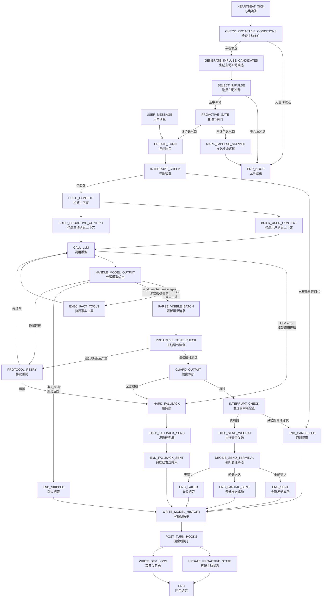
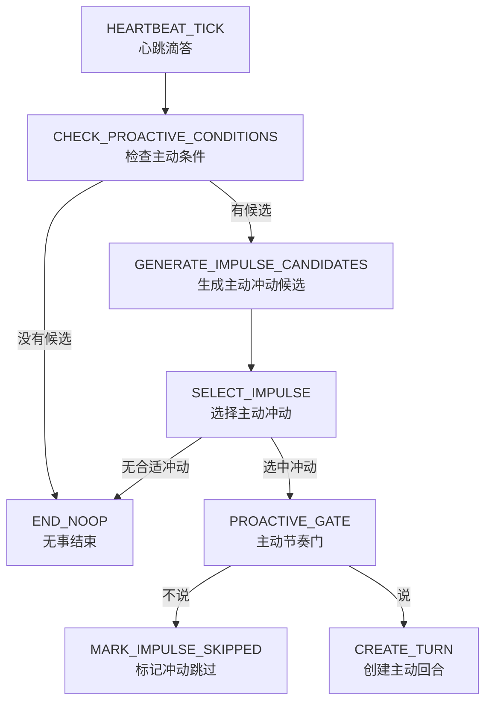
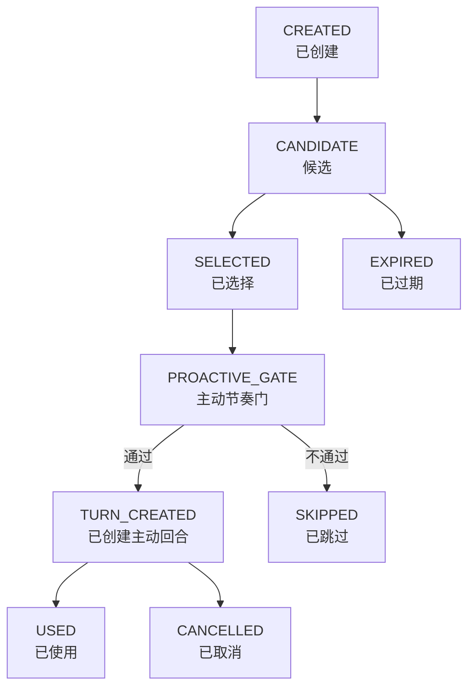

# Goal Chat Agent 第 1 层状态机图 v1.4 — 主动消息专项设计

> 文档定位：第 1 层状态机图（Level-1 State Machine Diagram）v1.4  
> 适用项目：Goal Chat Agent / 微信陪伴聊天 Agent  
> 本版主题：主动消息机制、心跳机制、定时触发、主动冲动、主动回合、用户回复主动消息识别。  
> 设计方向：把主动消息从“定时提醒/通知”升级为“AI 的关系性主动发起能力”。  
> 不处理范围：轻量模型路由、完整记忆系统、情绪引擎、联网搜索、复杂任务助手能力。

---

## 0. v1.4 的设计目标与范围

`v1.4` 的目标不是增加一个简单的定时发消息功能，而是补齐微信陪伴聊天的另一半能力：

```text
用户发起：用户给 AI 发消息 → AI 回复用户
主动发起：AI 主动想起用户 → AI 给用户发消息 → 用户回复 AI
```

因此，本版把主动消息定义为：

```text
AI 在某个时间点产生“想起用户、想和用户说句话”的主动冲动，
经过节奏判断、上下文构建、模型生成、输出保护、微信发送后，
形成一条真实微信可见消息。
```

本版重点解决：

```text
1. AI 为什么会在这一刻想起用户。
2. AI 主动说的话怎样不像系统通知。
3. 主动消息怎样接入原有主链路。
4. 用户回复主动消息后，系统怎样接住上下文。
5. 定时任务怎样变成“主动冲动”，而不是直接变成通知。
```

---

## 1. 核心设计原则

### 1.1 主动消息不是通知

错误定位：

```text
到点了 → 系统发一条提醒
```

正确定位：

```text
某个时刻 / 某段关系余温 / 某个未完成话题
让 AI 产生“我想起了你”的冲动
→ AI 自然开口
```

主动消息要表达的是：

```text
我想起了你。
```

不是：

```text
我有信息要告诉你。
```

### 1.2 主动消息和被动回复同等重要

本系统不是网页端问答助手，而是微信陪伴聊天 Agent。

因此主动消息不是附属功能，而是和用户消息同等级的回合来源：

| 回合来源 | 中文说明 | 作用 |
|---|---|---|
| `USER_MESSAGE` | 用户消息 | 用户发起聊天，AI 回复。 |
| `PROACTIVE_IMPULSE` | 主动冲动 | AI 发起聊天，用户回复。 |

### 1.3 主动消息不能绕过主发送链路

主动消息虽然是 AI 主动发起，但仍然必须走统一主链路：

```text
CREATE_TURN
→ BUILD_CONTEXT
→ CALL_LLM
→ send_wechat_messages / skip_reply
→ GUARD_OUTPUT
→ EXEC_SEND_WECHAT
→ WRITE_MODEL_HISTORY
→ POST_TURN_HOOKS
```

禁止：

```text
心跳直接发微信
定时任务直接发微信
主动冲动直接发微信
模板池绕过模型直接发微信
```

### 1.4 主动消息允许“没事找你”

微信陪伴感来自关系，而不只是信息。

所以主动消息允许：

```text
没事冒泡
轻轻关心
延续刚才的话题
表达想起用户
表达陪伴感
```

但禁止：

```text
编造现实观察
假装自己真的看见用户在做什么
把系统任务伪装成感情
连续多条自说自话
像通知、客服、 productivity app
```

---

## 2. 总状态机图

本版在原主链路前新增主动消息入口：



说明：

```text
USER_MESSAGE 和 PROACTIVE_IMPULSE 最终都进入 CREATE_TURN。
区别不在发送链路，而在上下文构建方式。
```

---

## 3. 术语定义

| 英文字段 | 中文说明 | 大白话解释 |
|---|---|---|
| `HEARTBEAT_TICK` | 心跳滴答 | 系统定期醒来一次。 |
| `CHECK_PROACTIVE_CONDITIONS` | 检查主动条件 | 看现在有没有可能适合主动开口。 |
| `GENERATE_IMPULSE_CANDIDATES` | 生成主动冲动候选 | 生成几个“想说话的念头”。 |
| `IMPULSE` | 主动冲动 | AI 想起用户、想说句话的念头。 |
| `SELECT_IMPULSE` | 选择主动冲动 | 从多个念头里选一个最自然的。 |
| `PROACTIVE_GATE` | 主动节奏门 | 判断这个念头此刻适不适合说出口。 |
| `PROACTIVE_CONTEXT` | 主动消息上下文 | 给模型看的主动开口背景。 |
| `PROACTIVE_TONE_CHECK` | 主动语气检查 | 检查是否像通知、客服、编造事实。 |
| `assistant:proactive` | 主动助手消息 | 写入历史时标记这是 AI 主动发的。 |
| `reply_to_proactive` | 回复主动消息 | 用户正在回复上一条主动消息。 |
| `END_NOOP` | 无事结束 | 心跳醒来但没有任何动作。 |

---

## 4. 心跳机制设计

### 4.1 心跳的定位

`HEARTBEAT_TICK`（心跳滴答）表示系统定期醒来。

它的职责是：

```text
检查有没有主动消息的可能性。
```

它不是：

```text
定时发送器
消息生成器
微信发送器
```

心跳不能直接发微信。

### 4.2 心跳触发频率

建议第一版配置：

```yaml
proactive:
  heartbeat:
    enabled: true
    interval_seconds: 300
    jitter_seconds: 60
```

含义：

| 字段 | 中文说明 | 建议 |
|---|---|---|
| `interval_seconds` | 心跳间隔秒数 | 第一版 300 秒，即 5 分钟。 |
| `jitter_seconds` | 随机抖动秒数 | 避免每次整点触发，显得像机器。 |

### 4.3 心跳后的可能结果



---

## 5. 主动冲动 `IMPULSE` 设计

### 5.1 为什么需要主动冲动

如果只有定时任务，主动消息会很像：

```text
到点提醒。
```

如果只有模型随机生成，主动消息会缺少稳定的触发理由。

所以需要中间层：

```text
IMPULSE（主动冲动）
```

它表示：

```text
系统内部认为 AI 此刻有一个想对用户说话的理由。
```

### 5.2 主动冲动字段

| 字段 | 中文说明 | 说明 |
|---|---|---|
| `impulse_id` | 主动冲动编号 | 每个冲动唯一。 |
| `user_id` | 用户编号 | 对应微信用户或会话。 |
| `impulse_type` | 主动冲动类型 | 如回声型、存在型、未完成话题型。 |
| `trigger_source` | 触发来源 | 心跳、定时点、最近对话、未完成话题等。 |
| `trigger_reason` | 内部触发原因 | 给系统和模型看的原因，不一定原样发给用户。 |
| `source_context` | 来源上下文 | 最近聊天片段、话题快照、时间信息。 |
| `strength` | 冲动强度 | 数值越高越值得说出口。 |
| `created_at` | 创建时间 | 冲动生成时间。 |
| `expires_at` | 过期时间 | 过期后不再使用。 |
| `status` | 冲动状态 | `CANDIDATE`、`SELECTED`、`USED`、`SKIPPED`、`EXPIRED`。 |
| `skip_reason` | 跳过原因 | 如时机不合适、重复、上一条未回复等。 |

### 5.3 主动冲动状态机



---

## 6. 主动冲动类型

第一版建议启用 5 类。

### 6.1 `ECHO`（回声型）

来源：最近对话余波。

适合场景：

```text
用户之前说累、烦、困、崩、开心、纠结。
过一段时间，AI 想起这件事，轻轻接一下。
```

例子：

```text
刚刚突然想到你下午说好累，不知道现在有没有缓过来一点。
```

特点：

```text
最有陪伴感。
最应该优先做。
```

### 6.2 `PRESENCE`（存在型）

来源：关系维持。

适合场景：

```text
没有具体事件，但 AI 想冒个泡。
```

例子：

```text
没啥事，就是突然想来冒个泡。
```

特点：

```text
表达“我在”。
不要包装成提醒。
```

### 6.3 `UNFINISHED_TOPIC`（未完成话题型）

来源：之前聊到一半的话题。

适合场景：

```text
用户之前在聊 bug、项目、纠结的选择、情绪问题。
聊天中断后，AI 后续自然补一句。
```

例子：

```text
我刚才还在想你那个 bug，感觉你先别急着大改，先抓触发条件。
```

特点：

```text
像真人真的把刚才的话放在心上。
```

### 6.4 `EMOTIONAL_CARE`（情绪牵挂型）

来源：最近几轮明显有低落、疲惫、压力。

适合场景：

```text
用户连续表达疲惫、烦躁、压力。
AI 过一段时间主动关心。
```

例子：

```text
我感觉你这两天一直在硬扛，今天先别把自己逼太狠。
```

特点：

```text
不需要完整情绪系统，第一版可基于最近历史粗判断。
```

### 6.5 `TIME_ATMOSPHERE`（时间氛围型）

来源：时间点带来的聊天氛围。

适合场景：

```text
早上、午后、深夜、周末等。
```

错误表达：

```text
现在是晚上 11 点，请注意休息。
```

正确表达：

```text
都这个点了，突然有点想叫你别硬撑。
```

特点：

```text
重点不是提醒时间，而是借时间表达关系。
```

---

## 7. 定时任务设计

### 7.1 定时任务不是直接发送

本版不允许：

```text
SCHEDULED_TASK → EXEC_SEND_WECHAT
```

只允许：

```text
SCHEDULED_TASK
→ GENERATE_IMPULSE_CANDIDATES
→ SELECT_IMPULSE
→ PROACTIVE_GATE
→ CREATE_TURN
```

也就是说，定时任务只能产生主动冲动，不能直接发微信。

### 7.2 定时任务类型

| 类型 | 英文字段 | 中文说明 | 第一版是否建议 |
|---|---|---|---|
| 固定时间氛围 | `FIXED_TIME_ATMOSPHERE` | 早安、晚安、深夜冒泡等 | 建议 |
| 长时间未联系 | `LONG_SILENCE` | 用户很久没发消息后轻轻出现 | 建议 |
| 对话余波延迟 | `DELAYED_ECHO` | 用户说完某件事后，过一段时间回声式关心 | 强烈建议 |
| 未完成话题延迟 | `TOPIC_REVISIT` | 对刚才未完的话题补一句 | 建议 |
| 明确用户提醒 | `USER_SET_REMINDER` | 用户明确要求提醒 | 后续可做 |

### 7.3 定时任务字段

| 字段 | 中文说明 | 说明 |
|---|---|---|
| `schedule_id` | 定时任务编号 | 每个定时规则唯一。 |
| `schedule_type` | 定时类型 | 固定时间、长沉默、延迟回声等。 |
| `user_id` | 用户编号 | 对应会话。 |
| `next_run_at` | 下次检查时间 | 心跳到点后检查。 |
| `enabled` | 是否启用 | 可开关。 |
| `payload` | 任务载荷 | 存放触发所需参数，不存最终文案。 |
| `last_triggered_at` | 上次触发时间 | 用于节奏控制。 |

### 7.4 定时任务输出

定时任务输出的不是消息文本，而是：

```text
ImpulseCandidate
主动冲动候选
```

例如：

```json
{
  "impulse_type": "ECHO",
  "trigger_source": "DELAYED_ECHO",
  "trigger_reason": "用户下午说自己很累，现在已经过了 3 小时，适合轻轻关心一下。",
  "strength": 0.82
}
```

---

## 8. 主动节奏门 `PROACTIVE_GATE`

### 8.1 主动节奏门的定位

`PROACTIVE_GATE` 不是为了把主动消息压到很少。

它的职责是：

```text
判断这个主动冲动此刻说出来像不像一个真实微信联系人。
```

它控制的是“关系节奏”，不是“网页端防打扰”。

### 8.2 判断维度

| 维度 | 英文字段 | 说明 |
|---|---|---|
| 最近是否刚聊过 | `recent_chat_active` | 如果刚刚还在聊，主动消息可能变成插话。 |
| 上条主动消息是否被回复 | `last_proactive_replied` | 用户回了，说明关系热度高；没回，下一条要更谨慎。 |
| 关系热度 | `relationship_temperature` | 用户最近回复积极，可更主动。 |
| 冲动强度 | `impulse_strength` | 冲动越强，越值得说出口。 |
| 类型重复 | `type_repetition` | 不要连续多次同一种主动消息。 |
| 话题连续性 | `topic_continuity` | 是否能自然接上之前的话。 |
| 当前时间氛围 | `time_atmosphere` | 深夜、早晨、午后语气不同。 |

### 8.3 第一版通过规则

建议第一版用简单规则：

```text
1. 如果用户刚刚 1-3 分钟内发过消息，不创建主动消息，避免和用户消息抢回合。
2. 如果上一条主动消息刚发出且用户没回，不连续发同类型主动消息。
3. 如果冲动类型是 ECHO 或 UNFINISHED_TOPIC，优先级高。
4. 如果冲动类型是 PRESENCE，强度低时可以跳过。
5. 如果当前存在正在运行的用户回合，主动冲动等待或过期。
6. 如果冲动过期，不补发。
```

### 8.4 主动节奏门结果

| 结果 | 中文说明 | 流转 |
|---|---|---|
| `ALLOW` | 允许说出口 | 创建主动回合。 |
| `DELAY` | 延迟 | 保留冲动，稍后再检查。 |
| `SKIP` | 跳过 | 标记冲动已跳过。 |
| `EXPIRE` | 过期 | 标记冲动已过期。 |

---

## 9. 主动消息上下文 `PROACTIVE_CONTEXT`

### 9.1 主动消息上下文和用户消息上下文不同

用户消息回合：

```text
模型是在回答用户。
```

主动消息回合：

```text
模型是在主动开口。
```

所以主动消息必须明确告诉模型：

```text
这不是回复用户问题。
这是 AI 主动发起微信聊天。
目标是表达“我想起了你”。
```

### 9.2 主动上下文字段

| 字段 | 中文说明 | 说明 |
|---|---|---|
| `turn_source` | 回合来源 | 固定为 `PROACTIVE_IMPULSE`。 |
| `impulse_id` | 主动冲动编号 | 追踪本次主动来源。 |
| `impulse_type` | 主动冲动类型 | 回声型、存在型等。 |
| `trigger_reason` | 内部触发原因 | 给模型理解原因。 |
| `recent_history` | 最近聊天历史 | 最近 5-10 条即可。 |
| `last_user_message_at` | 用户最后消息时间 | 判断距离。 |
| `last_proactive_message` | 上一条主动消息 | 防止重复。 |
| `last_proactive_replied` | 用户是否回复上一条主动消息 | 判断关系节奏。 |
| `topic_snapshot` | 最近话题快照 | 不需要强记忆，来自近期历史。 |
| `current_time` | 当前时间 | 用于自然时间氛围。 |
| `style_instruction` | 风格约束 | 像微信真人，不像通知。 |
| `forbidden_claims` | 禁止声明 | 禁止编造现实观察。 |

### 9.3 给模型的主动开口约束

主动消息模型必须知道：

```text
1. 你不是在回答用户，而是在主动发起一句微信聊天。
2. 这句话要像“我想起了你”，不要像“我有通知给你”。
3. 可以短，可以轻，可以亲近。
4. 不要编造你看到了用户正在做什么。
5. 不要说“系统检测到”“根据记录”“现在提醒你”。
6. 不要每次都问“你现在怎么样”。
7. 可以选择 skip_reply，表示这个念头不适合说出口。
```

---

## 10. 主动消息生成链路

### 10.1 主动消息必须由模型生成

第一版允许后端生成结构化冲动，但不建议后端直接生成最终文案。

原因：

```text
模板文案会有机械感。
主动消息最重要的是自然和关系感。
```

正确方式：

```text
后端生成 impulse
模型根据 impulse + context 自然生成微信消息
```

### 10.2 模型合法输出

主动消息回合中，模型仍然只能通过终态工具结束：

```text
send_wechat_messages
skip_reply
```

含义：

| 工具 | 中文说明 | 主动消息中的含义 |
|---|---|---|
| `send_wechat_messages` | 发送微信消息 | 这个主动冲动适合说出口。 |
| `skip_reply` | 跳过回复 | 这个主动冲动不适合说出口。 |

### 10.3 `skip_reply` 不是失败

在主动消息场景中，`skip_reply` 表示：

```text
AI 有一个念头，但最后觉得不说更自然。
```

这不是错误。

它应该进入：

```text
END_SKIPPED
```

并更新主动状态。

---

## 11. 主动语气检查 `PROACTIVE_TONE_CHECK`

### 11.1 为什么需要主动语气检查

普通输出保护主要防协议泄露、危险内容、结构错误。

主动消息还需要额外检查：

```text
是不是像通知
是不是像客服
是不是像任务提醒
是不是编造事实
是不是过度解释触发原因
```

### 11.2 检查项

| 检查项 | 英文字段 | 处理方式 |
|---|---|---|
| 通知味 | `notification_tone` | 进入协议重试或清洗。 |
| 客服味 | `customer_service_tone` | 进入协议重试或清洗。 |
| 任务味 | `task_reminder_tone` | 进入协议重试或清洗。 |
| 编造现实观察 | `fabricated_observation` | 直接重试或硬兜底。 |
| 暴露系统原因 | `internal_reason_leak` | 清洗或重试。 |
| 过度连续追问 | `excessive_questioning` | 重试。 |
| 过度亲密越界 | `over_intimacy` | 清洗或重试。 |

### 11.3 不合格例子

```text
系统检测到你已经 6 小时没有说话了。
```

问题：系统味太重。

```text
现在是晚上 11 点，请注意休息。
```

问题：通知味太重。

```text
我看到你还没睡。
```

问题：编造现实观察。

```text
根据你下午的疲惫状态，我现在来关心你。
```

问题：暴露内部推理，太机械。

### 11.4 合格例子

```text
刚刚突然想到你下午说好累，不知道现在有没有缓过来一点。
```

```text
没啥事，就是来冒个泡，感觉今天少听你说两句怪怪的。
```

```text
我刚才还在想你那个 bug，先别急着大改，抓触发条件可能更稳。
```

---

## 12. 用户回复主动消息识别

### 12.1 为什么必须识别

主动消息发出后，用户下一句很可能是在回复它。

例如：

```text
AI：刚刚突然想到你下午说好累，不知道现在有没有缓过来一点。
用户：没有，还是累。
```

模型必须知道：

```text
用户这句“没有，还是累”是在回复上一条主动消息。
```

否则上下文会断。

### 12.2 识别字段

| 字段 | 中文说明 | 说明 |
|---|---|---|
| `reply_to_proactive` | 是否回复主动消息 | 布尔值。 |
| `reply_to_proactive_id` | 回复的主动消息编号 | 对应上次主动消息。 |
| `last_proactive_text` | 上一条主动消息文本 | 构建上下文时提供。 |
| `reply_delay_seconds` | 回复间隔秒数 | 判断是否仍属于同一关系流。 |

### 12.3 第一版识别规则

建议先简单：

```text
1. 如果上一条 assistant 消息是 assistant:proactive。
2. 用户在合理时间窗口内回复。
3. 中间没有新的普通用户发起回合覆盖该上下文。
4. 则标记 reply_to_proactive = true。
```

时间窗口可配置：

```yaml
proactive:
  reply_detection:
    window_seconds: 21600  # 6 小时
```

### 12.4 用户回复主动消息后的上下文

构建用户回合上下文时增加：

```text
用户正在回复你上一条主动消息。
上一条主动消息内容：xxx
主动消息类型：ECHO / PRESENCE / ...
```

这样模型才能自然接住。

---

## 13. 主动消息状态表

本版不需要完整强记忆系统，但需要主动消息运行状态。

### 13.1 `ProactiveState` 字段

| 字段 | 中文说明 | 说明 |
|---|---|---|
| `user_id` | 用户编号 | 对应微信用户。 |
| `last_user_message_at` | 用户最后消息时间 | 关系节奏判断。 |
| `last_assistant_message_at` | AI 最后消息时间 | 判断最近是否刚聊过。 |
| `last_proactive_sent_at` | 上次主动发送时间 | 主动节奏判断。 |
| `last_proactive_id` | 上次主动消息编号 | 用于回复识别。 |
| `last_proactive_text` | 上次主动消息文本 | 用于上下文。 |
| `last_proactive_type` | 上次主动消息类型 | 避免连续重复。 |
| `last_proactive_user_replied` | 用户是否回复上次主动消息 | 判断关系热度。 |
| `recent_proactive_count` | 近期主动次数 | 用于关系节奏。 |
| `relationship_temperature` | 关系热度 | 简单数值即可。 |
| `topic_snapshot` | 最近话题快照 | 只保存短期话题，不等于长期记忆。 |
| `pending_impulse_ids` | 待处理主动冲动 | 心跳候选。 |

### 13.2 `relationship_temperature` 更新规则

第一版可以简单：

| 用户行为 | 变化 |
|---|---:|
| 用户回复主动消息 | `+1` |
| 用户快速回复主动消息 | `+2` |
| 用户长时间不回复主动消息 | `-1` |
| 用户明确表示不想聊 | `-3` |
| 普通聊天持续进行 | `+1` |

用途：

```text
关系热度高：主动消息可以更自然、更频繁一点。
关系热度低：主动消息更轻、更少、更短。
```

---

## 14. 主动消息历史写入

### 14.1 主动消息必须特殊标记

主动消息发送成功后，写入模型历史时必须标记为：

```text
assistant:proactive
```

不能写成普通：

```text
assistant
```

更不能写成：

```text
user
```

### 14.2 写入规则

| 终态 | 主动消息历史写入 | 说明 |
|---|---|---|
| `END_SENT` | 写入 `assistant:proactive` | 只写确认送达内容。 |
| `END_PARTIAL_SENT` | 写入确认送达部分 | 未送达不写。 |
| `END_SKIPPED` | 不写可见消息历史 | 可写开发日志。 |
| `END_FAILED` | 不写 assistant 历史 | 避免模型以为发过。 |
| `END_CANCELLED` | 不写 assistant 历史 | 被用户新消息打断。 |

### 14.3 用户回复主动消息历史

用户回复主动消息时，用户消息仍写为普通 `user`，但带元数据：

```text
reply_to_proactive = true
reply_to_proactive_id = xxx
```

这样后续模型知道关系流。

---

## 15. 中断规则

主动消息尤其需要中断检查，因为它可能和用户新消息撞车。

### 15.1 必须中断检查的位置

| 位置 | 中文说明 | 原因 |
|---|---|---|
| `PROACTIVE_GATE` 通过后 | 创建主动回合前 | 防止刚好用户发来消息。 |
| `CREATE_TURN` 后 | 创建回合后 | 保持主链路一致。 |
| `CALL_LLM` 返回后 | 模型返回后 | 模型生成期间用户可能发消息。 |
| `PROACTIVE_TONE_CHECK` 前 | 语气检查前 | 避免处理过期主动消息。 |
| `EXEC_SEND_WECHAT` 前 | 发送前 | 最关键，防止旧主动消息发出。 |

### 15.2 中断后的处理

如果主动消息被用户新消息打断：

```text
进入 END_CANCELLED
不发送主动消息
不写 assistant:proactive 历史
标记 impulse = CANCELLED
用户消息进入新的 USER_MESSAGE 回合
```

---

## 16. 错误处理

### 16.1 冲动生成错误

| 错误 | 中文说明 | 流转 |
|---|---|---|
| `impulse_generation_failed` | 冲动生成失败 | 记录日志，`END_NOOP`。 |
| `invalid_impulse_payload` | 冲动结构错误 | 丢弃冲动，记录日志。 |
| `proactive_state_load_failed` | 主动状态读取失败 | 降级为只用最近历史，或 `END_NOOP`。 |

### 16.2 主动模型输出错误

| 错误 | 中文说明 | 流转 |
|---|---|---|
| `assistant.content only` | 只输出普通文本 | `PROTOCOL_RETRY`。 |
| `no terminal tool` | 未调用终态工具 | `PROTOCOL_RETRY`。 |
| `notification_tone` | 通知味过重 | `PROTOCOL_RETRY`。 |
| `fabricated_observation` | 编造现实观察 | `PROTOCOL_RETRY`，超限后跳过或兜底。 |
| `guard_blocked_all` | 输出保护全部拦截 | `HARD_FALLBACK` 或 `END_SKIPPED`。 |

### 16.3 主动消息是否需要硬兜底

主动消息不同于用户消息。

如果用户主动发消息而系统失败，可以硬兜底告诉用户系统出错。

但如果是 AI 主动消息失败，第一版建议：

```text
优先 END_SKIPPED / END_FAILED，不主动发送硬兜底。
```

原因：

```text
用户本来没有发消息。
如果主动消息生成失败，却发一条“我出错了”，很出戏。
```

只有在系统已经准备发送、且部分状态需要一致性时，才考虑硬兜底。

---

## 17. 配置建议

```yaml
proactive:
  enabled: true

  heartbeat:
    enabled: true
    interval_seconds: 300
    jitter_seconds: 60

  impulse:
    enabled_types:
      - ECHO
      - PRESENCE
      - UNFINISHED_TOPIC
      - EMOTIONAL_CARE
      - TIME_ATMOSPHERE
    default_ttl_seconds: 7200
    max_pending_impulses: 20

  gate:
    min_seconds_after_user_message: 180
    min_seconds_between_same_type: 10800
    allow_presence_type: true
    prefer_echo_type: true

  reply_detection:
    window_seconds: 21600

  tone_check:
    reject_notification_tone: true
    reject_fabricated_observation: true
    reject_internal_reason_leak: true

  history:
    proactive_role: assistant:proactive
```

说明：

```text
这些数值只是第一版建议，后续应根据真实体验调整。
重点不是固定频率，而是关系节奏。
```

---

## 18. 最低验收标准

实现后至少必须通过以下验收：

1. `HEARTBEAT_TICK` 不能直接发送微信。
2. 定时任务不能直接发送微信，只能生成主动冲动候选。
3. 主动消息必须通过 `CREATE_TURN` 进入主链路。
4. 主动消息必须调用 `send_wechat_messages` 或 `skip_reply` 才能结束。
5. 主动消息必须经过 `GUARD_OUTPUT`。
6. 主动消息发送前必须执行 `INTERRUPT_CHECK`。
7. 用户新消息到达时，未发送的主动消息必须取消。
8. 发送成功的主动消息必须写为 `assistant:proactive`。
9. 发送失败、取消、跳过的主动消息不能写入普通 assistant 历史。
10. 用户回复主动消息时，必须标记 `reply_to_proactive = true`。
11. 主动消息上下文必须告诉模型“这是 AI 主动开口，不是在回答用户”。
12. 主动消息不能像系统通知。
13. 主动消息不能暴露“系统检测到”“根据记录”“触发条件”等内部原因。
14. 主动消息不能编造现实观察。
15. `skip_reply` 在主动消息中必须视为正常终态，不是失败。
16. 上一条主动消息未被回复时，不能短时间连续发送同类型主动消息。
17. `ECHO` 回声型主动消息应优先支持。
18. `PRESENCE` 存在型主动消息允许“没事冒泡”，但不能模板化。
19. 主动消息的内部 `trigger_reason` 必须写开发日志，但不能直接暴露给用户。
20. 主动消息失败时，默认不主动发送“出错兜底消息”，避免出戏。

---

## 19. 第一版推荐实现顺序

### Phase 1：主动状态与历史标记

```text
新增 ProactiveState
支持 assistant:proactive 历史写入
支持 reply_to_proactive 识别
```

目标：

```text
先让系统知道哪些消息是 AI 主动发的，哪些用户消息是在回复主动消息。
```

### Phase 2：心跳与主动冲动

```text
新增 HEARTBEAT_TICK
新增 GENERATE_IMPULSE_CANDIDATES
新增 IMPULSE 数据结构
```

目标：

```text
系统能产生“想起用户”的念头，但还不急着大量发送。
```

### Phase 3：主动回合接入主链路

```text
PROACTIVE_IMPULSE → CREATE_TURN → BUILD_PROACTIVE_CONTEXT → CALL_LLM
```

目标：

```text
主动消息和用户消息一样走统一主链路。
```

### Phase 4：主动语气检查

```text
新增 PROACTIVE_TONE_CHECK
拦截通知味、客服味、编造现实观察
```

目标：

```text
主动消息像微信联系人，不像系统通知。
```

### Phase 5：体验调节

```text
调整主动类型比例
调整关系热度
调整心跳间隔
调整主动消息风格
```

目标：

```text
从“能主动”变成“主动得自然”。
```

---

## 20. 本版一句话总结

`v1.4` 的核心不是做一个定时提醒系统，而是给微信陪伴 Agent 增加“主动想起用户并自然开口”的能力。

最终目标：

```text
AI 不是等用户来问才存在。
AI 也能在合适的时候轻轻发来一句：
“刚刚突然想到你。”
```
