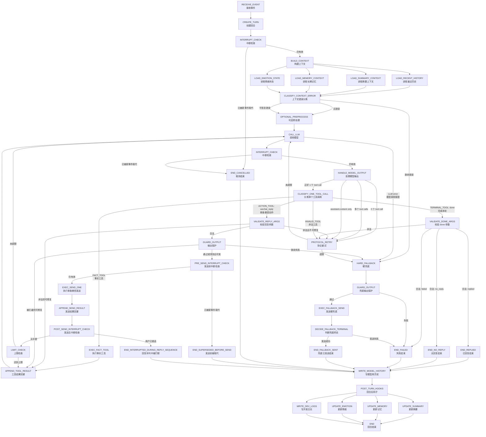
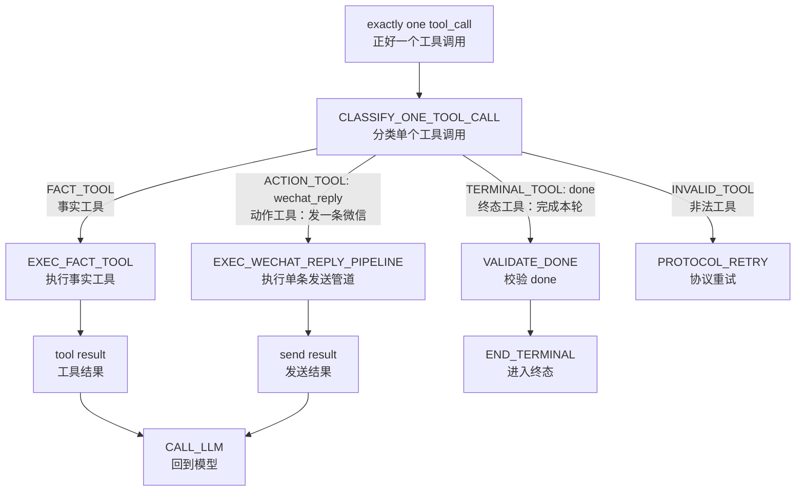
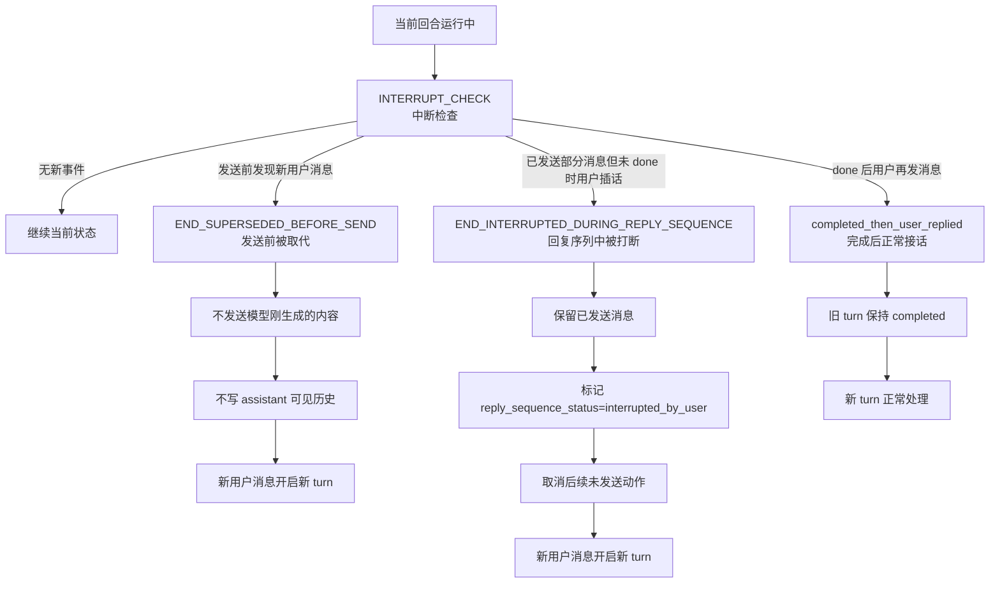
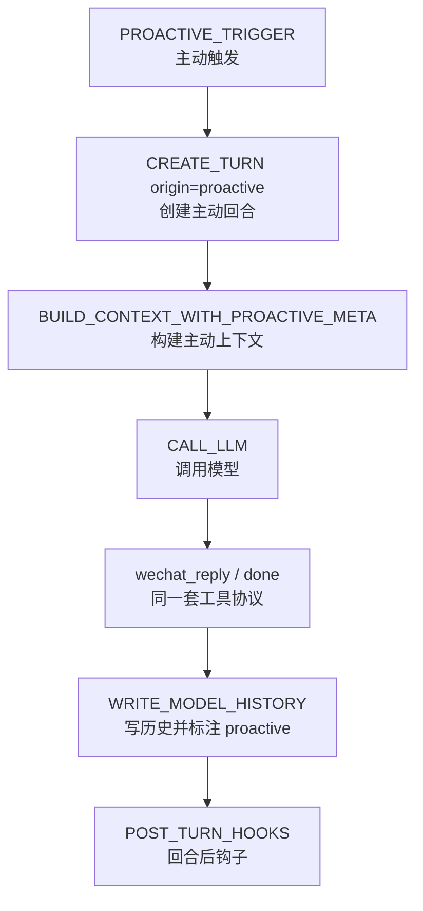
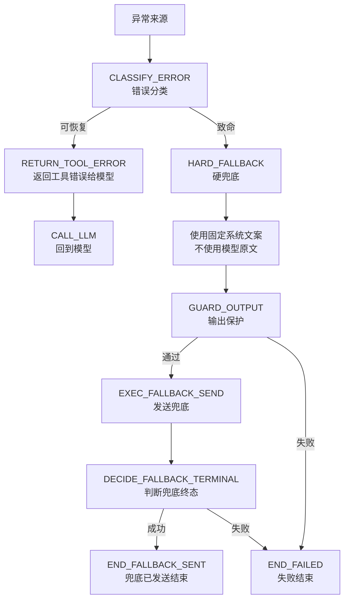

# Goal Chat Agent 严格 CC 因果链状态机设计 v1.5

> 适用项目：Goal Chat Agent / 微信聊天 Agent  
> 文档定位：第 0 层状态机与工具契约重设计  
> 当前阶段：从批量数组发送模式迁移到严格 CC 因果链模式  
> 核心目标：把“微信气泡”从后端批量数组元素，提升为模型的一次显式发送动作。模型每发一条微信，都必须调用一次 `wechat_reply`，收到真实发送结果后，再自行决定是否继续发下一条，最终用 `done` 显式结束本轮。

---

## 0. 本文档解决什么问题

当前系统已经能做到“微信端显示多条气泡”，但底层并不是模型逐条发送。

旧模式是：

```text
模型一次调用 send_wechat_messages(messages=["第一条", "第二条", "第三条"])
→ 后端解析 messages 数组
→ 后端循环发送多条微信
→ 回合结束
```

这个模式的问题是：

1. 模型不是一条一条发，而是一次性提交数组。
2. 模型不知道自己已经真实发出了第几条。
3. 模型不能在第一条发送成功后，再决定是否补第二条。
4. 发送工具是终态工具，一调用就结束本轮。
5. 发送结果不回灌模型，模型没有真实动作反馈。
6. 主动消息如果继续沿用批量发送，会再次形成两套发送系统。
7. 微信端“看起来像多条”容易误导排查，但底层因果链不真实。

因此，本设计只解决一件事：

> 让模型像 Claude Code / MCP `wechat_reply` 一样，按真实微信聊天动作逐条发送。

新模式是：

```text
模型调用 wechat_reply(text="第一条")
→ 后端真实发送一条微信
→ 工具结果 ok 回灌模型
→ 模型基于“第一条已经发送”的事实，决定是否继续
→ 模型调用 wechat_reply(text="第二条")
→ 后端真实发送第二条微信
→ 工具结果 ok 回灌模型
→ 模型调用 done(status="replied")
→ 回合结束
```

核心区别：

> 旧模式是“后端替模型拆开发送”。  
> 新模式是“模型自己逐条行动”。

---

## 1. 核心设计原则

### 1.1 一条微信气泡 = 一次模型工具调用

任何用户最终能在微信里看到的一条气泡，都必须对应一次模型原生工具调用：

```text
wechat_reply(text="一条微信内容")
```

禁止：

```text
send_wechat_messages(messages=["第一条", "第二条"])
```

禁止：

```text
wechat_reply(text="第一条\n第二条")
```

大白话：

> 模型想发几条，就调用几次 `wechat_reply`。  
> 后端不能替模型把一段话拆成多条，也不能替模型把数组循环发送。

---

### 1.2 `wechat_reply` 不是终态工具

`wechat_reply` 只是一个发送动作，不代表本轮结束。

正确流程：

```text
wechat_reply
→ 发送一条微信
→ 工具结果回灌模型
→ 回到 CALL_LLM
→ 模型继续决定下一步
```

禁止：

```text
wechat_reply
→ 直接 END_SENT
```

否则就会退回旧模式：模型发完一条后没有机会补一句。

---

### 1.3 `done` 是唯一正常终态工具

每一轮必须由模型显式调用：

```text
done(status, note)
```

来结束。

允许：

```text
wechat_reply → done(status="replied")
```

允许：

```text
done(status="no_reply")
```

禁止让模型“不调用任何工具”来表示结束。

原因：后端不能猜模型到底是“判断不用回复”，还是“忘了调用工具”，还是“模型输出异常”。

---

### 1.4 每次 LLM 输出只能有一个 tool call

严格 CC 因果链要求：模型必须等上一条真实发送结果回来后，再决定下一步。

因此每次模型响应只能包含一个工具调用。

允许：

```text
第 1 次 LLM 输出：wechat_reply("第一条")
工具结果：ok
第 2 次 LLM 输出：wechat_reply("第二条")
工具结果：ok
第 3 次 LLM 输出：done(status="replied")
```

禁止：

```text
同一次 LLM 输出：
wechat_reply("第一条")
wechat_reply("第二条")
done(status="replied")
```

这看起来也是“一条一个工具”，但它不是严格因果链，因为模型没有等待第一条发送成功后再决定第二条。

---

### 1.5 工具结果必须回灌模型，但不能重复原文

`wechat_reply` 执行后，工具结果必须作为 tool result 回灌模型。

成功结果示例：

```json
{
  "status": "ok",
  "delivery": "sent",
  "message_index": 1
}
```

不要返回：

```json
{
  "status": "ok",
  "text": "刚刚发出的原文"
}
```

原因：模型自己的上一条 tool call 里已经有原文，tool result 再重复原文容易导致模型复读。

---

### 1.6 主动消息必须走同一套状态机

主动消息不是独立发送系统。

正确流程：

```text
PROACTIVE_TRIGGER
→ CREATE_TURN
→ BUILD_CONTEXT
→ CALL_LLM
→ wechat_reply / done
```

禁止：

```text
主动消息模块
→ 直接发微信
```

主动消息也必须满足：

> 一条气泡 = 一次 `wechat_reply` = 一次真实发送结果回灌。

---

## 2. 英文字段与术语说明

| 字段 / 名词 | 中文含义 | 说明 |
|---|---|---|
| `wechat_reply` | 微信回复工具 | 模型每调用一次，只发送一条微信气泡 |
| `done` | 完成本轮工具 | 模型显式结束本轮的终态工具 |
| `status` | 结束状态 | `done` 的结果分类，如 `replied` / `no_reply` / `failed` |
| `note` | 简短说明 | `done` 的原因说明，主要用于日志和调试 |
| `action tool` | 动作工具 | 会执行动作，但不结束本轮的工具 |
| `terminal tool` | 终态工具 | 一调用就结束本轮的工具，本设计中只有 `done` |
| `fact tool` | 事实工具 | 查询事实信息，如时间、天气，结果回灌模型 |
| `state tool` | 状态工具 | 修改内部状态，如记忆建议、标签更新，执行后继续回到模型 |
| `tool result` | 工具结果 | 工具执行后回灌给模型的结构化结果 |
| `reply sequence` | 回复序列 | 一轮中模型连续发出的多条微信气泡组成的序列 |
| `message_index` | 消息序号 | 本轮内第几条成功发送的微信气泡 |
| `idempotency_key` | 幂等键 | 防止同一次工具调用被重复发送的唯一键 |
| `interrupted_by_user` | 被用户打断 | 回复序列未正常 done，用户新消息已到达 |
| `superseded_before_send` | 发送前被取代 | 模型生成了发送动作，但发送前用户新消息到达，因此不发送旧内容 |
| `completed` | 已完成 | 模型已调用 `done`，本轮正常结束 |
| `protocol retry` | 协议重试 | 模型未按工具协议输出时，系统要求其重新输出 |
| `guard` | 输出保护 | 发送前检查可见内容是否允许发送 |
| `hard fallback` | 硬兜底 | 正常流程失败时使用系统固定文案，不使用模型原文 |

---

## 3. 工具契约

### 3.1 `wechat_reply(text)`

作用：发送一条微信气泡。

```json
{
  "text": "要发送给用户的一条微信消息"
}
```

规则：

1. 一次调用只发送一条微信气泡。
2. `text` 必须是字符串。
3. `text` 不能为空。
4. `text` 不能是数组。
5. `text` 不能用换行模拟多条消息。
6. `wechat_reply` 执行成功后，必须把工具结果回灌模型。
7. `wechat_reply` 不是终态工具，执行后必须回到 `CALL_LLM`。
8. 本轮成功发送条数不能超过 `MAX_REPLY_MESSAGES_PER_TURN`。

成功返回：

```json
{
  "status": "ok",
  "delivery": "sent",
  "message_index": 1
}
```

重复执行同一个幂等键时返回：

```json
{
  "status": "ok",
  "delivery": "already_sent",
  "message_index": 1
}
```

可修复错误返回：

```json
{
  "status": "error",
  "recoverable": true,
  "reason": "message_too_long",
  "hint": "请缩短后重新调用 wechat_reply"
}
```

不可修复错误返回：

```json
{
  "status": "error",
  "recoverable": false,
  "reason": "wechat_sender_unavailable",
  "hint": "发送通道不可用，本轮无法继续发送"
}
```

---

### 3.2 `done(status, note)`

作用：显式结束本轮。

```json
{
  "status": "replied | no_reply | failed",
  "note": "简短说明"
}
```

状态含义：

| `status` | 中文含义 | 使用条件 |
|---|---|---|
| `replied` | 已回复完成 | 本轮已经成功发送过至少一条 `wechat_reply` |
| `no_reply` | 不需要回复 | 本轮没有发送任何微信，模型判断不需要打扰用户 |
| `failed` | 失败结束 | 发生不可继续的失败，模型选择结束 |

校验规则：

| 当前情况 | 合法 `done.status` | 非法 `done.status` |
|---|---|---|
| `sent_count > 0` | `replied`, `failed` | `no_reply` |
| `sent_count = 0` | `no_reply`, `failed` | `replied` |

示例：已回复完成

```json
{
  "status": "replied",
  "note": "已完成本轮回复"
}
```

示例：不需要回复

```json
{
  "status": "no_reply",
  "note": "用户只是自然结束话题，不需要继续回复"
}
```

示例：失败结束

```json
{
  "status": "failed",
  "note": "微信发送通道不可用，无法继续发送"
}
```

---

## 4. 工具分类规则

| 工具类型 | 工具 | 中文含义 | 执行后流转 |
|---|---|---|---|
| `FACT_TOOL` | `get_time`, `get_weather` | 事实工具 | 执行后结果回灌模型，回到 `CALL_LLM` |
| `ACTION_TOOL` | `wechat_reply` | 动作工具 | 执行真实发送，结果回灌模型，回到 `CALL_LLM` |
| `TERMINAL_TOOL` | `done` | 终态工具 | 校验通过后进入终态 |
| `STATE_TOOL` | 未来记忆/标签/状态工具 | 状态工具 | 执行后回到 `CALL_LLM` 或失败 |
| `INVALID_TOOL` | 未注册工具 / 旧工具 | 非法工具 | 进入 `PROTOCOL_RETRY` |

关键变化：

```text
wechat_reply 不是 terminal tool。
done 才是 terminal tool。
```

---

## 5. 工具调用组合规则

严格 CC 因果链下，每次模型响应只允许一个工具调用。

| 工具组合 | 是否允许 | 处理方式 |
|---|---:|---|
| 1 个 `FACT_TOOL` | 允许 | 执行后回灌模型 |
| 1 个 `wechat_reply` | 允许 | 发送一条微信，结果回灌模型 |
| 1 个 `done` | 允许 | 校验后进入终态 |
| 0 个 tool call | 禁止 | `PROTOCOL_RETRY` |
| 多个 tool calls | 禁止 | `PROTOCOL_RETRY`，不执行任何工具 |
| `wechat_reply` + `done` 同时出现 | 禁止 | `PROTOCOL_RETRY` |
| 多个 `wechat_reply` 同时出现 | 禁止 | `PROTOCOL_RETRY` |
| 旧工具 `send_wechat_messages` | 禁止 | `PROTOCOL_RETRY`，提示工具已废弃 |
| 旧工具 `skip_reply` | 禁止 | `PROTOCOL_RETRY`，提示使用 `done(status="no_reply")` |
| `assistant.content` 直接回复 | 禁止 | `PROTOCOL_RETRY` |

---

## 6. 第 0 层状态机总览



---

## 7. 主状态说明

| 状态 | 中文含义 | 责任 |
|---|---|---|
| `RECEIVE_EVENT` | 接收事件 | 接收用户消息、主动触发、系统事件 |
| `CREATE_TURN` | 创建回合 | 创建唯一 turn，并记录来源、输入序号、截止时间 |
| `INTERRUPT_CHECK` | 中断检查 | 判断当前回合是否已被新事件取代 |
| `BUILD_CONTEXT` | 构建上下文 | 加载历史、摘要、记忆、情绪状态、主动触发元数据 |
| `CALL_LLM` | 调用模型 | 调用 LLM Gateway，暴露 `wechat_reply`、`done` 和事实工具 |
| `HANDLE_MODEL_OUTPUT` | 处理模型输出 | 检查是否正好一个 native tool call |
| `CLASSIFY_ONE_TOOL_CALL` | 分类单个工具调用 | 将工具分为事实、动作、终态、非法 |
| `EXEC_FACT_TOOL` | 执行事实工具 | 查询时间、天气等，结果回灌模型 |
| `VALIDATE_REPLY_ARGS` | 校验回复参数 | 检查 `wechat_reply(text)` 是否符合单条微信要求 |
| `GUARD_OUTPUT` | 输出保护 | 发送前检查可见内容 |
| `PRE_SEND_INTERRUPT_CHECK` | 发送前中断检查 | 发送前确认用户没有新消息插入 |
| `EXEC_SEND_ONE` | 执行单条微信发送 | 只发送当前这一条微信气泡 |
| `APPEND_SEND_RESULT` | 发送结果回灌 | 把 ok/error 工具结果喂回模型，不返回原文 |
| `POST_SEND_INTERRUPT_CHECK` | 发送后中断检查 | 判断已发一条后，用户是否已插话 |
| `LIMIT_CHECK` | 上限检查 | 检查本轮发送条数、LLM 步数、失败次数是否超限 |
| `VALIDATE_DONE_ARGS` | 校验 done 参数 | 校验 `status` 与本轮发送事实是否一致 |
| `PROTOCOL_RETRY` | 协议重试 | 模型未按协议调用工具时提醒重试 |
| `HARD_FALLBACK` | 硬兜底 | 使用固定系统文案，不使用模型原文 |
| `WRITE_MODEL_HISTORY` | 写模型用历史 | 只写真实发生且模型需要知道的内容 |
| `POST_TURN_HOOKS` | 回合后钩子 | 更新摘要、记忆、情绪、开发日志 |

---

## 8. 工具分类状态图



规则：

1. `wechat_reply` 是动作工具，不是终态工具。
2. `done` 是唯一正常终态工具。
3. 事实工具与 `wechat_reply` 一样，执行后都必须回灌模型。
4. 旧工具 `send_wechat_messages` 和 `skip_reply` 不再是合法工具。

---

## 9. 单条微信发送路径状态图

```mermaid
flowchart TD
    A[wechat_reply(text)<br/>模型请求发一条微信] --> B[VALIDATE_REPLY_ARGS<br/>校验参数]
    B -->|非法但可修复| R1[RETURN_RECOVERABLE_ERROR<br/>返回可修复错误]
    B -->|非法且不可修复| R2[PROTOCOL_RETRY<br/>协议重试]
    B -->|合法| C[GUARD_OUTPUT<br/>输出保护]

    C -->|通过| D[PRE_SEND_INTERRUPT_CHECK<br/>发送前中断检查]
    C -->|清洗后可发| D
    C -->|可修复拦截| R1
    C -->|致命失败| X[HARD_FALLBACK<br/>硬兜底]

    D -->|已被新事件取代| Z1[END_SUPERSEDED_BEFORE_SEND<br/>发送前被取代]
    D -->|仍有效| E[EXEC_SEND_ONE<br/>执行单条发送]

    E -->|成功| F[RECORD_VISIBLE_MESSAGE<br/>记录已发送可见消息]
    E -->|可修复失败| R1
    E -->|不可修复失败| R3[RETURN_FATAL_ERROR<br/>返回不可修复错误]

    F --> G[APPEND_SEND_TOOL_RESULT<br/>回灌发送结果]
    R1 --> G
    R3 --> G

    G --> H[POST_SEND_INTERRUPT_CHECK<br/>发送后中断检查]
    H -->|用户已插话| Z2[END_INTERRUPTED_DURING_REPLY_SEQUENCE<br/>回复序列中被打断]
    H -->|无中断| I[LIMIT_CHECK<br/>上限检查]
    I -->|未超限| J[CALL_LLM<br/>模型继续决定]
    I -->|达到上限| K[RETURN_MAX_LIMIT_RESULT<br/>要求 done 结束]
    K --> J
```

关键约束：

1. 每次只发送一条。
2. 发送前必须 guard。
3. 发送前必须检查中断。
4. 发送成功后必须记录可见历史候选。
5. 发送结果必须回灌模型。
6. 发送结果不能带原文。
7. 发送后如果用户插话，进入 `END_INTERRUPTED_DURING_REPLY_SEQUENCE`。
8. 未调用 `done` 前，本轮不能算完整完成。

---

## 10. `done` 终态路径状态图

```mermaid
flowchart TD
    A[done(status,note)<br/>模型声明本轮结束] --> B[VALIDATE_DONE_ARGS<br/>校验参数]
    B -->|status 非法| R[PROTOCOL_RETRY<br/>协议重试]
    B -->|sent_count=0 且 status=replied| R
    B -->|sent_count>0 且 status=no_reply| R
    B -->|status=replied 合法| Z1[END_REPLIED<br/>已回复结束]
    B -->|status=no_reply 合法| Z2[END_NO_REPLY<br/>无回复结束]
    B -->|status=failed 合法| Z3[END_FAILED<br/>失败结束]

    Z1 --> C[reply_sequence_status=completed<br/>回复序列已完成]
    Z2 --> D[reply_sequence_status=no_reply<br/>无回复完成]
    Z3 --> E[reply_sequence_status=failed<br/>失败完成]
```

规则：

1. `done(status="replied")` 要求本轮至少成功发送过一条微信。
2. `done(status="no_reply")` 要求本轮没有发送过微信。
3. `done(status="failed")` 可用于发送失败、工具不可用、无法继续。
4. `done` 成功后才算模型正常完成本轮。

---

## 11. 中断机制状态图



必须区分三种情况：

| 情况 | 旧 turn 状态 | 是否写 assistant 历史 | 下一轮模型应理解 |
|---|---|---:|---|
| 发送前被取代 | `END_SUPERSEDED_BEFORE_SEND` | 否 | 那条内容用户没看到 |
| 回复序列中被打断 | `END_INTERRUPTED_DURING_REPLY_SEQUENCE` | 是，只写已发送内容并标中断 | 我上一轮可能没说完，用户插话了 |
| done 后用户再回复 | `END_REPLIED` / `END_NO_REPLY` | 按正常规则写 | 上一轮完整结束，正常接话 |

---

## 12. 上下文与历史写入规则

### 12.1 给模型看的历史只保存真实发生的内容

允许写入：

- 用户真实消息。
- 成功发送到微信的 assistant 消息。
- 主动消息成功发送内容，并标注 `assistant:proactive`。
- 被用户打断前已经成功发送的 assistant 消息，并标注回复序列被打断。

禁止写入：

- 未发送成功的消息。
- 发送前被取代的消息。
- 工具错误详情。
- 协议重试提示。
- guard 拦截原因。
- 开发日志。
- 旧 JSON actions。
- 模型没有通过 `wechat_reply` 发送的普通文本。

---

### 12.2 单条发送历史示例

```json
{
  "role": "assistant",
  "content": "看完了，整体方向是对的",
  "meta": {
    "turn_id": "turn_xxx",
    "source": "wechat_reply",
    "message_index": 1,
    "delivery_status": "sent",
    "reply_sequence_status": "in_progress"
  }
}
```

正常 done 后更新：

```json
{
  "reply_sequence_status": "completed"
}
```

被用户打断后更新：

```json
{
  "reply_sequence_status": "interrupted_by_user",
  "interruption_type": "during_reply_sequence"
}
```

---

## 13. 历史写入矩阵

| 终态 | 写用户消息 | 写 assistant 消息 | 写回复序列状态 | 写记忆候选 | 写开发日志 |
|---|---:|---:|---|---:|---:|
| `END_REPLIED` | 是 | 是，全部成功发送消息 | `completed` | 是 | 是 |
| `END_NO_REPLY` | 是 | 否 | `no_reply` | 视情况 | 是 |
| `END_FAILED` | 可写 | 只写已确认发送成功的内容 | `failed` 或部分失败 | 否或谨慎 | 是 |
| `END_FALLBACK_SENT` | 是 | 不建议写普通 assistant 历史 | `fallback` | 否 | 是 |
| `END_CANCELLED` | 视是否被新回合吸收 | 否 | `cancelled` | 否 | 是 |
| `END_SUPERSEDED_BEFORE_SEND` | 由新回合处理 | 否 | `superseded_before_send` | 否 | 是 |
| `END_INTERRUPTED_DURING_REPLY_SEQUENCE` | 新消息由新回合处理 | 是，只写已发送内容 | `interrupted_by_user` | 基于已发送内容谨慎提取 | 是 |
| `END_MAX_LIMIT` | 是 | 是，已发送内容 | `max_limit_reached` | 谨慎 | 是 |
| `END_PROTOCOL_ERROR` | 可写 | 否 | `protocol_error` | 否 | 是 |

原则：

> 历史只记录用户真实看见的内容，以及模型下一轮理解对话所必须知道的元信息。

---

## 14. 主动消息接入规则

主动消息作为 `TURN_SOURCE` 接入同一状态机。



主动消息上下文必须告诉模型：

```text
这是你主动发起的一轮，不是用户刚刚发消息。
主动触发原因是：xxx。
你可以选择 wechat_reply，也可以选择 done(status="no_reply")。
```

主动消息限制：

1. 不能绕过模型直接发送。
2. 不能绕过 guard。
3. 不能走旧批量数组工具。
4. 必须使用 `wechat_reply` / `done`。
5. 必须标注 `origin=proactive`。
6. 建议主动消息设置更低 soft limit，例如 2～3 条，避免打扰用户。
7. 全局 hard limit 仍可沿用 15 条，但主动消息正常不应触发。

---

## 15. 上限与循环控制

### 15.1 推荐常量

| 常量 | 建议值 | 含义 |
|---|---:|---|
| `MAX_REPLY_MESSAGES_PER_TURN` | 15 | 一轮最多成功发送 15 条微信气泡 |
| `MAX_LLM_STEPS_PER_TURN` | 25～30 | 一轮最多模型循环次数 |
| `MAX_FACT_TOOL_CALLS_PER_TURN` | 3 | 一轮最多事实工具调用次数 |
| `MAX_PROTOCOL_RETRIES_PER_TURN` | 2 | 协议错误最多重试次数 |
| `MAX_SEND_FAILURES_PER_TURN` | 2 | 发送失败最多修复/重试次数 |
| `PROACTIVE_SOFT_REPLY_LIMIT` | 2～3 | 主动消息建议软上限 |

### 15.2 为什么不能沿用旧 `MAX_TOOL_LOOP = 5`

严格 CC 模式下：

```text
15 条微信 = 至少 15 次 wechat_reply 工具调用
最后还需要 1 次 done
中途可能还有 get_time / get_weather
还可能有协议重试
```

所以旧的 5 次工具循环不够。

### 15.3 达到发送上限后的处理

达到 `MAX_REPLY_MESSAGES_PER_TURN` 后，工具结果回灌模型：

```json
{
  "status": "error",
  "recoverable": false,
  "reason": "max_reply_messages_reached",
  "hint": "本轮微信消息数量已达上限，请调用 done 结束。"
}
```

如果模型仍继续调用 `wechat_reply`，进入：

```text
END_MAX_LIMIT
```

---

## 16. 错误分类规则

### 16.1 可恢复错误

例子：

- `text` 为空。
- `text` 太长。
- `text` 像 JSON/数组/多条批量内容。
- guard 拦截但允许重新表达。
- 临时事实工具失败。

处理：

```text
返回 recoverable error tool result
→ 回到 CALL_LLM
→ 让模型修正、重发或 done
```

---

### 16.2 不可恢复错误

例子：

- 微信发送器不可用。
- 工具注册表不可用。
- 模型 API 连续失败。
- 状态机内部异常，无法判断下一状态。
- guard 系统不可用且无法安全兜底。

处理：

```text
返回 fatal error tool result 或进入 HARD_FALLBACK
→ 无法继续时 END_FAILED
```

---

## 17. 兜底路径状态图



兜底规则：

1. 硬兜底不使用模型普通文本。
2. 硬兜底也必须经过 guard。
3. 硬兜底成功不算正常 `END_REPLIED`。
4. 硬兜底失败进入 `END_FAILED`。
5. 硬兜底不应写入普通 assistant 历史，除非单独标记为 `assistant:fallback`。

---

## 18. 幂等设计

严格 CC 模式下，每一次 `wechat_reply` 都是真实发送动作，必须有幂等保护。

推荐：

```text
idempotency_key = turn_id + tool_call_id
```

或：

```text
idempotency_key = turn_id + reply_index
```

更推荐：

```text
turn_id + tool_call_id
```

原因：同一次工具调用因网络重试、MCP 重放、后端重试而再次执行时，`tool_call_id` 更能表示“同一次模型动作”。

处理规则：

```text
如果 idempotency_key 未发送过：真实发送。
如果 idempotency_key 已成功发送过：不重复发送，返回 already_sent。
```

返回示例：

```json
{
  "status": "ok",
  "delivery": "already_sent",
  "message_index": 2
}
```

---

## 19. 日志设计

新日志必须能证明：

> 多条微信到底是模型多次调用 `wechat_reply`，还是后端循环发送。

每轮必须记录：

| 字段 | 含义 |
|---|---|
| `turn_id` | 回合 ID |
| `origin` | `user` / `proactive` / `system` |
| `llm_step` | 第几次模型调用 |
| `tool_name` | 工具名 |
| `tool_call_id` | 工具调用 ID |
| `reply_index` | 第几条成功发送的微信 |
| `sent_count` | 本轮已发送数量 |
| `done_status` | `done.status` |
| `interrupt_status` | 中断状态 |
| `reply_sequence_status` | 回复序列状态 |
| `terminal_state` | 最终终态 |

`wechat_reply` 日志示例：

```text
state_machine: tool_call step=3 name=wechat_reply tool_call_id=call_xxx
state_machine: reply_args valid=True len=18 has_newline=False preview="看完了，整体方向是对的"
state_machine: guard result=pass
state_machine: pre_send_interrupt interrupted=False
state_machine: send_one result=ok reply_index=1 idempotency_key=turn_xxx_call_xxx
state_machine: append_tool_result status=ok delivery=sent message_index=1
state_machine: post_send_interrupt interrupted=False
```

`done` 日志示例：

```text
state_machine: tool_call step=5 name=done status=replied sent_count=2
state_machine: terminal_state=END_REPLIED reply_sequence_status=completed
```

打断日志示例：

```text
state_machine: post_send_interrupt interrupted=True latest_seq=9 input_latest_seq=7
state_machine: terminal_state=END_INTERRUPTED_DURING_REPLY_SEQUENCE sent_count=1
```

---

## 20. 新架构必须删除或隔离的旧逻辑

以下旧逻辑不能进入新状态机：

1. `send_wechat_messages(messages=[...])` 作为模型可见工具。
2. `skip_reply` 作为模型可见工具。
3. `assistant.content` 直接发送微信。
4. 旧 JSON actions 解析。
5. 后端把一个数组循环发送多条微信的模型可见主路径。
6. `wechat_reply` 被分类为 terminal tool。
7. 发送成功后不回灌模型。
8. 模型一次输出多个 tool calls 并被后端顺序执行。
9. 发送结果返回原文导致模型复读。
10. 主动消息绕过 `wechat_reply` / `done`。

可以短期保留为迁移期诊断或内部兼容代码，但不能暴露给模型，也不能作为合法主流程。

---

## 21. 扩展口权限表

| 扩展口 | 中文含义 | 允许做 | 禁止做 |
|---|---|---|---|
| `TURN_SOURCE` | 回合来源 | 接入用户消息、主动消息、系统事件 | 绕过统一状态机 |
| `BUILD_CONTEXT` | 构建上下文 | 加载历史、摘要、记忆、情绪、主动触发元数据 | 塞入开发日志、未送达消息、旧 JSON |
| `OPTIONAL_PREPROCESS` | 可选预处理 | 预取事实、轻量分类 | 直接生成回复、直接发微信 |
| `HANDLE_MODEL_OUTPUT` | 处理模型输出 | 检查是否正好一个 native tool call | 接受普通文本直接回复 |
| `HANDLE_TOOL_CALL` | 处理工具调用 | 分类并执行单个工具 | 同时执行多个工具 |
| `GUARD_OUTPUT` | 输出保护 | 过滤可见输出 | 被任何发送路径绕过 |
| `WECHAT_SENDER` | 微信发送器 | 发送一条已 guard 的微信 | 接收批量数组作为模型主路径 |
| `POST_TURN_HOOKS` | 回合后钩子 | 更新摘要、记忆、情绪、日志 | 修改终态、补发微信 |
| `MEMORY_LAYER` | 记忆层 | 读相关记忆、写审核后记忆 | 记录未送达、猜测、错误内容 |

---

## 22. 终态定义

| 终态 | 中文含义 | 是否算正常回复成功 | 是否有可见输出 | 说明 |
|---|---|---:|---:|---|
| `END_REPLIED` | 已回复结束 | 是 | 是 | 模型成功发送至少一条微信，并调用 `done(status="replied")` |
| `END_NO_REPLY` | 无回复结束 | 是，属于合法决策 | 否 | 模型未发送微信，并调用 `done(status="no_reply")` |
| `END_FAILED` | 失败结束 | 否 | 不一定 | 无法继续或模型调用 `done(status="failed")` |
| `END_FALLBACK_SENT` | 兜底已发送结束 | 否 | 是 | 系统硬兜底成功发送 |
| `END_CANCELLED` | 取消结束 | 否 | 否 | 回合被新事件取代，未进入发送动作 |
| `END_SUPERSEDED_BEFORE_SEND` | 发送前被取代 | 否 | 否 | 模型生成了发送动作，但发送前用户插话，旧内容不发 |
| `END_INTERRUPTED_DURING_REPLY_SEQUENCE` | 回复序列中被打断 | 部分成功 | 是 | 已发送部分微信，但未 done 前用户插话 |
| `END_MAX_LIMIT` | 达到上限结束 | 部分成功或失败 | 可能有 | 达到发送/循环上限后强制结束 |
| `END_PROTOCOL_ERROR` | 协议错误结束 | 否 | 否 | 模型多次不遵守工具协议 |
| `END_ABORTED_BY_SYSTEM` | 系统中止 | 否 | 否 | 系统关闭、依赖不可用、内部异常 |

---

## 23. 第 0 层不做什么

第 0 层状态机不负责：

1. 具体 prompt 文案。
2. 具体人设风格。
3. 具体记忆召回算法。
4. 具体情绪计算公式。
5. 具体天气 API 实现。
6. 具体微信 iLink 实现。
7. 具体数据库表结构。
8. 具体延迟模拟策略。
9. 具体模型路由策略。

第 0 层只负责：

> 生命周期、状态边界、工具契约、合法流转、失败出口、扩展约束。

---

## 24. 实现时的最低验收标准

实现 v1.5 状态机后，至少必须满足：

1. 模型每发一条微信，必须调用一次 `wechat_reply`。
2. `wechat_reply` 每次只发送一条微信气泡。
3. `wechat_reply` 不是终态工具。
4. `wechat_reply` 发送结果必须回灌模型。
5. `wechat_reply` 工具结果不能返回原文。
6. 模型必须最终调用 `done(status,note)` 结束本轮。
7. `done(status="replied")` 必须要求本轮已发送至少一条微信。
8. `done(status="no_reply")` 必须要求本轮未发送微信。
9. 旧工具 `send_wechat_messages` 不再暴露给模型。
10. 旧工具 `skip_reply` 不再暴露给模型。
11. `assistant.content` 永远不能直接成为微信消息。
12. 模型一次响应多个 tool calls 时，不执行任何一个，进入协议重试。
13. 所有可见输出必须经过 guard。
14. 发送前必须做中断检查。
15. 发送后、下一次 LLM 前必须做中断检查。
16. 发送前被取代时，不发送旧内容，不写 assistant 历史。
17. 回复序列中被打断时，只写已成功发送内容，并标记 `interrupted_by_user`。
18. done 后用户再回复时，不能标记为 interrupted。
19. 主动消息必须走同一套 `wechat_reply` / `done` 状态机。
20. 日志必须能区分“模型逐条 tool call”与“后端数组循环发送”。

---

## 25. 推荐实施顺序

### Phase 1：工具层改造

目标：先把模型可见工具换干净。

1. 新增 `wechat_reply(text)`。
2. 新增 `done(status,note)`。
3. 移除模型可见 `send_wechat_messages`。
4. 移除模型可见 `skip_reply`。
5. 更新 tool schema。
6. 更新提示词工具协议。

验收：模型看不到旧批量发送工具。

---

### Phase 2：状态机主链路

目标：完成严格 CC 因果链。

1. `wechat_reply` 分类为 `ACTION_TOOL`。
2. `done` 分类为 `TERMINAL_TOOL`。
3. 每次 LLM 输出只允许一个 tool call。
4. `wechat_reply` 执行后回灌工具结果。
5. `wechat_reply` 执行后回到 `CALL_LLM`。
6. `done` 成功后进入终态。

验收：模型能 `wechat_reply → tool ok → wechat_reply → tool ok → done`。

---

### Phase 3：打断与历史元数据

目标：避免接话错乱。

1. 实现 `END_SUPERSEDED_BEFORE_SEND`。
2. 实现 `END_INTERRUPTED_DURING_REPLY_SEQUENCE`。
3. 区分 `completed_then_user_replied`。
4. 写入 `reply_sequence_status` 元数据。
5. 历史只保存已发送内容。

验收：用户插话后，模型知道上一轮是否没说完。

---

### Phase 4：主动消息并入

目标：主动消息不再拥有独立发送路径。

1. `PROACTIVE_TRIGGER` 进入同一状态机。
2. 上下文标注 `origin=proactive`。
3. 主动消息使用同一套 `wechat_reply` / `done`。
4. 主动消息设置 soft limit。
5. 主动消息历史标注 `assistant:proactive`。

验收：主动消息也是模型逐条工具调用，不是后端直接发。

---

## 26. 回归测试清单

### 26.1 单条回复

流程：

```text
用户：在吗
模型：wechat_reply("在")
工具：ok
模型：done(status="replied")
```

期望：

```text
发送 1 条微信
terminal_state = END_REPLIED
reply_sequence_status = completed
```

---

### 26.2 多条严格因果链

流程：

```text
模型 step1: wechat_reply("第一条")
tool result: ok
模型 step2: wechat_reply("第二条")
tool result: ok
模型 step3: done(status="replied")
```

期望：

```text
wechat_sender 被调用 2 次
每次只发送 1 条
每次发送结果都进入下一次 LLM 上下文
```

---

### 26.3 禁止一次多个 tool calls

模型同一响应输出：

```text
wechat_reply("第一条")
wechat_reply("第二条")
```

期望：

```text
不发送任何消息
进入 PROTOCOL_RETRY
```

---

### 26.4 禁止旧工具

模型调用：

```text
send_wechat_messages(messages=["第一条", "第二条"])
```

期望：

```text
不发送任何消息
进入 PROTOCOL_RETRY
提示工具已废弃
```

---

### 26.5 no_reply

模型直接：

```text
done(status="no_reply", note="话题自然结束，不需要继续回复")
```

期望：

```text
不发送微信
terminal_state = END_NO_REPLY
```

---

### 26.6 done 状态矛盾

已发送 1 条后：

```text
done(status="no_reply")
```

期望：

```text
进入 PROTOCOL_RETRY
不改变已发送事实
```

---

### 26.7 发送序列中被打断

流程：

```text
模型发送第一条成功
用户新消息到达
```

期望：

```text
旧 turn = END_INTERRUPTED_DURING_REPLY_SEQUENCE
已发送消息保留
未继续生成第二条
新 turn 上下文看到 interrupted_by_user
```

---

### 26.8 done 后正常接话

流程：

```text
模型发送第一条
模型 done(status="replied")
用户再发消息
```

期望：

```text
旧 turn = END_REPLIED
reply_sequence_status = completed
新 turn 不带 interrupted 标记
```

---

### 26.9 主动消息同路径

流程：

```text
proactive trigger
模型 wechat_reply
工具 ok
模型 done(status="replied")
```

期望：

```text
使用同一套状态机
origin = proactive
历史标注 assistant:proactive
```

---

## 27. 一句话总则

> Goal Chat Agent 的微信可见输出，不再是模型一次性提交数组后由后端循环发送；而是模型每次通过 `wechat_reply` 显式发送一条微信，系统把真实发送结果回灌模型，模型再决定下一步，最终通过 `done` 显式结束本轮。主动消息、普通聊天、未来扩展都必须走这同一条因果链。
