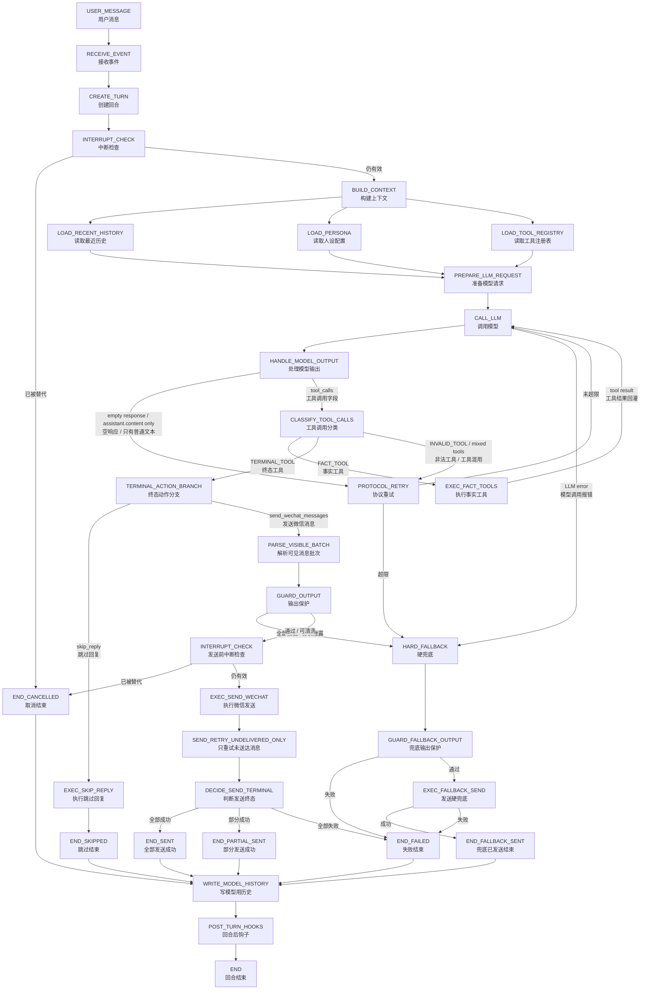

# Goal Chat Agent 第 1 层状态机图 v1

> 文档定位：第 1 层状态机图（Level-1 State Machine Diagram）  
> 设计方向：先做基础功能的整体细化改造；可单独添加的功能延迟设计。  
> 适用项目：Goal Chat Agent / 微信聊天 Agent  
> 基准来源：`Goal Chat Agent 底层架构设计总则 v0.2`、`Goal Chat Agent 第 0 层状态机图 v0.2`

---

## 0. 本轮 v1 的设计边界

本轮 `v1`（第 1 版）只细化基础主链路，目标是把当前微信聊天 Agent 的核心回合跑稳。

本轮重点不是增加功能，而是把“用户消息进来以后，模型如何决策、如何调用工具、如何发送、如何写历史、如何结束”这条链路设计清楚。

### 0.1 本轮必须细化的基础功能

| 模块 | 是否本轮细化 | 说明 |
|---|---:|---|
| `USER_MESSAGE`（用户消息） | 是 | 当前唯一必须完整实现的回合来源。 |
| `CREATE_TURN`（创建回合） | 是 | 每条用户消息必须形成一个明确 `turn`（回合）。 |
| `BUILD_CONTEXT`（构建上下文） | 是 | 读取人设、最近历史、必要摘要、工具注册表。 |
| `CALL_LLM`（调用模型） | 是 | 调用 LLM Gateway（模型网关）。 |
| `native tool calls`（原生工具调用）协议 | 是 | 只认 API 返回的结构化工具调用字段。 |
| `FACT_TOOL`（事实工具） | 是 | 支持 `get_time`（获取时间）、`get_weather`（获取天气）等基础事实工具。 |
| `TERMINAL_TOOL`（终态工具） | 是 | 支持 `send_wechat_messages`（发送微信消息）、`skip_reply`（跳过回复）。 |
| `GUARD_OUTPUT`（输出保护） | 是 | 所有微信可见输出必须经过保护。 |
| `EXEC_SEND_WECHAT`（执行微信发送） | 是 | 真正调用微信发送器。 |
| `SEND_RETRY_UNDELIVERED_ONLY`（只重试未送达消息） | 是 | 防止重复发送已送达消息。 |
| `WRITE_MODEL_HISTORY`（写模型用历史） | 是 | 只写真实发生、模型需要知道的对话内容。 |
| `POST_TURN_HOOKS`（回合后钩子） | 是 | 先提供钩子结构，可先做摘要/日志，其他能力可空实现。 |

### 0.2 本轮只保留接口、不细化实现的功能

| 模块 | 本轮处理方式 | 延迟原因 |
|---|---|---|
| `PROACTIVE_TRIGGER`（主动消息触发） | 只保留入口 | 主动消息是独立复杂功能，容易干扰主链路稳定。 |
| `FULL_MEMORY_SYSTEM`（完整记忆系统） | 只保留接口和边界 | 记忆写入需要审核、去重、防污染，适合单独设计。 |
| `EMOTION_ENGINE`（情绪引擎） | 只保留读写位置 | 情绪计算不应影响基础发送链路。 |
| `STATE_TOOL_SET`（状态工具集合） | 只保留分类规则 | 第一版不建议开放自由 `write_memory`（写记忆）。 |
| `SCHEDULED_EVENT`（定时事件） | 只保留来源类型 | 定时任务与主动消息类似，后续接入。 |
| `SYSTEM_RESUME`（系统恢复触发） | 只保留来源类型 | 需要单独设计恢复语义。 |
| `search_web`（联网搜索） / `read_calendar`（读取日历） | 延迟 | 可作为未来 `FACT_TOOL`（事实工具）接入。 |
| 多 bot、多账号、复杂权限 | 延迟 | 不是当前基础功能。 |

---

## 1. v1 总状态机图：基础功能版

这张图是本轮核心。它只覆盖基础用户消息链路，主动消息、完整记忆、情绪引擎等能力只作为未来扩展点保留。




---

## 2. `CREATE_TURN`（创建回合）细化

`CREATE_TURN`（创建回合）的职责不是处理消息内容，而是把一次输入变成可追踪、可取消、可落终态的回合。

### 2.1 输入

| 字段 | 中文说明 | 来源 |
|---|---|---|
| `source` | 来源 | 当前为 `USER_MESSAGE`（用户消息）。 |
| `user_id` | 用户标识 | 微信用户或会话标识。 |
| `raw_message` | 原始消息 | 用户真实输入文本。 |
| `received_at` | 接收时间 | 系统接收事件的时间。 |
| `conversation_id` | 会话标识 | 当前聊天会话。 |

### 2.2 输出

| 字段 | 中文说明 | 说明 |
|---|---|---|
| `turn_id` | 回合 ID | 本轮唯一 ID。 |
| `turn_source` | 回合来源 | 当前主要为 `USER_MESSAGE`（用户消息）。 |
| `turn_status` | 回合状态 | 初始为 `RUNNING`（运行中）。 |
| `interrupt_token` | 中断令牌 | 用于判断当前回合是否被新事件替代。 |
| `scratchpad` | 本轮临时区 | 当前回合内部临时数据，不长期保存。 |

### 2.3 禁止行为

- 禁止在 `CREATE_TURN`（创建回合）里生成回复。
- 禁止在 `CREATE_TURN`（创建回合）里发送微信。
- 禁止把主动消息、记忆、情绪逻辑塞进这里。

---

## 3. `BUILD_CONTEXT`（构建上下文）细化

`BUILD_CONTEXT`（构建上下文）的职责是给模型准备“它应该知道的信息”，不是替模型做决策。

### 3.1 本轮基础上下文组件

| 子状态 | 中文说明 | 本轮是否必须 | 失败策略 |
|---|---|---:|---|
| `LOAD_SYSTEM_PROMPT` | 读取基础系统提示词 | 是 | 失败为 `FATAL_ERROR`（致命错误）。 |
| `LOAD_PERSONA` | 读取人设配置 | 是 | 失败可用默认人设，若默认也失败则致命。 |
| `LOAD_RECENT_HISTORY` | 读取最近历史 | 是 | 失败可降级为空历史并记录日志。 |
| `LOAD_SUMMARY_CONTEXT` | 读取摘要上下文 | 可选 | 失败可降级继续。 |
| `LOAD_TOOL_REGISTRY` | 读取工具注册表 | 是 | 失败为致命错误。 |
| `VALIDATE_TOOL_SCHEMA` | 校验工具结构 | 是 | 失败为致命错误。 |
| `LOAD_MEMORY_CONTEXT` | 读取长期记忆 | 本轮可空实现 | 失败可降级继续。 |
| `LOAD_EMOTION_STATE` | 读取情绪状态 | 本轮可空实现 | 失败可降级继续。 |

### 3.2 上下文包输出

`BUILD_CONTEXT`（构建上下文）输出 `CONTEXT_PACKAGE`（上下文包）。

`CONTEXT_PACKAGE`（上下文包）至少包含：

```text
system_prompt（系统提示词）
persona（人设配置）
recent_history（最近历史）
tool_registry（工具注册表）
current_user_message（当前用户消息）
turn_metadata（回合元信息）
```

可选包含：

```text
summary_context（摘要上下文）
memory_context（长期记忆上下文）
emotion_state（情绪状态）
pre_fetched_facts（预取事实）
```

### 3.3 禁止进入模型上下文的内容

| 内容 | 原因 |
|---|---|
| `DEV_LOG`（开发日志） | 这是给开发者看的，不是给模型聊天用的。 |
| 发送失败的 assistant 消息 | 用户没看到，模型不能当成已经说过。 |
| 未送达消息 | 同上。 |
| `PROTOCOL_RETRY`（协议重试）内部提示 | 会污染聊天语气。 |
| `GUARD_OUTPUT`（输出保护）拦截原因 | 内部安全细节，不该进入普通上下文。 |
| 旧 JSON actions | 新架构不承认旧协议。 |

---

## 4. `CALL_LLM`（调用模型）与协议循环细化


模型这一段必须坚持一条规则：**模型普通文本不能直接发微信。**

### 4.1 合法输出

模型合法结束本轮只能通过 `TERMINAL_TOOL`（终态工具）：

```text
send_wechat_messages（发送微信消息）
skip_reply（跳过回复）
```

### 4.2 非法输出

以下情况进入 `PROTOCOL_RETRY`（协议重试）：

| 情况 | 中文说明 | 处理 |
|---|---|---|
| `empty response` | 空响应 | 提醒模型必须调用终态工具。 |
| `assistant.content only` | 只有模型普通文本 | 不直接发微信，进入协议重试。 |
| `old JSON actions` | 旧 JSON 动作 | 不解析，不兼容，进入协议重试。 |
| `INVALID_TOOL` | 非法工具 | 进入协议重试。 |
| `TERMINAL_TOOL + FACT_TOOL` | 终态工具和事实工具混用 | 进入协议重试。 |
| multiple `TERMINAL_TOOL` | 多个终态工具 | 进入协议重试。 |

### 4.3 协议重试规则

建议 `PROTOCOL_RETRY`（协议重试）最多 1 次。

```text
第一次违规 → PROTOCOL_RETRY（协议重试）→ 回到 CALL_LLM（调用模型）
第二次仍违规 → HARD_FALLBACK（硬兜底）
```

原因：微信聊天是实时系统，不能让模型在协议错误里反复循环。

---

## 5. 工具分类与执行规则

本轮基础功能只需要完整支持 `FACT_TOOL`（事实工具）和 `TERMINAL_TOOL`（终态工具）。

### 5.1 `FACT_TOOL`（事实工具）

作用：查询事实信息，结果回灌模型。

本轮建议保留：

| 工具 | 中文说明 | 说明 |
|---|---|---|
| `get_time` | 获取时间 | 查询当前时间。 |
| `get_weather` | 获取天气 | 查询天气。 |

流转：

```text
模型调用 FACT_TOOL（事实工具）
→ EXEC_FACT_TOOLS（执行事实工具）
→ tool result（工具结果）回灌模型
→ CALL_LLM（调用模型）
```

限制：

- `FACT_TOOL`（事实工具）不能直接发微信。
- `FACT_TOOL`（事实工具）不能写 assistant 历史。
- `FACT_TOOL`（事实工具）不能决定终态。

### 5.2 `TERMINAL_TOOL`（终态工具）

作用：结束当前回合。

本轮必须支持：

| 工具 | 中文说明 | 说明 |
|---|---|---|
| `send_wechat_messages` | 发送微信消息 | 唯一正常发送可见回复的入口。 |
| `skip_reply` | 跳过回复 | 明确表示本轮不回复。 |

限制：

- `TERMINAL_TOOL`（终态工具）不能和其他工具混用。
- 同一轮不能同时调用多个 `TERMINAL_TOOL`（终态工具）。
- `send_wechat_messages`（发送微信消息）执行后，发送结果不能回灌模型。
- `skip_reply`（跳过回复）必须显式调用，不能靠空消息列表猜测。

### 5.3 `STATE_TOOL`（状态工具）

`STATE_TOOL`（状态工具）本轮只保留分类概念，不建议启用具体工具。

如果模型调用未注册的状态工具，例如：

```text
write_memory（写记忆）
update_user_tags（更新用户标签）
```

处理方式：

```text
未注册 → INVALID_TOOL（非法工具）→ PROTOCOL_RETRY（协议重试）
```

未来如果要开放 `STATE_TOOL`（状态工具），必须满足：

```text
EXEC_STATE_TOOLS（执行状态工具）
→ CLASSIFY_TOOL_ERROR（工具错误分类）
→ CALL_LLM（调用模型）
→ 继续要求模型调用 TERMINAL_TOOL（终态工具）
```

---

## 6. 发送链路细化


发送链路是本系统最重要的硬边界。任何用户能在微信看到的内容，都必须经过这里。

### 6.1 `PARSE_VISIBLE_BATCH`（解析可见消息批次）

输入：`send_wechat_messages`（发送微信消息）工具参数。

输出：`visible_batch`（可见消息批次）。

基础校验：

| 校验项 | 说明 | 失败去向 |
|---|---|---|
| 参数结构 | 必须是合法消息列表 | `PROTOCOL_RETRY`（协议重试） |
| 消息数量 | 不允许无限多条 | `PROTOCOL_RETRY`（协议重试）或裁剪后 guard |
| 消息文本 | 不能为空、不能全是空白 | `PROTOCOL_RETRY`（协议重试） |
| 消息类型 | 本轮默认只支持文本 | 非文本延迟设计 |

### 6.2 `GUARD_OUTPUT`（输出保护）

输出保护负责检查所有微信可见内容。

| 结果 | 处理 |
|---|---|
| 全部通过 | 进入发送前中断检查。 |
| 可安全清洗 | 使用清洗后文本进入发送前中断检查。 |
| 全部拦截 | 进入 `HARD_FALLBACK`（硬兜底）。 |
| 检测到协议泄露 | 进入 `HARD_FALLBACK`（硬兜底）。 |
| 参数结构错误 | 优先 `PROTOCOL_RETRY`（协议重试），超限后硬兜底。 |

协议泄露示例：

```text
我将调用 send_wechat_messages 工具...
tool_calls: ...
{"name":"send_wechat_messages"}
```

这些内容绝不能发给微信用户。

### 6.3 `EXEC_SEND_WECHAT`（执行微信发送）

`EXEC_SEND_WECHAT`（执行微信发送）只做一件事：调用微信发送器，把已经通过 `GUARD_OUTPUT`（输出保护）的消息发出去。

它不能：

- 自己生成新回复。
- 修改模型语义。
- 把发送结果回灌模型。
- 把失败消息伪装成成功。

### 6.4 `SEND_RETRY_UNDELIVERED_ONLY`（只重试未送达消息）

重试原则：只重试未送达消息，绝不重发已送达消息。

建议策略：

```text
初始发送 1 次
失败消息最多重试 2 次
总尝试最多 3 轮
```

### 6.5 `DECIDE_SEND_TERMINAL`（判断发送终态）

| 发送结果 | 终态 |
|---|---|
| 全部成功 | `END_SENT`（全部发送成功） |
| 部分成功 | `END_PARTIAL_SENT`（部分发送成功） |
| 全部失败 | `END_FAILED`（失败结束） |

---

## 7. 终态定义与历史写入矩阵

### 7.1 终态定义

| 终态 | 中文说明 | 是否正常成功 | 是否有可见输出 |
|---|---|---:|---:|
| `END_SENT` | 全部发送成功 | 是 | 是 |
| `END_PARTIAL_SENT` | 部分发送成功 | 部分成功 | 是 |
| `END_SKIPPED` | 跳过结束 | 是，属于合法决策 | 否 |
| `END_FALLBACK_SENT` | 兜底已发送结束 | 否 | 是 |
| `END_FAILED` | 失败结束 | 否 | 否 |
| `END_CANCELLED` | 取消结束 | 否 | 否 |

### 7.2 历史写入矩阵


| 终态 | 写用户消息 | 写 assistant 消息 | 写开发日志 | 说明 |
|---|---:|---:|---:|---|
| `END_SENT`（全部发送成功） | 是 | 是，全部成功送达消息 | 是 | 正常成功。 |
| `END_PARTIAL_SENT`（部分发送成功） | 是 | 只写成功送达部分 | 是 | 失败部分不能进模型历史。 |
| `END_SKIPPED`（跳过结束） | 是 | 否 | 是 | 模型明确决定不回复。 |
| `END_FALLBACK_SENT`（兜底已发送结束） | 是 | 不写普通 assistant 历史 | 是 | 硬兜底不算正常聊天。 |
| `END_FAILED`（失败结束） | 可写 | 否 | 是 | 不写 assistant 成功回复。 |
| `END_CANCELLED`（取消结束） | 视是否被新回合吸收 | 否 | 是 | 旧回合不能继续发旧回复。 |

### 7.3 历史写入原则

`WRITE_MODEL_HISTORY`（写模型用历史）只保存模型之后聊天需要知道的真实内容。

应该写：

- 用户真实消息。
- bot 实际成功送达的回复。
- 部分成功时，只写成功送达的部分。

不应该写：

- 未送达消息。
- 发送失败消息。
- `PROTOCOL_RETRY`（协议重试）提示。
- `GUARD_OUTPUT`（输出保护）拦截原因。
- 工具报错堆栈。
- 旧 JSON actions。
- 硬兜底作为普通 assistant 聊天内容。

---

## 8. `HARD_FALLBACK`（硬兜底）细化

`HARD_FALLBACK`（硬兜底）是系统保命，不是模型正常聊天。

触发来源：

| 来源 | 中文说明 |
|---|---|
| `LLM error` | 模型调用报错 |
| `protocol retry exceeded` | 协议重试超限 |
| `guard rejected all` | 输出保护全部拦截 |
| `fatal system error` | 致命系统错误 |
| `empty response repeated` | 空响应重复出现 |

硬兜底规则：

```text
HARD_FALLBACK（硬兜底）
→ 使用固定系统文案
→ GUARD_FALLBACK_OUTPUT（兜底输出保护）
→ EXEC_FALLBACK_SEND（发送硬兜底）
→ END_FALLBACK_SENT（兜底已发送结束）或 END_FAILED（失败结束）
```

硬兜底禁止：

- 禁止使用模型原文。
- 禁止绕过 `GUARD_OUTPUT`（输出保护）。
- 禁止记为 `END_SENT`（全部发送成功）。
- 禁止写成普通 assistant 历史。

---

## 9. `POST_TURN_HOOKS`（回合后钩子）细化

`POST_TURN_HOOKS`（回合后钩子）发生在终态已经确定之后。

本轮基础实现建议：

| 钩子 | 中文说明 | 本轮策略 |
|---|---|---|
| `WRITE_DEV_LOGS` | 写开发日志 | 必须实现。 |
| `UPDATE_SUMMARY_HOOK` | 更新摘要钩子 | 可实现轻量版。 |
| `UPDATE_MEMORY_HOOK` | 更新记忆钩子 | 保留接口，可空实现。 |
| `UPDATE_EMOTION_HOOK` | 更新情绪钩子 | 保留接口，可空实现。 |
| `QUALITY_METRICS_HOOK` | 质量指标钩子 | 可选。 |

回合后钩子禁止：

- 禁止修改已经确定的终态。
- 禁止补发微信。
- 禁止把失败消息伪装成成功历史。
- 禁止把未送达内容写入记忆。
- 禁止把工具错误写入用户记忆。

---

## 10. 本轮不细化、后续可单独添加的功能


### 10.1 `PROACTIVE_TRIGGER`（主动消息触发）

本轮只保留入口，不设计触发策略。

未来接入方式：

```text
PROACTIVE_TRIGGER（主动消息触发）
→ RECEIVE_EVENT（接收事件）
→ CREATE_TURN（创建回合）
→ 进入同一基础主链路
```

未来必须遵守：

- 不能绕过模型。
- 不能绕过 `GUARD_OUTPUT`（输出保护）。
- 不能绕过微信发送终态。
- 历史中必须标注 `assistant:proactive`（助手主动消息）。

### 10.2 `FULL_MEMORY_SYSTEM`（完整记忆系统）

本轮只保留 `LOAD_MEMORY_CONTEXT`（读取长期记忆）和 `UPDATE_MEMORY_HOOK`（更新记忆钩子）。

未来单独设计：

```text
EXTRACT_MEMORY_CANDIDATES（提取记忆候选）
→ FILTER_MEMORY_CANDIDATES（过滤记忆候选）
→ DEDUPE_MEMORY（记忆去重）
→ WRITE_LONG_TERM_MEMORY（写入长期记忆）
```

第一版完整记忆仍然不建议开放自由 `write_memory`（写记忆）给模型。

### 10.3 `EMOTION_ENGINE`（情绪引擎）

本轮只保留：

```text
BUILD_CONTEXT（构建上下文）读取情绪状态
POST_TURN_HOOKS（回合后钩子）更新情绪状态
```

未来情绪引擎禁止直接发消息。

### 10.4 `STATE_TOOL_SET`（状态工具集合）

未来可加入：

| 工具 | 中文说明 |
|---|---|
| `propose_memory_update` | 提出记忆更新 |
| `update_user_tags` | 更新用户标签 |
| `record_preference` | 记录偏好 |
| `update_emotion_state` | 更新情绪状态 |

但所有 `STATE_TOOL`（状态工具）执行后必须回到 `CALL_LLM`（调用模型），继续要求模型调用终态工具。

### 10.5 新 `FACT_TOOL`（事实工具）

未来可加入：

| 工具 | 中文说明 |
|---|---|
| `search_web` | 联网搜索 |
| `read_calendar` | 读取日历 |
| `read_file` | 读取文件 |
| `retrieve_memory` | 检索记忆 |

这些工具都只能提供事实结果，不能直接生成微信回复。

---

## 11. 后续升级路线

建议按下面顺序升级，不要乱跳。

### 阶段 A：基础主链路落地

目标：把本轮 `v1`（第 1 版）完整实现。

验收重点：

- `assistant.content`（模型普通文本输出）不会直接发微信。
- 模型必须调用 `send_wechat_messages`（发送微信消息）或 `skip_reply`（跳过回复）。
- 所有可见输出经过 `GUARD_OUTPUT`（输出保护）。
- 发送结果有明确终态。
- 历史只写真实发生内容。

### 阶段 B：完整记忆系统

目标：实现长期记忆，但不污染主链路。

建议先做：

```text
POST_TURN_HOOKS（回合后钩子）自动提取记忆候选
系统审核 / 过滤 / 去重
写入 LONG_TERM_MEMORY（长期记忆）
```

### 阶段 C：主动消息

目标：把 `PROACTIVE_TRIGGER`（主动消息触发）作为新 `TURN_SOURCE`（回合来源）接入。

关键要求：主动消息必须走同一条主链路。

### 阶段 D：情绪引擎

目标：让情绪状态影响模型参考输入，但不能直接发消息。

### 阶段 E：更多事实工具

目标：加入联网搜索、日历、文件等工具。全部作为 `FACT_TOOL`（事实工具）接入。

### 阶段 F：质量指标与灰度观测

目标：统计协议违规率、fallback 率、发送失败率、部分成功率、中断率。

---

## 12. 英文字段速查表

| 英文字段 | 中文说明 | 大白话解释 |
|---|---|---|
| `USER_MESSAGE` | 用户消息 | 用户在微信里发来的消息。 |
| `RECEIVE_EVENT` | 接收事件 | 系统收到一件事，比如用户发消息。 |
| `CREATE_TURN` | 创建回合 | 给这次处理建一个独立生命周期。 |
| `turn` | 回合 | 一次完整处理过程。 |
| `turn_id` | 回合 ID | 本轮唯一编号。 |
| `TURN_SOURCE` | 回合来源 | 这轮是用户消息、主动触发还是系统事件。 |
| `PROACTIVE_TRIGGER` | 主动消息触发 | 系统主动想发消息的触发事件。 |
| `SYSTEM_RESUME` | 系统恢复触发 | 系统恢复后继续某个任务。 |
| `SCHEDULED_EVENT` | 定时事件 | 到点触发的事件。 |
| `INTERRUPT_CHECK` | 中断检查 | 看这轮是否已经被新消息取代。 |
| `END_CANCELLED` | 取消结束 | 本轮被取消，不再发送旧回复。 |
| `BUILD_CONTEXT` | 构建上下文 | 给模型准备它要看的信息。 |
| `CONTEXT_PACKAGE` | 上下文包 | 打包给模型看的信息集合。 |
| `LOAD_SYSTEM_PROMPT` | 读取系统提示词 | 读取基础系统规则。 |
| `LOAD_PERSONA` | 读取人设配置 | 读取当前 bot 的说话风格和身份设置。 |
| `LOAD_RECENT_HISTORY` | 读取最近历史 | 读取最近聊天记录。 |
| `LOAD_SUMMARY_CONTEXT` | 读取摘要上下文 | 读取较长对话的摘要。 |
| `LOAD_MEMORY_CONTEXT` | 读取长期记忆 | 读取长期保存的用户信息。 |
| `LOAD_EMOTION_STATE` | 读取情绪状态 | 读取当前情绪板块状态。 |
| `LOAD_TOOL_REGISTRY` | 读取工具注册表 | 读取模型可用工具清单。 |
| `VALIDATE_TOOL_SCHEMA` | 校验工具结构 | 检查工具参数定义是否合法。 |
| `PREPARE_LLM_REQUEST` | 准备模型请求 | 拼好发给模型的请求。 |
| `CALL_LLM` | 调用模型 | 调用 DeepSeek 或其他模型服务。 |
| `LLM error` | 模型调用报错 | 模型 API 超时、失败或异常。 |
| `HANDLE_MODEL_OUTPUT` | 处理模型输出 | 检查模型返回内容是否合法。 |
| `assistant.content` | 模型普通文本输出 | 模型直接写出来的自然语言文本。 |
| `empty response` | 空响应 | 模型什么有效内容都没返回。 |
| `tool_calls` | 工具调用字段 | 模型 API 返回的结构化工具调用。 |
| `native tool calls` | 原生工具调用 | 模型通过 API 工具字段调用工具，不是在文本里写 JSON。 |
| `CLASSIFY_TOOL_CALLS` | 工具调用分类 | 判断模型调用的是哪类工具。 |
| `FACT_TOOL` | 事实工具 | 查时间、天气等事实信息的工具。 |
| `EXEC_FACT_TOOLS` | 执行事实工具 | 真正调用事实工具。 |
| `tool result` | 工具结果 | 工具查到的结果。 |
| `TERMINAL_TOOL` | 终态工具 | 一调用就应该结束本轮的工具。 |
| `send_wechat_messages` | 发送微信消息 | 模型请求发送微信回复的终态工具。 |
| `skip_reply` | 跳过回复 | 模型明确决定本轮不回复的终态工具。 |
| `STATE_TOOL` | 状态工具 | 修改内部状态但不直接结束本轮的工具。 |
| `INVALID_TOOL` | 非法工具 | 未注册或不允许的工具。 |
| `PROTOCOL_RETRY` | 协议重试 | 模型没按协议调用工具时，再提醒一次。 |
| `TERMINAL_ACTION_BRANCH` | 终态动作分支 | 判断是发送微信还是跳过回复。 |
| `PARSE_VISIBLE_BATCH` | 解析可见消息批次 | 解析准备发给用户的消息列表。 |
| `visible_batch` | 可见消息批次 | 将要发给微信用户的一组消息。 |
| `GUARD_OUTPUT` | 输出保护 | 检查可见消息是否安全、干净、无协议泄露。 |
| `EXEC_SEND_WECHAT` | 执行微信发送 | 真正调用微信发送器。 |
| `SEND_RETRY_UNDELIVERED_ONLY` | 只重试未送达消息 | 失败时只重发没发出去的部分。 |
| `DECIDE_SEND_TERMINAL` | 判断发送终态 | 根据发送结果决定终态。 |
| `END_SENT` | 全部发送成功 | 所有消息都成功发到微信。 |
| `END_PARTIAL_SENT` | 部分发送成功 | 只有一部分消息发成功。 |
| `END_SKIPPED` | 跳过结束 | 合法决定不回复。 |
| `END_FAILED` | 失败结束 | 没有完成有效可见输出。 |
| `HARD_FALLBACK` | 硬兜底 | 系统固定保命文案，不用模型原文。 |
| `GUARD_FALLBACK_OUTPUT` | 兜底输出保护 | 兜底文案也要过输出保护。 |
| `EXEC_FALLBACK_SEND` | 发送硬兜底 | 发送系统固定兜底文案。 |
| `END_FALLBACK_SENT` | 兜底已发送结束 | 兜底发送成功，但不算正常回复成功。 |
| `WRITE_MODEL_HISTORY` | 写模型用历史 | 写入以后给模型看的真实聊天记录。 |
| `POST_TURN_HOOKS` | 回合后钩子 | 回合结束后自动做摘要、记忆、日志等。 |
| `WRITE_DEV_LOGS` | 写开发日志 | 写给开发者排查问题的日志。 |
| `UPDATE_SUMMARY_HOOK` | 更新摘要钩子 | 回合后更新摘要。 |
| `UPDATE_MEMORY_HOOK` | 更新记忆钩子 | 回合后更新记忆。 |
| `UPDATE_EMOTION_HOOK` | 更新情绪钩子 | 回合后更新情绪状态。 |
| `QUALITY_METRICS_HOOK` | 质量指标钩子 | 记录质量数据。 |
| `DEV_LOG` | 开发日志 | 给开发者看的日志，不给模型看。 |
| `LONG_TERM_MEMORY` | 长期记忆 | 跨回合保存的用户信息。 |
| `SUMMARY_CONTEXT` | 摘要上下文 | 对较长聊天历史的压缩摘要。 |
| `RECENT_HISTORY` | 最近历史 | 最近的原始聊天记录。 |
| `FATAL_ERROR` | 致命错误 | 不能继续主流程的错误。 |
| `RECOVERABLE_ERROR` | 可恢复错误 | 可以降级继续的错误。 |
| `END` | 回合结束 | 本轮生命周期彻底结束。 |

---

## 13. v1 最低验收标准

实现完成后，至少要通过以下检查：

1. 模型只输出 `assistant.content`（模型普通文本输出）时，不会直接发微信。
2. 旧 JSON actions 不会被解析成合法动作。
3. 模型必须调用 `send_wechat_messages`（发送微信消息）或 `skip_reply`（跳过回复）结束本轮。
4. `send_wechat_messages`（发送微信消息）执行后，发送结果不会回灌模型。
5. 所有可见输出必须经过 `GUARD_OUTPUT`（输出保护）。
6. `HARD_FALLBACK`（硬兜底）也必须经过输出保护。
7. 微信发送失败时，只重试未送达消息。
8. 部分成功必须进入 `END_PARTIAL_SENT`（部分发送成功）。
9. 全部失败必须进入 `END_FAILED`（失败结束）。
10. 硬兜底成功必须进入 `END_FALLBACK_SENT`（兜底已发送结束），不能记为 `END_SENT`（全部发送成功）。
11. `skip_reply`（跳过回复）必须是显式工具调用。
12. `WRITE_MODEL_HISTORY`（写模型用历史）只写用户真实消息和实际送达的 assistant 消息。
13. 未送达消息、失败消息、协议重试提示、guard 拦截原因不得进入模型历史。
14. `POST_TURN_HOOKS`（回合后钩子）不得修改已确定终态。
15. 主动消息、完整记忆、情绪引擎等未来功能不得绕过本主链路。

---

## 14. 一句话结论

本轮 `v1`（第 1 版）不是加功能，而是把基础主链路压实：

```text
USER_MESSAGE（用户消息）
→ CREATE_TURN（创建回合）
→ BUILD_CONTEXT（构建上下文）
→ CALL_LLM（调用模型）
→ native tool calls（原生工具调用）
→ TERMINAL_TOOL（终态工具）
→ GUARD_OUTPUT（输出保护）
→ EXEC_SEND_WECHAT（执行微信发送）
→ TERMINAL_STATE（明确终态）
→ WRITE_MODEL_HISTORY（写模型用历史）
→ POST_TURN_HOOKS（回合后钩子）
→ END（回合结束）
```

可单独添加的能力先延迟，不要让主动消息、记忆、情绪等模块在主链路还没稳的时候继续制造复杂度。
