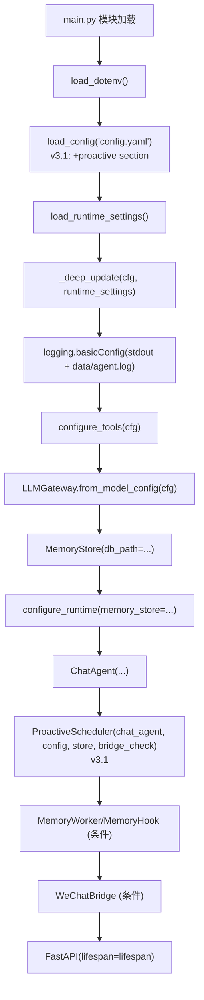
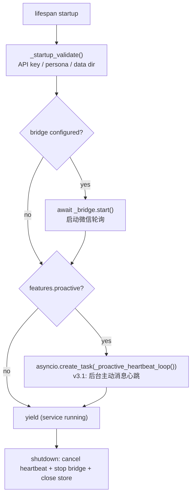
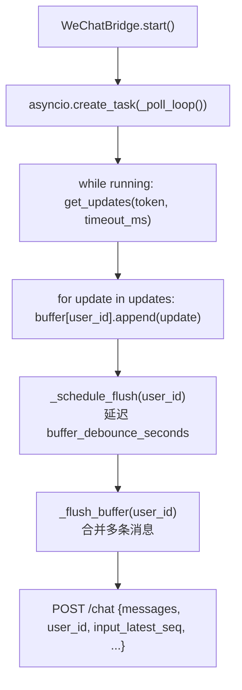
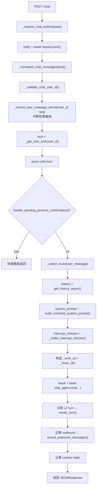
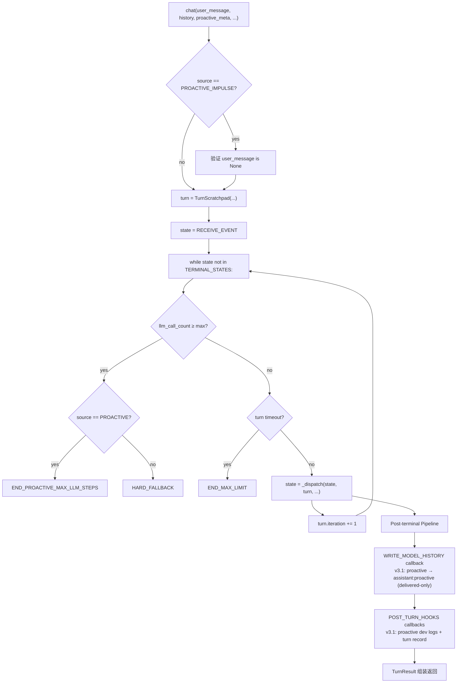
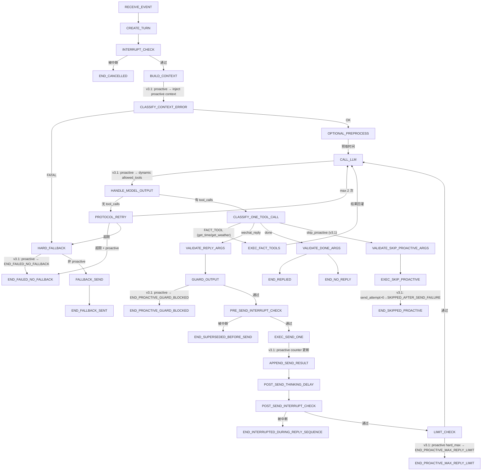
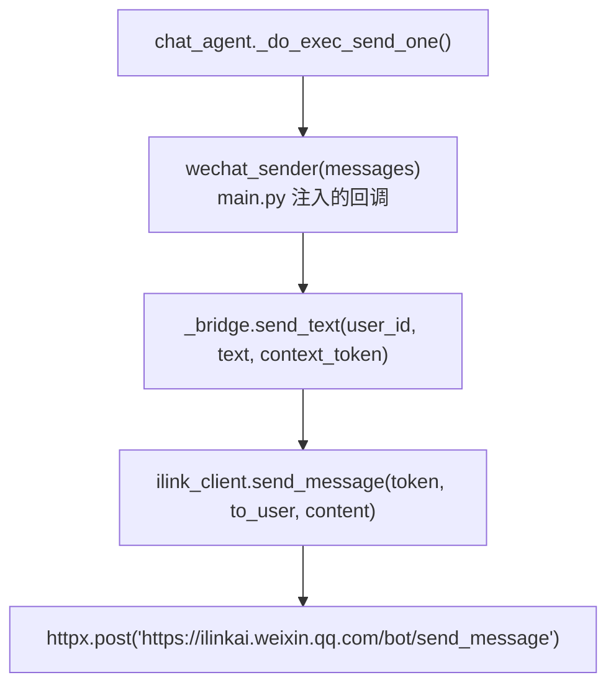
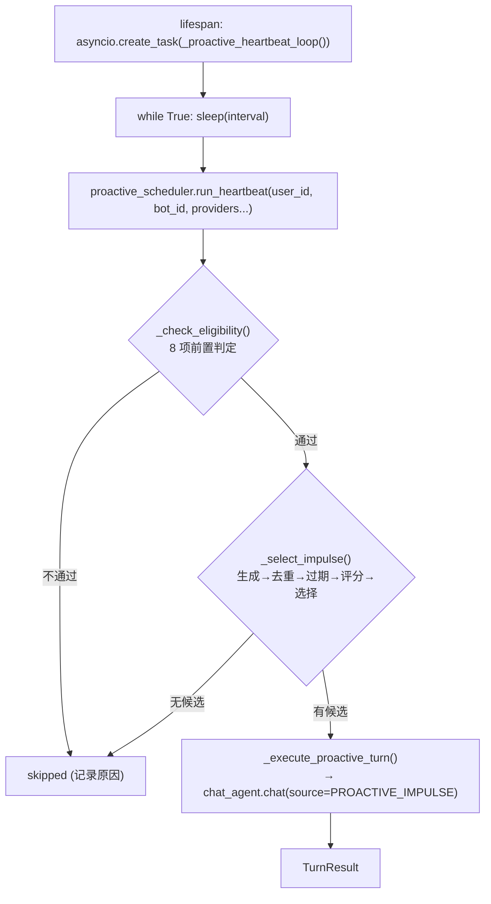
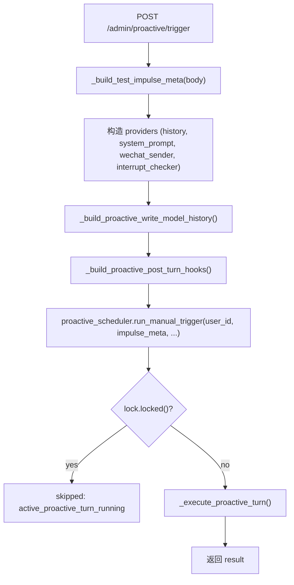

# Runtime Flow — 运行入口和主链路分析

> 最后更新: 2026-05-31
> 基于实际代码追踪 (v3.1 proactive pipeline)

---

## 1. 程序启动入口

**文件**: `main.py` (顶层模块级代码)

启动链路:



**lifespan 启动**:



---

## 2. 微信消息接收入口

### 内部桥接模式 (WeChatBridge 长轮询)



### 外部调用模式

外部服务直接 POST `/chat` 端点, 格式同上。

---

## 3. 消息进入处理链路

**文件**: `main.py` → `async def chat(request: Request)`



---

## 4. 状态机主循环

**文件**: `agent/chat_agent.py` → `ChatAgent.chat()`



### 完整状态流转 (v3.1)



---

## 5. LLM 调用位置

**文件**: `agent/chat_agent.py` → `_do_call_llm()`

调用链: `chat_agent._do_call_llm()` → `LLMGateway.complete()` → `DeepSeekAdapter.complete()` → `openai.AsyncOpenAI.chat.completions.create()`

v3.1 新增:
- proactive 回合动态 allowed_tools (Phase A/B/C, 基于 delivered_count)
- proactive_llm_step_count 追踪和上限检查
- tool_choice="required" (主动回合强制工具调用)

---

## 6. Tool Call 执行位置

### 工具分类

**文件**: `agent/tool_classifier.py` → `classify_single_tool_call()`

| 类型 | 工具 | 执行后流向 |
|------|------|-----------|
| FACT_TOOL | get_time, get_weather | execute_tool() → 结果回灌 → CALL_LLM |
| ACTION_TOOL | wechat_reply | 发送链路 → 继续 LLM 循环 |
| TERMINAL_TOOL | done, skip_proactive | 结束 turn |

### FACT_TOOL 执行

**文件**: `agent/chat_agent.py` → `_do_exec_fact_tools()`, `agent/tools.py` → `execute_tool()`

### ACTION_TOOL (wechat_reply) 执行

状态链: VALIDATE_REPLY_ARGS → GUARD_OUTPUT → PRE_SEND_INTERRUPT_CHECK → EXEC_SEND_ONE

v3.1: GUARD_OUTPUT 先过 `guard_proactive_output()` (主动回合) 再过 `guard_single_message()` (通用)

### skip_proactive 执行 (v3.1)

状态链: VALIDATE_SKIP_PROACTIVE_ARGS → EXEC_SKIP_PROACTIVE → END_SKIPPED_PROACTIVE

仅主动回合 Phase A (delivered_count == 0) 可用。send_attempt_count > 0 时状态为 SKIPPED_AFTER_SEND_FAILURE。

---

## 7. 微信发送位置



v3.1: EXEC_SEND_ONE 中主动回合递增 `proactive_send_attempt_count` 和 `proactive_delivered_count`。

---

## 8. 主动消息链路 (v3.1)

### 8.1 心跳触发



### 8.2 管理界面手动触发



### 8.3 可见上下文一致性

```
发送层: EXEC_SEND_ONE → delivery_status
  ↓
历史写入层: WRITE_MODEL_HISTORY → 只写 proactive_delivered_texts
  ↓
上下文构造器: BUILD_CONTEXT → 只从 confirmed visible history 构造
  ↓
日志层: dev log → 记录全量 attempts (与对话历史隔离)
```

---

## 9. 日志/历史记录位置

| 数据类型 | 写入位置 | 触发时机 |
|----------|----------|----------|
| 应用日志 | `data/agent.log` | 全局 logging |
| 对话历史 (L1) | `conversation_history` 表 | WRITE_MODEL_HISTORY callback |
| Turn 记录 (L2) | `turns` 表 | POST_TURN_HOOKS → create_turn() |
| 出站消息 | `outbound_messages` 表 | POST_TURN_HOOKS → record_outbound_messages() |
| Turn 诊断 | `turn_diagnostics` 表 | POST_TURN_HOOKS → _hook_dev_logs() |
| LLM Trace | `llm_traces` 表 | llm_gateway.on_trace callback |
| 主动消息事件 | `usage_events` 表 | proactive post_turn_hooks |
| 记忆提取 | `memories` 表 | POST_TURN_HOOKS → _hook_memory (条件) |

---

## 10. 关键函数索引

| 步骤 | 文件 | 函数 |
|------|------|------|
| 启动入口 | `main.py` | 模块级代码 + `lifespan()` |
| 主动心跳 (v3.1) | `main.py` | `_proactive_heartbeat_loop()` |
| 微信轮询 | `bridge/wechat_poller.py` | `WeChatBridge._poll_loop()` |
| 消息接收 | `main.py` | `chat()` |
| 主动触发 (v3.1) | `main.py` | `admin_trigger_proactive()` |
| 中断检查 | `main.py` | `_make_interrupt_checker()` |
| 路由选择 | `main.py` | `_select_route()` |
| 状态机入口 | `agent/chat_agent.py` | `ChatAgent.chat()` |
| 状态分发 | `agent/chat_agent.py` | `ChatAgent._dispatch()` |
| 上下文构建 | `agent/chat_agent.py` | `_do_build_context()` |
| 主动上下文 (v3.1) | `agent/chat_agent.py` | `_build_proactive_context_system_message()` |
| LLM 调用 | `agent/chat_agent.py` | `_do_call_llm()` |
| 主动 allowed_tools (v3.1) | `agent/chat_agent.py` | `_get_proactive_allowed_tools()` |
| 工具分类 | `agent/tool_classifier.py` | `classify_single_tool_call()` |
| skip_proactive 验证 (v3.1) | `agent/chat_agent.py` | `_do_validate_skip_proactive_args()` |
| skip_proactive 执行 (v3.1) | `agent/chat_agent.py` | `_do_exec_skip_proactive()` |
| 输出守卫 | `agent/output_guard.py` | `guard_single_message()`, `guard_proactive_output()` |
| 工具执行 | `agent/tools.py` | `execute_tool()` |
| 微信发送 | `main.py` | `wechat_sender()` |
| iLink API | `bridge/ilink_client.py` | `send_message()` |
| 调度编排 (v3.1) | `agent/scheduler.py` | `ProactiveScheduler.run_heartbeat()`, `run_manual_trigger()` |
| 资格检查 (v3.1) | `agent/scheduler.py` | `ProactiveScheduler._check_eligibility()` |
| 冲动生成 (v3.1) | `agent/scheduler.py` | `ProactiveScheduler._select_impulse()` |
| 关系热度 (v3.1) | `agent/scheduler.py` | `ProactiveScheduler.update_relationship_temperature()` |
| 历史写入 | `main.py` | `_build_chatagent_write_model_history()`, `_build_proactive_write_model_history()` |
| 诊断记录 | `main.py` | `_build_chatagent_post_turn_hooks()`, `_build_proactive_post_turn_hooks()` |
| 记忆提取 | `agent/memory_worker.py` | `MemoryWorker.extract()` |
