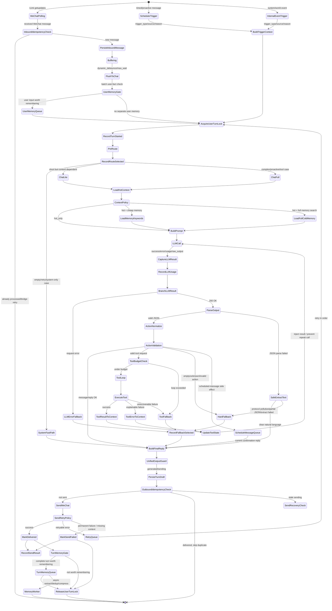
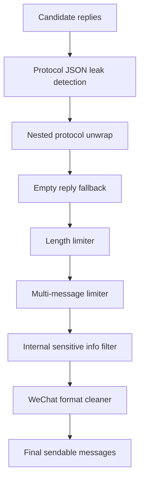
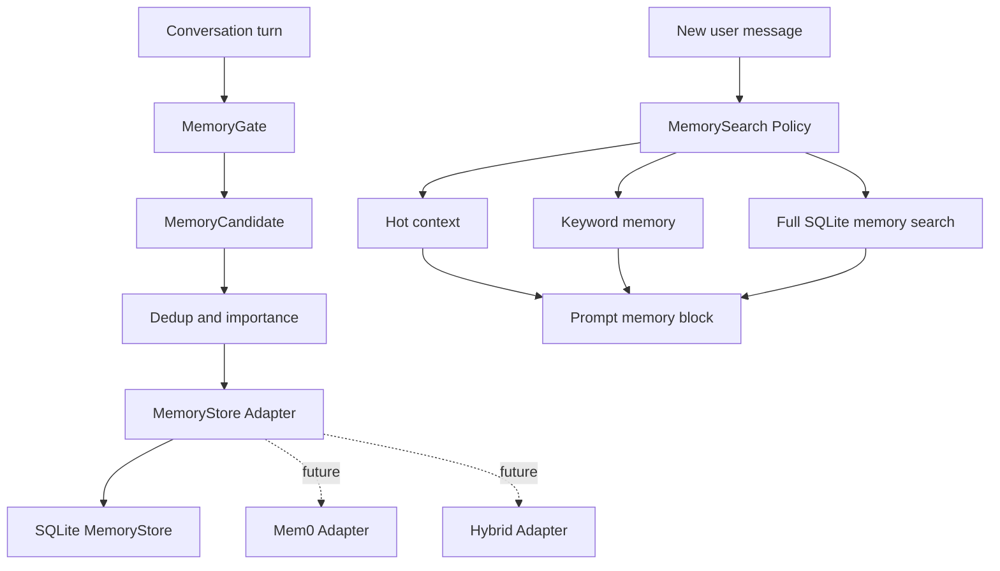

# LightChat Agent V2 Flow Design

This document is a working design note for the next agent flow. It is written
for the owner and future AI coding agents. Keep it practical: update it when the
implementation changes, and prefer small stable steps over a big rewrite.

## Goal

V2 is primarily a stability release.

Priority order:

1. Fewer hard fallbacks and fewer visible protocol leaks.
2. Better observability for every turn.
3. Idempotency and per-user concurrency control.
4. Reliable send state: draft, delivered, failed.
5. Memory quality improvements after the core flow is stable.

Non-goal for V2: replacing the current SQLite memory layer with mem0 SDK,
Qdrant, Chroma, FAISS, or another vector stack.

## Current Problems

The current system already has a working chat loop, WeChat bridge, scheduler,
SQLite memory, safeguards, and admin UI. The V2 work should improve the parts
that are hardest to debug in production:

- Model output sometimes leaks internal JSON protocol into message text.
- Hard fallback is correct as a final guard, but avoidable cases should be
  recovered first.
- LLM usage, fallback type, route choice, and send result need structured
  records, not only log lines.
- User messages, scheduled messages, and proactive messages can collide without
  a per-user turn lock.
- WeChat retries or process retries can cause duplicate input or duplicate
  output unless turn/message ids are tracked.
- Memory extraction should stay asynchronous and must not block conversation.

## Core Principles

- All user-facing output must pass through one `UnifiedOutputGuard`.
- Record LLM usage whether the model call succeeds or fails.
- Record send result whether WeChat delivery succeeds or fails.
- Use per-user turn locks before reading context and generating a reply.
- Persist a turn draft before sending, then mark it delivered or failed.
- Keep memory writes async; enqueue and release the user lock before slow memory
  extraction.
- Use SQLite first. Design adapters so a future mem0-style backend can be tested
  later without rewriting the chat loop.

## V2 State Machine



## Unified Output Guard

All paths that can produce user-visible text must pass through this module:



Responsibilities:

- Detect internal protocol text such as `actions`, `wechat_reply`, or `done`.
- If protocol JSON is nested inside a message, unwrap the actual natural
  language reply first.
- If unwrap fails, use hard fallback instead of leaking JSON.
- Prevent empty replies.
- Clamp message length and message count.
- Filter concrete internal secrets such as API keys, cookies, context tokens,
  and full internal protocol payloads. Do not over-filter normal technical
  words like "token", "JSON", or "prompt" when the user is discussing them.
- Perform final WeChat text cleanup.

## Important Modules

### Inbound Idempotency

Purpose: avoid processing the same WeChat bridge retry twice.

Use strong ids when available:

- provider message id
- from_user
- context_token
- provider timestamp

If no strong id exists, use a short time-window weak key. Do not deduplicate
purely by text, because users can intentionally send repeated short messages.

### Buffering

Purpose: merge fast consecutive WeChat messages into one turn.

V2 should keep the current debounce/max-wait idea, then make it configurable:

- debounce for normal typing bursts
- max wait to avoid holding a long stream forever
- future option: dynamic debounce based on message length and recent typing

### Per-User Turn Lock

Purpose: prevent user chat, scheduled messages, and proactive messages from
generating or sending out of order for the same user.

Rules:

- Acquire before loading context and generating final reply.
- Retry queue should also respect ordering.
- Release as soon as send result and memory queue enqueue are done.
- Do not hold the lock while `MemoryWorker` performs slow extraction.

### Routing

Routes:

- `SystemFastPath`: empty input, duplicate confirmation, pure system-level
  cases. It should be conservative and should not handle context-dependent
  "continue" messages.
- `ChatLite`: short user message that still depends on context.
- `ChatFull`: complex input, proactive trigger, scheduled trigger, or tool
  likely needed.

Record the route for every turn.

### Context Policy

Keep this conservative in V2.

Policies:

- `hot_only`: relationship, current time, recent messages.
- `hot + cheap memory`: lightweight keyword/category search.
- `hot + full memory search`: broader SQLite search.

Do not introduce vector dependencies in V2. If a future agent adds a mem0-style
backend, it must go behind a `MemoryStore` adapter.

### Tool Loop

Track these fields:

- called tool names
- tool iteration count
- normalized tool signatures
- failed tools and error summaries

When injecting tool results back into the LLM, include a clear instruction:

```text
Tool get_weather returned: ...
Use this result to answer. Do not call get_weather again for the same city/time.
```

### Turn Draft And Send State

Add a durable send state before complex retry work.

Suggested SQLite table shape:

```sql
CREATE TABLE IF NOT EXISTS turn_drafts (
    id TEXT PRIMARY KEY,
    user_id TEXT NOT NULL,
    source TEXT NOT NULL DEFAULT '',
    route TEXT NOT NULL DEFAULT '',
    status TEXT NOT NULL DEFAULT 'generated',
    messages_json TEXT NOT NULL,
    send_error TEXT NOT NULL DEFAULT '',
    created_at REAL NOT NULL,
    updated_at REAL NOT NULL
);
```

Statuses:

- `generated`
- `sending`
- `delivered`
- `failed`
- `retry_pending`

Keep output message ids if the WeChat provider exposes them. If not, use local
turn/message ids for best-effort duplicate prevention.

### Usage And Diagnostics

Every turn should be queryable from the admin page or SQLite.

Minimum fields:

- `turn_id`
- `user_id`
- `source`
- `route`
- `context_policy`
- `llm_status`
- `token_count`
- `elapsed_ms`
- `fallback_type`
- `send_status`
- `memory_enqueued`

This is more useful than only logging because future AI agents can inspect the
database and reason about failures without guessing from text logs.

## Memory Design

V2 keeps SQLite as the primary memory backend.

Current local memory is closer to a lightweight mem0-inspired implementation
than the real mem0 SDK. It uses SQLite, keyword/CJK-style retrieval, importance,
dedup, conversation history, and summaries. This is acceptable for V2 because
stability is the current priority.

Future-proof with an adapter boundary:



Why not mem0/vector now:

- It adds embedding model/API dependencies.
- It can require extra storage or services.
- It makes retrieval harder to debug.
- It does not directly solve the current stability/fallback issues.

What mem0-style design can inspire later:

- ADD-only memory extraction.
- Agent-generated facts as first-class memories.
- Entity linking.
- Multi-signal retrieval: semantic, keyword, entity, time.
- Time-aware ranking for "recent", "last time", "current plan".

V2 should keep the adapter boundary clean so V2.5 can compare SQLite retrieval
against a mem0-style backend using real chat samples.

## Implementation Phases

### Phase 1: Output Stability

- Extract `UnifiedOutputGuard` into a dedicated module.
- Move nested protocol unwrap there.
- Add tests for:
  - valid natural language
  - nested protocol unwrap
  - unrecoverable protocol leak fallback
  - empty reply fallback
  - length and count limits

### Phase 2: Turn Observability

- Add `turn_id` to chat processing.
- Record route, fallback type, LLM status, token count, and send status.
- Expand admin usage panel to show recent fallback/send failures.

### Phase 3: Draft And Delivery State

- Add `turn_drafts`.
- Persist draft before send.
- Mark delivered or failed after send.
- Avoid duplicate sends for already delivered drafts.

### Phase 4: User Turn Lock

- Add per-user async lock in process.
- Later, if multiple processes are used, replace or supplement with SQLite
  lock rows.
- Make scheduler/proactive triggers acquire the same user lock.

### Phase 5: Conservative Routing

- Add route selection with `SystemFastPath`, `ChatLite`, and `ChatFull`.
- Start with conservative rules. Do not route "continue" or ambiguous short
  messages to template-only fast replies.

### Phase 6: Context Policy

- Add `hot_only`, `hot + cheap memory`, and `hot + full memory search`.
- Keep SQLite search.
- Record selected policy for diagnostics.

## Things To Avoid

- Do not replace the whole chat loop in one patch.
- Do not add vector DB or mem0 SDK during V2 stability work.
- Do not deduplicate by raw text only.
- Do not hold user turn lock during slow memory extraction.
- Do not let scheduled-message queue become the only path to current reply.
- Do not record failed-send assistant replies as delivered conversation facts.

## Handoff Notes For Future AI Agents

When implementing this design:

1. Read `main.py`, `agent/chat_agent.py`, `memory/store.py`,
   `bridge/wechat_poller.py`, and `static/admin.js` first.
2. Keep changes small and testable.
3. Prefer adding tables with `CREATE TABLE IF NOT EXISTS`; existing servers
   should migrate automatically.
4. Keep SQLite as the storage layer.
5. Add tests before or with each new state transition.
6. Verify with:

```powershell
.\.venv\Scripts\python.exe -m py_compile main.py agent\chat_agent.py memory\store.py
node --check static\admin.js
.\.venv\Scripts\python.exe -m pytest tests -q
```

On Linux server, use the equivalent Python inside the deployment environment or
container.
