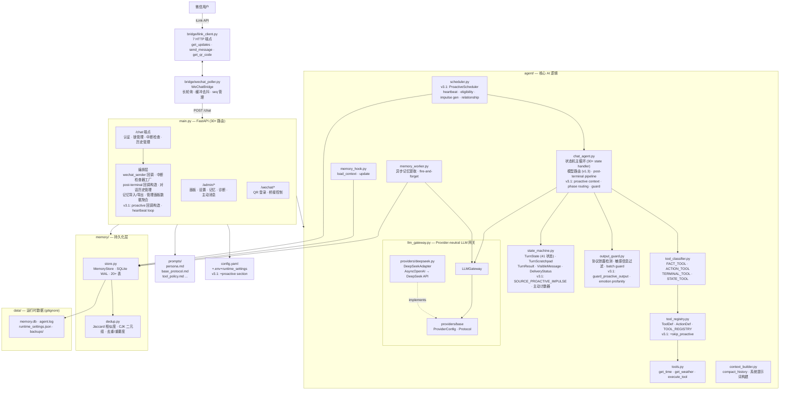
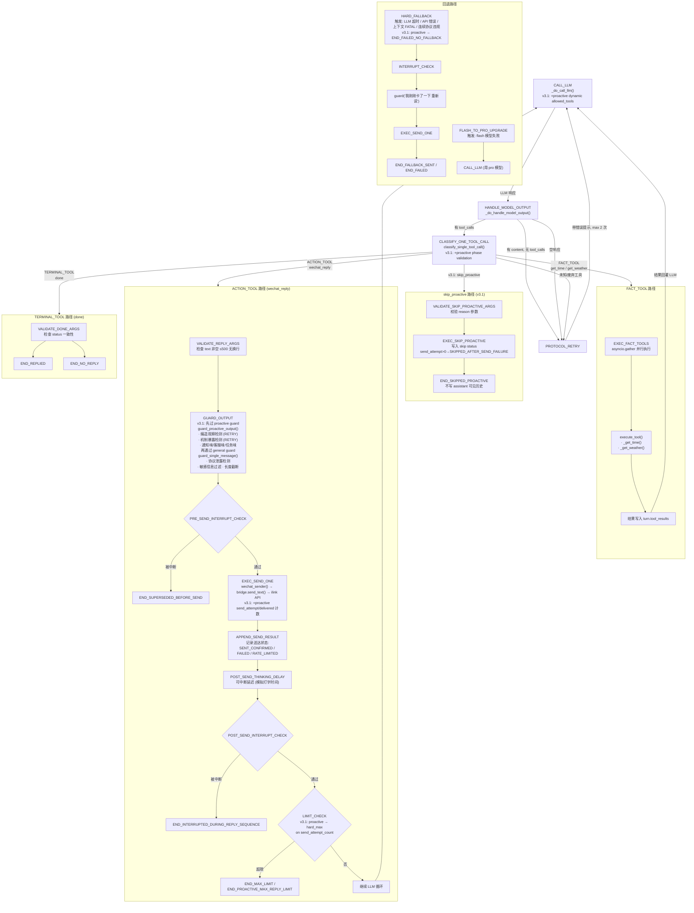
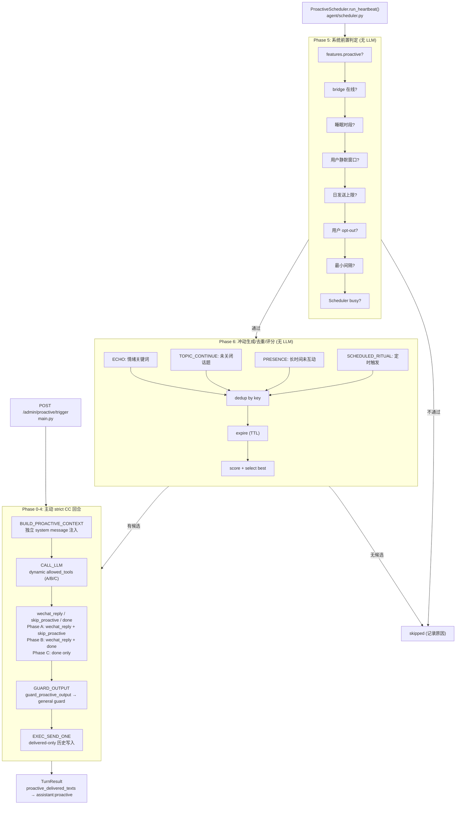

# Architecture — 系统架构图

> 最后更新: 2026-05-31
> 基于实际代码 (v3.1 proactive pipeline)

---

## 1. 系统模块图

---

## 2. 主链路流程图

一次微信消息从接收到回复的完整链路:

```mermaid
flowchart TD
    A[微信用户发送消息] --> B["WeChatBridge._poll_loop()<br/>bridge/wechat_poller.py"]
    B --> B1["iLink get_updates()"]
    B1 --> B2[缓冲去抖]
    B2 --> B3["flush → POST /chat<br/>{messages, user_id, input_latest_seq}"]

    B3 --> C["POST /chat<br/>main.py"]
    C --> C1["_require_chat_auth() — API key 验证"]
    C1 --> C2["_normalize_chat_messages() — 标准化"]
    C2 --> C3["_validate_chat_user_id()"]
    C3 --> C4["_record_user_message_arrival(seq) — 中断基础"]
    C4 --> C5["_get_user_lock(user_id) — per-user 锁"]

    C5 --> D{"handle_pending_<br/>persona_confirmation()?"}
    D -->|有 pending| D1[快速路径返回]
    D -->|无 pending| E

    E["预处理 (锁内)"] --> E1["_select_route()"]
    E1 -->|空消息| E2["SystemFastPath"]
    E1 -->|≤30字| E3["ChatLite"]
    E1 -->|其他| E4["ChatFull"]

    E --> E5["history = get_history_async()"]
    E5 --> E6["system_prompt = build_enriched_system_prompt()"]
    E6 --> E7["interrupt_checker = _make_interrupt_checker()"]
    E7 --> E8["_wmh_cb + _hook_cbs 构造"]

    E8 --> F["chat_agent.chat()<br/>agent/chat_agent.py"]
    F --> F1["turn = TurnScratchpad(...)"]
    F1 --> F2["state = RECEIVE_EVENT"]

    F2 --> SM

    subgraph SM["状态机主循环"]
        direction TB
        S1["RECEIVE_EVENT"] --> S2["CREATE_TURN"]
        S2 --> S3{"INTERRUPT_CHECK"}
        S3 -->|被中断| S3C["END_CANCELLED"]
        S3 -->|通过| S4["BUILD_CONTEXT"]
        S4 --> S5{"CLASSIFY_CONTEXT_ERROR"}
        S5 -->|FATAL| S5F["HARD_FALLBACK"]
        S5 -->|OK| S6["OPTIONAL_PREPROCESS<br/>(预取时间)"]
        S6 --> S7["CALL_LLM"]
        S7 --> S8["HANDLE_MODEL_OUTPUT"]
        S8 --> S9["CLASSIFY_ONE_TOOL_CALL"]

        S9 -->|FACT_TOOL| FT["EXEC_FACT_TOOLS<br/>(get_time/get_weather)"]
        FT --> FT1["结果回灌 LLM"]
        FT1 --> S7

        S9 -->|ACTION_TOOL| AT["VALIDATE_REPLY_ARGS"]
        AT --> AT1["GUARD_OUTPUT<br/>v3.1: +proactive guard"]
        AT1 --> AT2{"PRE_SEND_<br/>INTERRUPT_CHECK"}
        AT2 -->|被中断| AT2C["END_SUPERSEDED"]
        AT2 -->|通过| AT3["EXEC_SEND_ONE<br/>(wechat_sender)"]
        AT3 --> AT4["APPEND_SEND_RESULT"]
        AT4 --> AT5["POST_SEND_THINKING_DELAY"]
        AT5 --> AT6{"POST_SEND_<br/>INTERRUPT_CHECK"}
        AT6 -->|被中断| AT6C["END_INTERRUPTED"]
        AT6 -->|通过| AT7{"LIMIT_CHECK"}
        AT7 -->|超限| AT7L["END_MAX_LIMIT/<br/>END_PROACTIVE_MAX_REPLY_LIMIT"]
        AT7 -->|否| S7

        S9 -->|TERMINAL_TOOL| TT["VALIDATE_DONE_ARGS"]
        TT --> TT1["END_REPLIED / END_NO_REPLY"]

        S9 -->|skip_proactive| SP["VALIDATE_SKIP_PROACTIVE_ARGS<br/>v3.1: 主动专用"]
        SP --> SP1["EXEC_SKIP_PROACTIVE"]
        SP1 --> SP2["END_SKIPPED_PROACTIVE"]

        S5F --> HF1["INTERRUPT_CHECK"]
        HF1 --> HF2["v3.1: proactive → END_FAILED_NO_FALLBACK"]
        HF2 --> HF3["guard('我刚刚卡了一下 重新说')"]
        HF3 --> HF4["EXEC_SEND_ONE"]
        HF4 --> HF5["END_FALLBACK_SENT / END_FAILED"]
    end

    SM -->|terminal state 确定| PT

    subgraph PT["Post-terminal Pipeline"]
        direction TB
        PT1["1. WRITE_MODEL_HISTORY<br/>写 user 消息 → conversation_history<br/>按终态矩阵写 assistant 消息<br/>v3.1: proactive → assistant:proactive (delivered-only)"]
        PT2["2. POST_TURN_HOOKS (串行, 单失败不阻塞)<br/>_hook_memory → 异步记忆提取<br/>_hook_dev_logs → turn_diagnostics + usage<br/>v3.1: proactive dev logs + turn record"]
        PT1 --> PT2
    end

    PT --> G["TurnResult 组装返回 main.py"]
    G --> G1["记录 L2 turn → create_turn()"]
    G1 --> G2["记录 outbound → record_outbound_messages()"]
    G2 --> G3["返回 JSONResponse"]
    G3 --> H[微信用户收到回复]
```

---

## 3. Tool Call 循环图

v3.1 严格 CC 因果链: 每次 LLM 响应只允许一个 tool call, `wechat_reply` 是 action (非终态), `done` 是唯一终态工具, `skip_proactive` 是主动回合专用终态。

### Tool Call 循环的关键约束

| 约束 | 值 |
|------|-----|
| 每次 LLM 响应最多 tool calls | 1 (严格单工具) |
| MAX_LLM_STEPS_PER_TURN | 20 |
| MAX_PROTOCOL_RETRIES | 2 |
| MAX_REPLY_MESSAGES_PER_TURN | 15 |
| MAX_SEND_FAILURES_PER_TURN | 2 |
| proactive hard_max_wechat_reply_per_turn | 5 (限制 send_attempt_count) |
| proactive max_llm_steps_per_proactive_turn | 8 |
| FACT_TOOL 结果 | 回灌 LLM |
| ACTION_TOOL 结果 | 继续 LLM 循环 |
| TERMINAL_TOOL (done) | 结束 turn |
| skip_proactive | 主动回合专用终态 (Phase A only) |
| PROTOCOL_RETRY 最多 | 2 次 |
| HARD_FALLBACK | 主动回合不发送兜底 |
| send_wechat_messages | 已废弃 (v1.5) |
| skip_reply | 已废弃 (v1.5) |

---

## 4. v3.1 主动消息管道

### 主动回合消息计数器 (v3.1)

| 计数器 | 含义 | 限制 |
|--------|------|------|
| `proactive_attempt_count` | 模型调用 wechat_reply 次数 | LLM 行为审计 |
| `proactive_send_attempt_count` | 实际调用微信发送次数 | hard_max_wechat_reply_per_turn=5 |
| `proactive_delivered_count` | 确认送达条数 | allowed_tools 阶段判定依据 |

### 主动回合终态 (v3.1)

| 终态 | 含义 | 发送兜底 | 写 delivered 历史 |
|------|------|----------|-------------------|
| `END_SKIPPED_PROACTIVE` | 模型主动跳过 | 否 | 否 |
| `END_FAILED_NO_FALLBACK` | 非 guard 失败 | 否 | 保留已送达 |
| `END_PROACTIVE_GUARD_BLOCKED` | guard BLOCK | 否 | 保留已送达 |
| `END_PROACTIVE_MAX_REPLY_LIMIT` | 达发送上限 | 否 | 保留已送达 |
| `END_PROACTIVE_MAX_LLM_STEPS` | LLM 调用超限 | 否 | 保留已送达 |
