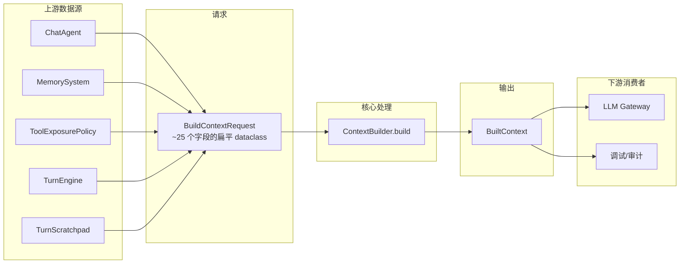
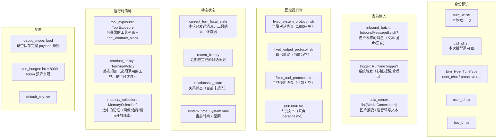
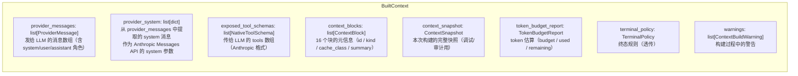
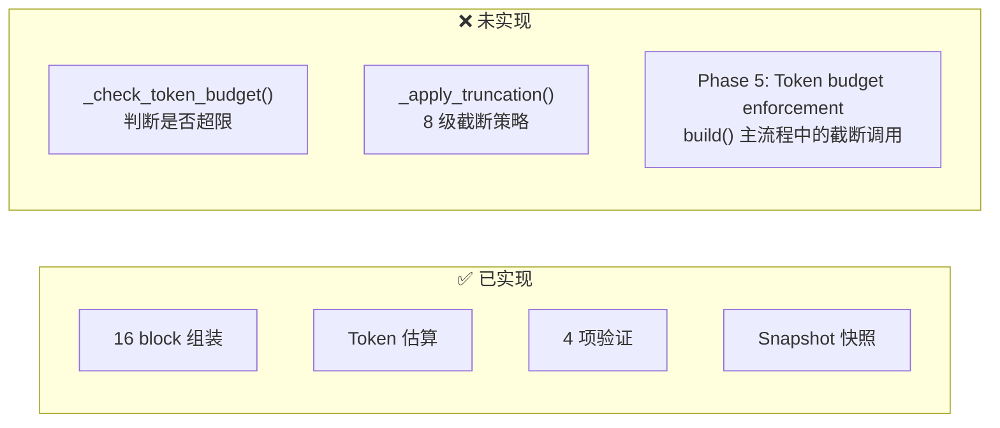
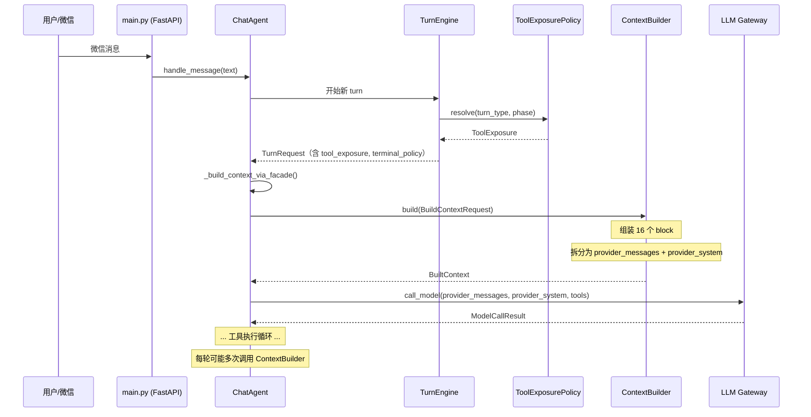

# ContextBuilder 架构图解

> 日期：2026-06-07
> 基于：`agent/runtime_context_builder.py`（当前生产代码）

---

## 1. 总览：数据流向



**一句话**：`ChatAgent._build_context_via_facade()` 把散落在各处的数据拼成 `BuildContextRequest`，交给 `ContextBuilder.build()` 组装成模型可消费的 `BuiltContext`。

---

## 2. 输入：BuildContextRequest 字段全景



每个字段的**数据来源**详见下表：

| 字段 | 数据来源 | 说明 |
|---|---|---|
| `turn_id`, `call_id` | `TurnScratchpad` | ChatAgent 在每轮开始时生成 |
| `turn_type` | `TurnClassification` | 由 TurnEngine 分类 |
| `user_id`, `bot_id` | 配置 | 当前硬编码 `"default"` |
| `inbound_batch` | `InboundMessageBatch` | 微信适配层解析的用户消息 |
| `trigger` | `RuntimeTrigger` | 调度器/管理员/心跳触发的系统事件 |
| `media_context` | 媒体处理管线 | 图片 vision 描述、语音 STT 转写 |
| `fixed_system_protocol` | `agent/context_builder.py` 中的 `ORDINARY_CHAT_GLOBAL_PROTOCOL` 常量 | 硬编码的全局对话协议 |
| `fixed_output_protocol` | — | 当前为空字符串 |
| `fixed_tool_protocol` | — | 当前为空字符串 |
| `persona` | `prompts/persona.md` | ChatAgent 启动时读取并拼入 system prompt |
| `current_turn_local_state` | `TurnScratchpad` | TurnEngine 在本轮过程中持续更新 |
| `recent_history` | 状态机的 history 数组 | ChatAgent 把 dict 列表转为 `ConversationHistoryMessage` 列表 |
| `relationship_state` | 关系子系统 | 当前 facade 路径未接入（传入 `None`） |
| `system_time` | `datetime.now()` | Asia/Shanghai 时区 |
| `tool_exposure` | `ToolExposurePolicy.resolve()` | 根据 turn_type / phase 决定暴露哪些工具 |
| `terminal_policy` | `TurnEngine` | 根据 turn_type / phase 决定终态要求 |
| `memory_selection` | `MemorySystem.select()` | 当前 facade 路径未接入（传入 `None`） |
| `token_budget` | 配置 | 默认 8000 |

---

## 3. 处理管线：16 个 Block 的组装顺序

`ContextBuilder.build()` 按固定顺序产出 16 个上下文块。顺序有语义——靠前的 block 构成可缓存的固定前缀。

```mermaid
flowchart TB
    subgraph phase1["Phase 1: 固定前缀（CacheClass=FIXED）"]
        B1["① fixed_system_protocol<br/>role=system<br/>全局对话协议"]
        B2["② fixed_output_protocol<br/>role=system<br/>输出格式规则（当前空）"]
        B3["③ fixed_tool_protocol<br/>role=system<br/>工具使用规则（当前空）"]
    end

    subgraph phase1b["Phase 1b: 低频变动（CacheClass=LOW_FREQUENCY）"]
        B4["④ persona<br/>role=system<br/>人设文本"]
        B5["⑤ relationship_state<br/>role=system<br/>关系状态（可选）"]
        B6["⑥ system_time_block<br/>role=system<br/>当前时间 + 恢复类型"]
    end

    subgraph phase2["Phase 2: 记忆块（CacheClass=LOW_FREQUENCY）"]
        B7["⑦ boundary_memory<br/>role=system<br/>用户明确边界"]
        B8["⑧ selected_profile_memory<br/>role=system<br/>用户画像"]
        B9["⑨ selected_episode_memory<br/>role=system<br/>近期重要事件"]
        B10["⑩ selected_open_threads<br/>role=system<br/>未完成上下文线索"]
    end

    subgraph phase3["Phase 3: 动态块（CacheClass=TURN_DYNAMIC）"]
        B11["⑪ recent_conversation_history<br/>展开为多条 user/assistant 消息<br/>只含 delivered，排除 failed"]
        B12["⑫ current_turn_local_state<br/>role=system<br/>本轮已发送消息 + 工具结果 + 计数器"]
        B13["⑬ media_context<br/>role=system<br/>图片/语音摘要（可选）"]
        B14["⑭ current_input<br/>role=user 或 system<br/>当前用户消息或系统触发"]
    end

    subgraph phase4["Phase 4: 契约块（CacheClass=TURN_DYNAMIC）"]
        B15["⑮ exposed_tools_contract<br/>role=system<br/>当前可用的工具列表和说明"]
        B16["⑯ terminal_policy<br/>role=system<br/>终态规则：必须调用的工具、是否可跳过"]
    end

    B1 --> B2 --> B3 --> B4 --> B5 --> B6 --> B7 --> B8 --> B9 --> B10 --> B11 --> B12 --> B13 --> B14 --> B15 --> B16
```



### 各 Block 的数据加工逻辑

#### ① ② ③ 固定协议块 — `_make_fixed_system_block()`

```
输入：request.fixed_system_protocol（一个长字符串）
加工：原样包装为 role="system" 的 ProviderMessage
输出：ProviderMessage(role="system", content=原字符串)
      ContextBlock(kind=FIXED_PROTOCOL, cache_class=FIXED)
```

三个固定协议块完全相同的处理逻辑，只是 label 不同。当前 `fixed_system_protocol` 是 1600+ 字的全局对话协议，后两者为空。

#### ④ 人设块 — `_make_persona_block()`

```
输入：request.persona（或构造时传入的 fallback）
加工：直接使用，不做任何修改
输出：ProviderMessage(role="system", content=persona)
      ContextBlock(kind=PERSONA, cache_class=LOW_FREQUENCY)
```

#### ⑤ 关系状态 — `_make_relationship_state_block()`

```
输入：request.relationship_state（当前始终为 None）
加工：如果为 None → 写入 "[关系状态未知]"
输出：ProviderMessage(role="system", content=关系文本)
      ContextBlock(kind=RELATIONSHIP_STATE, cache_class=LOW_FREQUENCY)
```

如果 `relationship_state` 为 `None`，会产生一条 `relationship_state_missing` warning。

#### ⑥ 系统时间块 — `_make_system_time_block()`

```
输入：request.system_time（SystemTime dataclass）
加工：
  1. 把 recent_history 转为 dict 列表
  2. 调用 TemporalContextBuilder.build(now, history, current_user_ts)
  3. 得到 resume_type（连续对话/短时间恢复/同日恢复/隔日恢复/长时间恢复/冷启动）
  4. 格式化为中文提示文本：
     "当前时间：2026年06月07日 14:30 周六"
     "上次用户消息：06月06日 22:15"
     "距离上次互动：16小时15分钟"
     "resume_type: next_day_resume"
     "使用规则：时间差只是事实..."
输出：ProviderMessage(role="system", content=格式化文本)
      ContextBlock(kind=SYSTEM_TIME, cache_class=LOW_FREQUENCY)
```

`resume_type` 判定依赖时间差阈值：
- ≤10 分钟 → `continuous_chat`
- ≤45 分钟 → `short_resume`
- ≤7 天 → `same_day_resume` / `next_day_resume`
- >7 天 → `long_gap_resume`
- 无历史 → `cold_start`

#### ⑦⑧⑨⑩ 记忆块 — `_make_all_memory_blocks()`

```
输入：request.memory_selection（MemorySelection dataclass）
加工：
  - boundary_memory → 格式化为 "[用户明确边界]\n1. xxx\n2. xxx"
  - profile_memory   → 格式化为 "[用户画像]\n1. xxx\n2. xxx"
  - episode_memory   → 格式化为 "[近期重要事件]\n1. xxx\n2. xxx"
  - open_thread_memory → 格式化为 "[未完成上下文线索]\n1. xxx\n2. xxx"
  - 每种记忆只在有内容时才生成 block（为空则静默跳过）
  - 如果 memory_selection 为 None，全部跳过
输出：每个非空记忆类型一条 ProviderMessage(role="system")
      对应的 ContextBlock(kind=MEMORY, cache_class=LOW_FREQUENCY)
```

记忆块的 source 标记为 `"MemorySystem"`（区别于 ContextBuilder 自身产生的块）。

#### ⑪ 最近对话历史 — `_make_recent_history_block()`

```
输入：request.recent_history（list[ConversationHistoryMessage]）
加工：
  1. 遍历每条历史消息
  2. 过滤规则：
     - role="user" → 保留为 ProviderMessage(role="user", content=原文)
     - role="assistant" + delivery_status=DELIVERED → 保留为 ProviderMessage(role="assistant", content=原文)
     - role="assistant" + delivery_status=FAILED/UNKNOWN → 丢弃（用户未看到）
  3. 不在 assistant 消息之间插入时间分割线（当前实现缺失）
输出：多条独立的 ProviderMessage（user/assistant 交替）
      一个 ContextBlock(kind=RECENT_HISTORY, cache_class=TURN_DYNAMIC)
```

**注意**：这里不限制条数，不截断，不压缩。全部历史原样进入上下文。

#### ⑫ 本轮状态 — `_make_turn_local_block()`

```
输入：request.current_turn_local_state（CurrentTurnLocalState dataclass）
加工：
  1. 如果 model_call_count==0 且无已发送消息且无工具结果 → 跳过（首轮首次调用不需要）
  2. 否则生成结构化文本：
     [本轮状态]
     模型调用次数: 2

     [本轮已发送消息]
     1. [delivered] "今晚早点睡。"
     2. [failed - 用户未看到] "再来一条。"

     [本轮工具结果]
     - send_text_message: sent
     - get_time: {"hour": 22, "minute": 15}

     已发送: 1 (送达), 1 (失败)
输出：ProviderMessage(role="system", content=格式化文本)
      ContextBlock(kind=TURN_LOCAL, cache_class=TURN_DYNAMIC)
```

这个 block 让模型在同一个 interaction turn 内的后续模型调用中，知道之前已经做了什么。

#### ⑬ 媒体上下文 — `_make_media_context_block()`

```
输入：request.media_context（list[MediaContextItem]）
加工：
  对每项生成 "[用户发送了一张图片]\nsummary: xxx" 或
  "[用户发送了一段语音]\nsummary: xxx"
输出：ProviderMessage(role="system", content=格式化文本)
      ContextBlock(kind=MEDIA, cache_class=TURN_DYNAMIC)
```

#### ⑭ 当前输入 — `_make_current_input_block()`

```
输入：request.inbound_batch 和 request.trigger
加工：
  分支 A：有 trigger 但无 inbound_batch → role="system"
         内容 = "[系统触发] {trigger.reason}"
  分支 B：有 inbound_batch → role="user"（聊天类）或 "system"（系统类）
         内容 = 用户文本原文，或 "[用户发送了图片/语音]"
  分支 C：都没有 → 返回 None
输出：ProviderMessage(role=user 或 system, content=当前输入)
      ContextBlock(kind=CURRENT_INPUT, cache_class=TURN_DYNAMIC)
```

#### ⑮ 工具契约 — `_make_tool_contract_block()`

```
输入：request.tool_exposure（ToolExposure dataclass）
加工：直接使用 tool_exposure.tool_contract_block 的文本内容
输出：ProviderMessage(role="system", content=tool_contract_block)
      ContextBlock(kind=TOOL_CONTRACT, cache_class=TURN_DYNAMIC)
```

`tool_contract_block` 由 `ToolExposurePolicy` 生成，包含当前可用的工具名称、用途和参数说明。它是模型看到的"工具菜单"。

#### ⑯ 终态规则 — `_make_terminal_policy_block()`

```
输入：request.terminal_policy（TerminalPolicy dataclass）
加工：格式化为规则文本
      [终态规则]
      必须调用的终态工具: finish_turn
      最少送达消息: 0
      （可能还有：阶段: 可跳过 / 阶段: 强制开口）
输出：ProviderMessage(role="system", content=规则文本)
      ContextBlock(kind=TERMINAL_POLICY, cache_class=TURN_DYNAMIC)
```

---

## 4. 输出：BuiltContext 结构



### 关键输出项说明

| 输出项 | 消费者 | 用途 |
|---|---|---|
| `provider_messages` | LLM Gateway | 作为 Anthropic Messages API 的 `messages` 数组 |
| `provider_system` | LLM Gateway | 作为 Anthropic Messages API 的 `system` 参数 |
| `exposed_tool_schemas` | LLM Gateway | 作为 Anthropic Messages API 的 `tools` 数组 |
| `context_blocks` | 调试/日志 | 16 个块的元信息，不发给模型 |
| `context_snapshot` | 审计 | 记录本次模型看到了什么 |
| `token_budget_report` | — | 当前**无人消费**（估算完就丢弃了） |
| `warnings` | ChatAgent | 转存到 TurnScratchpad 的诊断信息 |

### provider_messages 如何拆分为 provider_system

```python
def _split_provider_payload(messages):
    for msg in messages:
        if msg.role == "system":
            → provider_system.append({"type": "text", "text": msg.content})
        if msg.role in ("user", "assistant"):
            → provider_messages.append(msg)
```

即：16 个 block 中所有 `role="system"` 的消息汇入 `provider_system`，所有 `role="user"/"assistant"` 的消息留在 `provider_messages`。两者最终都发给模型。

---

## 5. 当前缺失的能力

对照规格书 `01-context-builder-spec.zh.md` §7.2 和 §8.1：



**实际效果**：当前每次模型调用会把**全部历史 + 全部记忆**无限制塞进上下文。如果对话很长（比如上百轮），token 会持续增长直到超出模型上下文窗口，导致请求失败或被远端截断。

`compact_history()` 函数（在旧的 `agent/context_builder.py` 中）虽然存在，但**全局没有任何地方调用它**，属于死代码。

---

## 6. 调用链：从用户消息到模型输入


